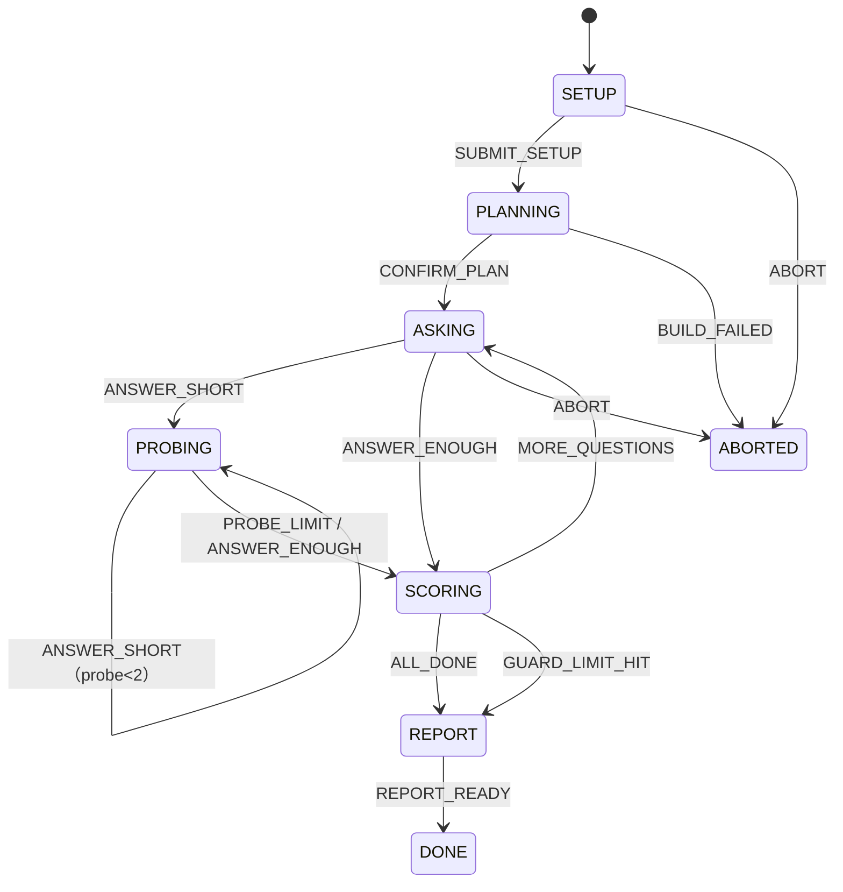

# AI 模拟面试系统 · 设计文档

| 项    | 内容                                                               |
| ---- | ---------------------------------------------------------------- |
| 版本   | v1.0（设计定稿，待评审）                                                   |
| 日期   | 2026-11-11                                                       |
| 状态   | 设计阶段，尚未进入编码                                                      |
| 技术栈  | Python 3.11 · LangChain v1 · DeepSeek · FastAPI · FAISS · SQLite |
| 对应演示 | `demo/overview.html`（说明书）· `demo/index.html`（可交互 Demo）           |

> 本文档是编码阶段的唯一依据。任何与本文档不一致的实现，先改文档再改代码。

---

## 1. 项目概述

### 1.1 一句话定位

一个面向技术岗求职者的 AI 模拟面试系统：按岗位 JD 逐题提问、针对回答追问、按 rubric 打分、输出可执行报告；同时是一个「敢上线」的 Agent 工程样板——全链路可追踪、质量可度量、改动可回归。

### 1.2 设计原则

| #  | 原则               | 含义                             | 反例（明确不做）                     |
| -- | ---------------- | ------------------------------ | ---------------------------- |
| P1 | **流程与智能分离**      | 六阶段由确定性状态机编排，模型只在节点内完成出题/追问/评分 | 让一个 Agent 自主决定「现在该问什么、要不要打分」 |
| P2 | **每步产出结构化对象并落库** | 任何阶段的结果都能被查询、回放、续跑             | 把整场对话塞进一个 list 放在内存里         |
| P3 | **模型不参与流程判定**    | 状态迁移条件由代码判断（字数、轮次、是否命中要点）      | 让模型输出「我们进入下一阶段」              |
| P4 | **旁挂可观测，不侵入业务**  | 日志与 trace 只能读，不能改变业务行为         | 为了指标好看而修改业务逻辑                |

### 1.3 能力边界

**做**：单人模拟面试 · 三类资料建库 · 语音提问 · 语音/文字作答 · 四维评分 · 报告导出 · 全链路追踪 · 项目自评测

**不做**（本期明确排除）：多用户与权限 · 真实招聘流程/ATS 对接 · 岗位爬虫 · 视频面试 · 多面试官协同 · 模型微调

### 1.4 术语

| 术语        | 含义                            |
| --------- | ----------------------------- |
| Session   | 一场面试，从配置到报告的全生命周期             |
| Turn      | 一轮问答，包含一次提问 + 若干次追问 + 一次作答    |
| Probe     | 追问，针对同一道题的深挖，上限 2 轮           |
| Span      | 链路中的一个可计时节点（一次模型调用、一次检索、一次合成） |
| Trace     | 一场面试的全部 span 组成的树             |
| Plan Item | 面试大纲中的一道题的位置与状态               |

---

## 2. 总体架构

### 2.1 分层视图

```
┌─────────────────────────────────────────────────────────────┐
│ 接入层  静态页面（配置/对话/报告） · FastAPI 路由 · SSE/WS   │
├─────────────────────────────────────────────────────────────┤
│ 编排层  状态机（唯一决定流程） · 阶段 Prompt · 护甲 · Trace  │
├─────────────────────────────────────────────────────────────┤
│ 能力层  agents/（出题·追问·评分·报告）                       │
│         kb/（解析·分块·索引·召回）                           │
│         voice/（分句·TTS·ASR·缓存）                          │
├─────────────────────────────────────────────────────────────┤
│ 存储层  SQLite（业务） · FAISS（向量） · 文件（音频）        │
└─────────────────────────────────────────────────────────────┘
        ┆ 旁挂（只读，不参与判定）
        ┆ observability/（TraceLab） · eval/（自评测）
```

### 2.2 依赖规则（硬约束）

1. **单向依赖**：接入层 → 编排层 → 能力层 → 存储层。反向 import 一律禁止。
2. **编排层不 import voice**。语音属于表现层，由路由层调用。状态机只产出文本。
3. **能力层不感知流程**。`interviewer.next_question()` 不知道自己是第几题，参数由编排层注入。
4. **observability 与 eval 只能被编排层/接入层调用，不能反向调用业务**。

违反第 2 条的后果：文字版测试跑不动，语音一挂整个业务挂。

### 2.3 目录结构

```
ai-interview/
├── src/app/
│   ├── main.py                 # FastAPI 入口 + 静态挂载
│   ├── config.py               # pydantic-settings，读 .env
│   ├── core/
│   │   ├── state_machine.py    # Stage/Event/TRANSITIONS + 迁移执行
│   │   ├── llm.py              # 模型工厂（role 路由 + 重试）
│   │   ├── middleware.py       # 四层护甲装配
│   │   └── tracing.py          # trace_id / span 上下文
│   ├── agents/
│   │   ├── interviewer.py      # 出题
│   │   ├── prober.py           # 追问判定
│   │   ├── evaluator.py        # 四维评分
│   │   └── reporter.py         # 全场报告
│   ├── kb/
│   │   ├── loaders.py          # jd / resume / transcript 解析
│   │   ├── chunker.py          # Q+A 成对切分
│   │   ├── index.py            # FAISS 建库 / 增量 / 重建
│   │   └── retriever.py        # 查询构造 + 多路召回 + 融合
│   ├── voice/
│   │   ├── segmenter.py        # 增量分句
│   │   ├── tts.py              # 适配器：edge-tts / volc
│   │   ├── asr.py              # 适配器：faster-whisper
│   │   └── cache.py            # 固定话术音频缓存
│   ├── observability/
│   │   ├── callbacks.py        # LangChain CallbackHandler
│   │   ├── spans.py            # @span 装饰器 / 上下文
│   │   ├── store.py            # 异步队列 + 批量写盘
│   │   └── viewer/routes.py    # /observe 页面与 API
│   ├── eval/
│   │   ├── datasets/*.jsonl
│   │   ├── metrics/{retrieval,generation,latency}.py
│   │   ├── runners/{rag,e2e}_runner.py
│   │   └── report.py
│   ├── db/
│   │   ├── models.py           # SQLAlchemy 2.0
│   │   └── repository.py       # 只为编排层提供方法
│   ├── api/v1/
│   │   ├── sessions.py / turns.py / kb.py / voice.py / reports.py
│   │   └── observe.py
│   ├── schemas/                # Pydantic 请求/响应/LLM 输出
│   └── prompts/                # 六个阶段的 Prompt，按文件管理
├── data/
│   ├── questions/seed.md       # 题库种子
│   ├── index/                  # FAISS 索引 + metadata
│   └── audio/                  # 录音与合成缓存
├── logs/                       # app-YYYYMMDD.jsonl
├── docs/
├── tests/
├── .env.example
├── requirements.txt
└── README.md
```

---

## 3. 核心状态机

### 3.1 阶段定义

```python
class Stage(str, Enum):
    SETUP    = "SETUP"      # 配置：岗位/级别/题数/简历/JD
    PLANNING = "PLANNING"   # 建库 + 生成大纲，等待用户确认
    ASKING   = "ASKING"     # 出题，等待作答
    PROBING  = "PROBING"    # 追问，等待作答
    SCORING  = "SCORING"    # 单题评分（后台，用户无感）
    REPORT   = "REPORT"     # 生成全场报告
    DONE     = "DONE"       # 正常结束
    ABORTED  = "ABORTED"    # 异常/主动终止，已产出阶段报告
```

### 3.2 迁移图



### 3.3 迁移表（代码即文档）

```python
TRANSITIONS: dict[tuple[Stage, Event], Stage] = {
    (Stage.SETUP,    Event.SUBMIT_SETUP):   Stage.PLANNING,
    (Stage.PLANNING, Event.CONFIRM_PLAN):   Stage.ASKING,
    (Stage.ASKING,   Event.ANSWER_SHORT):   Stage.PROBING,
    (Stage.ASKING,   Event.ANSWER_ENOUGH):  Stage.SCORING,
    (Stage.PROBING,  Event.ANSWER_SHORT):   Stage.PROBING,   # 自环，受 guard 保护
    (Stage.PROBING,  Event.ANSWER_ENOUGH):  Stage.SCORING,
    (Stage.PROBING,  Event.PROBE_LIMIT):    Stage.SCORING,
    (Stage.SCORING,  Event.MORE_QUESTIONS): Stage.ASKING,
    (Stage.SCORING,  Event.ALL_DONE):       Stage.REPORT,
    (Stage.SCORING,  Event.GUARD_LIMIT_HIT):Stage.REPORT,
    (Stage.REPORT,   Event.REPORT_READY):   Stage.DONE,
}
# 任意阶段 → ABORTED 由 ABORT 事件统一处理，不冗余登记
```

### 3.4 事件判定逻辑（模型不参与）

| 事件                | 判定条件                                    | 代码位置                |
| ----------------- | --------------------------------------- | ------------------- |
| `ANSWER_SHORT`    | 去空白后字数 < 80 **或** 未命中任何 `answer_points` | `prober.classify()` |
| `ANSWER_ENOUGH`   | 命中 ≥1 个要点 **且** 字数 ≥ 80                 | 同上                  |
| `PROBE_LIMIT`     | `turn.probe_count >= 2`                 | 状态机内部计数             |
| `MORE_QUESTIONS`  | `scored_items < plan_total`             | 状态机查询 plan_item     |
| `ALL_DONE`        | `scored_items == plan_total`            | 同上                  |
| `GUARD_LIMIT_HIT` | 中间件抛出 `ModelCallLimitError`             | 异常捕获层               |

### 3.5 防死循环的三道闸

1. `probe_count >= 2` → 强制 `SCORING`
2. `ModelCallLimitMiddleware(run_limit=4/题)` → 抛错转 `GUARD_LIMIT_HIT`
3. 单场 wall-clock 上限 45 分钟 → 超时转 `REPORT`

### 3.6 迁移执行算法

```python
def fire(session: SessionState, event: Event) -> Stage:
    key = (session.stage, event)
    if session.stage is Stage.ABORTED or session.stage is Stage.DONE:
        raise IllegalTransition(session.stage, event)
    if key not in TRANSITIONS:
        raise IllegalTransition(session.stage, event)
    nxt = TRANSITIONS[key]
    log_event("state.transition", from_=session.stage, to=nxt, event=event)
    session.stage = nxt
    session.save()
    return nxt
```

**所有非法迁移必须抛异常，不允许静默兜底。** 静默兜底会把状态错乱藏起来，等发现问题时已经找不到原因。

---

## 4. Prompt 体系

### 4.1 组织方式

- 一阶段一文件：`prompts/ask.md`、`probe.md`、`score.md`、`report.md`、`outline.md`、`setup_extract.md`
- 变量用 `{{slot}}` 占位，由 `PromptBuilder` 填充，**禁止 f-string 拼接**
- 每个 Prompt 文件顶部写 \`\`，改 Prompt 必须记一行

### 4.2 出题 Prompt（ask.md）

```
你是「{{job_title}}」岗位的{{level}}级技术面试官，正在问第 {{index}} 题（共 {{total}} 题）。

【岗位要求】
{{jd_text}}

【候选人简历】
{{resume_text}}

【题库素材】（检索结果，仅供参考，不要照抄原文）
{{retrieved_chunks}}

【当前考察维度】{{dimension}}

【已经问过的题目】
{{asked_list}}

【要求】
1. 只问一个问题，不要在一句话里塞多个子问题；
2. 必须与岗位要求相关，且不与已问过的题目重复；
3. 如果简历里有相关项目，优先围绕它提问；
4. 口语化，像真人面试官，不要用「请简述」这类书面语；
5. 全文不超过 60 字。

只输出题目本身。不要编号，不要解释，不要加引号。
```

### 4.3 追问判定 Prompt（probe.md）

```
你是面试官。候选人刚回答了上一题，请判断是否需要追问。

【原问题】{{question}}
【应答要点】{{answer_points}}
【候选人回答】{{answer}}
【已追问轮次】{{probe_count}}/2

【判定规则】
- 轮次已达 2：不再追问；
- 回答未覆盖任何应答要点：追问缺失的要点；
- 覆盖了要点但停留在概念层面：追问具体场景、权衡或数字；
- 覆盖要点且有具体细节：不追问；
- 追问只能问一个问题，20 字以内，不得重复原问题。

输出 JSON：
{"should_probe": true|false, "reason": "一句话说明依据", "probe_question": "追问内容或空串"}
```

### 4.4 评分 Prompt（score.md）

```
你是「{{job_title}}」岗位的资深面试官，请对候选人的回答打分。

【题目】{{question}}
【考察维度】{{dimension}}
【应答要点】{{answer_points}}
【候选人回答】{{answer}}

【评分维度，各 25 分】
- 正确性：是否答对，有无事实错误
- 深度：是否讲清原理、权衡、边界条件
- 结构：是否有层次，是否先结论后展开
- 匹配度：是否覆盖岗位要求的能力点

【要求】
1. 每个维度必须引用回答中的具体语句作为依据；
2. 分数只能取 5 的倍数；
3. 若回答与题目无关，四维均不超过 10 分；
4. 点评不超过 80 字，必须指出一个具体问题，不要说「继续加油」这类空话；
5. must_fix 给 2 条，必须可执行（能改、能验证）。

严格按给定 JSON Schema 输出。
```

### 4.5 结构化输出契约

```python
class DimensionScore(BaseModel):
    correctness: int = Field(ge=0, le=25, multiple_of=5)
    depth:       int = Field(ge=0, le=25, multiple_of=5)
    structure:   int = Field(ge=0, le=25, multiple_of=5)
    fit:         int = Field(ge=0, le=25, multiple_of=5)
    evidence:    dict[str, str]   # 维度 -> 引用原句

class Evaluation(BaseModel):
    scores: DimensionScore
    total: int = Field(ge=0, le=100)
    comment: str = Field(max_length=200)
    must_fix: list[str] = Field(min_length=2, max_length=2)
```

调用方式：`llm.with_structured_output(Evaluation, method="function_calling")`，`temperature=0.1`。

> ⚠️ 落地前需核对：DeepSeek 的 function calling 对 `multiple_of` 等 JSON Schema 约束可能不支持，若不支持则改为后置校验（分数非 5 倍数时向下取整并记 `score.adjusted` 事件）。

### 4.6 各阶段 Prompt 与 temperature

| 阶段   | 文件                 | temperature | 说明         |
| ---- | ------------------ | ----------- | ---------- |
| 简历抽取 | `setup_extract.md` | 0.1         | 输出结构化画像    |
| 大纲生成 | `outline.md`       | 0.3         | 需要一点多样性的选题 |
| 出题   | `ask.md`           | 0.7         | 太低温会导致每题雷同 |
| 追问判定 | `probe.md`         | 0.0         | 判定类任务，要稳定  |
| 评分   | `score.md`         | 0.1         | 要可复现       |
| 报告   | `report.md`        | 0.3         | 需要归纳与表达    |

---

## 5. 知识库

### 5.1 三类文档

| 来源    | 体量       | 处理策略                            | 是否入向量库 |
| ----- | -------- | ------------------------------- | ------ |
| JD    | 0.5–2k 字 | 全量注入 Prompt，同时抽成 `dimension` 列表 | 否      |
| 简历    | 0.5–3k 字 | 全量注入 Prompt，同时抽成 `skill` 画像     | 否      |
| 题库种子  | 50–200 题 | 结构化存储 + 向量化                     | 是      |
| 面经逐字稿 | 可增长      | Q+A 成对切分后向量化                    | 是      |

**JD 与简历不进向量库的原因**：它们只有一两千字，全量注入比检索更准；检索一旦漏召回，Agent 就完全不知道简历写了什么，追问会当场崩掉。向量库只负责跨场复用的公共语料。

### 5.2 分块策略

| 文档类型 | chunk_size | overlap | 切分器                | 说明                    |
| ---- | ---------- | ------- | ------------------ | --------------------- |
| 逐字稿  | 400        | 60      | 按「问：/答：」成对切        | **一轮问答一个 chunk，绝不拆开** |
| 题库   | 一题一 chunk  | —       | 结构化构造              | 保持题目完整性               |
| JD   | 500        | 50      | RecursiveCharacter | 仅用于抽取维度，不检索           |

逐字稿拆开问答的后果：检索回来只有问题没有答法，评分时拿不到参考要点，等于白建。

### 5.3 Chunk metadata Schema

```json
{
  "chunk_id": "c_000031",
  "source_type": "qbank | transcript",
  "source_url": "https://...",
  "session_id": null,
  "title": "分库分表全局唯一 ID",
  "job_tags": ["AI应用工程师", "后端"],
  "dimension": "RAG",
  "difficulty": 2,
  "q": "……",
  "a": "……",
  "created_at": "2026-11-11T20:00:00"
}
```


`source_url` 与 `chunk_id` 必须写进 `kb_chunk` 表——**没有来源就无法溯源，报告里的「引用」就是假的**。

### 5.4 双层索引

FAISS 不支持原地删除，因此分两层：

| 层 | 内容 | 生命周期 | 更新策略 |
|---|---|---|---|
| 公共索引 `data/index/public.faiss` | 题库 + 全部面经 | 长期 | 内容变更时**离线全量重建**（单机 5 秒内） |
| 会话索引 `data/index/session_{id}.faiss` | 本场专属（若用户上传了针对性资料） | 随会话 | 会话结束时删除 |

`kb_chunk.chunk_id` 与 FAISS 的 `IndexIDMap` 内 ID 一一对应，重建后通过 chunk_id 回查。

### 5.5 检索与融合

```python
def retrieve(query_ctx: QueryContext, k_per_route: int = 3) -> list[Chunk]:
    routes = [
        build_query(job=query_ctx.job_title, dimension=query_ctx.dimension),
        build_query(skills=query_ctx.resume_skills),
    ]
    hits = []
    for q in routes:
        hits.extend(session_index.search(q, k_per_route, filter={"dimension": query_ctx.dimension}))
        hits.extend(public_index.search(q, k_per_route))
    return fuse(hits, weights={"transcript": 1.2, "qbank": 1.0})[:5]
```

融合规则：按 chunk_id 去重 → 相似度 × 来源权重 → 截断到 5 条 → 保留 `source_url`。

**召回为空时必须记 `rag.retrieve.empty` 并在 trace 中标红**，这是最常见的线上故障来源。

---

## 6. 语音

### 6.1 链路与延迟预算

| 环节 | 目标 | 实现 |
|---|---|---|
| LLM 首 token | 300–600ms | `deepseek-flash` |
| 增量分句 | ≈0ms | 收到 `。？！；` 即切；首句 12–15 字强制切 |
| TTS 首包 | 200–400ms | WebSocket 流式 |
| 传输解码 | 100–200ms | 16kHz mp3 |
| **首字可听** | **< 1.2s** | P95 指标 |

### 6.2 分句规则

```python
END_PUNCT = "。？！；…\n"
def segment(buf: str, first: bool) -> tuple[list[str], str]:
    out, start = [], 0
    for i, ch in enumerate(buf):
        if ch in END_PUNCT and i - start >= (12 if first else 18):
            out.append(buf[start:i+1].strip()); start = i + 1
    return out, buf[start:]
```

首句阈值更小是为了让第一声尽快出来——**用户感知的是第一个字，不是最后一句话**。

### 6.3 TTS 适配器

```python
class TTSProvider(Protocol):
    async def stream(self, text: str) -> AsyncIterator[bytes]: ...

class EdgeTTS(TTSProvider):    # 开发期，免费
class VolcTTS(TTSProvider):    # 定稿，流式，音色接近真人
```

切换只改 `.env` 的 `TTS_PROVIDER`，业务代码不动。

### 6.4 ASR 与降级

`faster-whisper`（small 模型，CPU 可跑）。接口：

```python
async def transcribe(audio: bytes, lang: str = "zh") -> ASRResult:
    """返回 text + confidence + duration_ms；失败抛 ASRError"""
```

**降级链**：ASR 失败 → 返回 `E4001` → 前端提示「语音识别失败，请改用文字作答」→ 输入框保持可用。绝不让语音故障阻塞整场面试。

### 6.5 打断（barge-in）

播放期间持续读 `AnalyserNode` 音量，超过阈值（相对静音基线 +12dB）持续 200ms → 立即 `pause()` 并清空音频队列。前端实现，后端不参与。

---

## 7. 数据模型

SQLite，SQLAlchemy 2.0，`PRAGMA journal_mode=WAL`。

### 7.1 业务表（8 张）

```sql
CREATE TABLE interview_session (
  id            TEXT PRIMARY KEY,           -- s_20261111_a1
  job_title     TEXT NOT NULL,
  level         TEXT NOT NULL,              -- junior/mid/senior
  question_count INTEGER NOT NULL,
  jd_text       TEXT NOT NULL,
  resume_text   TEXT NOT NULL,              -- 已脱敏
  profile_json  TEXT,                       -- 抽取出的人物画像
  stage         TEXT NOT NULL,
  status        TEXT NOT NULL,              -- active/done/aborted
  trace_id      TEXT NOT NULL,
  created_at    TEXT NOT NULL,
  updated_at    TEXT NOT NULL
);

CREATE TABLE plan_item (
  id          TEXT PRIMARY KEY,
  session_id  TEXT NOT NULL REFERENCES interview_session(id),
  seq         INTEGER NOT NULL,
  question_id TEXT REFERENCES question(id),
  dimension   TEXT NOT NULL,
  difficulty  INTEGER NOT NULL,
  status      TEXT NOT NULL,                -- pending/asked/scored/skipped
  UNIQUE(session_id, seq)
);

CREATE TABLE turn (
  id          TEXT PRIMARY KEY,
  session_id  TEXT NOT NULL,
  plan_item_id TEXT NOT NULL,
  seq         INTEGER NOT NULL,
  question    TEXT NOT NULL,
  answer      TEXT,                         -- 最终采纳的答案
  probe_count INTEGER DEFAULT 0,
  input_mode  TEXT,                         -- voice/text
  latency_ms  INTEGER,
  tokens_in   INTEGER,
  tokens_out  INTEGER,
  created_at  TEXT NOT NULL
);

CREATE TABLE evaluation (
  id          TEXT PRIMARY KEY,
  turn_id     TEXT NOT NULL REFERENCES turn(id),
  correctness INTEGER NOT NULL,
  depth       INTEGER NOT NULL,
  structure   INTEGER NOT NULL,
  fit         INTEGER NOT NULL,
  total       INTEGER NOT NULL,
  comment     TEXT,
  must_fix_json TEXT,
  evidence_json TEXT,
  model       TEXT,
  created_at  TEXT NOT NULL
);

CREATE TABLE report (
  id            TEXT PRIMARY KEY,
  session_id    TEXT NOT NULL,
  total         INTEGER NOT NULL,
  dim_avg_json  TEXT NOT NULL,
  strengths_json TEXT,
  gaps_json     TEXT,
  plan_json     TEXT,
  markdown      TEXT,
  created_at    TEXT NOT NULL
);

CREATE TABLE question (
  id            TEXT PRIMARY KEY,
  content       TEXT NOT NULL,
  dimension     TEXT NOT NULL,
  difficulty    INTEGER NOT NULL,
  job_tags_json TEXT,
  answer_points_json TEXT NOT NULL,
  source_chunk_ids_json TEXT,               -- 评测 ground truth
  created_at    TEXT NOT NULL
);

CREATE TABLE kb_document (
  id          TEXT PRIMARY KEY,
  session_id  TEXT,                         -- null 表示公共库
  source_type TEXT NOT NULL,                -- jd/resume/qbank/transcript
  source_url  TEXT,
  title       TEXT,
  raw_chars   INTEGER,
  created_at  TEXT NOT NULL
);

CREATE TABLE kb_chunk (
  id            TEXT PRIMARY KEY,
  document_id   TEXT NOT NULL REFERENCES kb_document(id),
  content       TEXT NOT NULL,
  metadata_json TEXT NOT NULL,
  faiss_id      INTEGER,                    -- 对应 IndexIDMap 内 ID
  created_at    TEXT NOT NULL
);
```

### 7.2 观测表（独立 schema，同库不同表）

```sql
CREATE TABLE trace (
  id          TEXT PRIMARY KEY,
  session_id  TEXT,
  name        TEXT NOT NULL,
  status      TEXT NOT NULL,          -- ok/error/aborted
  started_at  TEXT NOT NULL,
  duration_ms INTEGER,
  total_tokens INTEGER,
  cost_est    REAL,
  guard_hits_json TEXT,
  error       TEXT
);

CREATE TABLE span (
  id          TEXT PRIMARY KEY,
  trace_id    TEXT NOT NULL,
  parent_id   TEXT,
  name        TEXT NOT NULL,          -- turn.ask / llm.invoke / tool.search
  type        TEXT NOT NULL,          -- chain|llm|tool|tts|asr|db|guard
  started_at  TEXT NOT NULL,
  duration_ms INTEGER,
  input_json  TEXT,                   -- 受 OBSERVE_STORE_IO 控制
  output_json TEXT,
  tokens_in   INTEGER,
  tokens_out  INTEGER,
  model       TEXT,
  status      TEXT NOT NULL,
  error       TEXT
);
CREATE INDEX idx_span_trace ON span(trace_id);
```

---

## 8. 接口契约

统一前缀 `/api/v1`，统一响应包：

```json
{ "ok": true, "data": {...}, "error": null, "trace_id": "t_..." }
{ "ok": false, "data": null, "error": {"code":"E3001","message":"模型调用超时","retryable":true} }
```

### 8.1 会话与流程

| 方法 | 路径 | 说明 |
|---|---|---|
| POST | `/sessions` | 创建会话（岗位/级别/题数/JD/简历）→ 返回 session_id |
| POST | `/sessions/{id}/kb` | 建库（可传 transcript 文本）→ 返回切分段数 |
| GET | `/sessions/{id}/plan` | 取大纲（题目列表 + 维度 + 难度） |
| PATCH | `/sessions/{id}/plan/{item_id}` | 换题 / 调难度 |
| POST | `/sessions/{id}/start` | 确认大纲，进入 ASKING |
| GET | `/sessions/{id}/state` | 当前阶段 + 进度（用于断点续跑） |

### 8.2 问答

| 方法 | 路径 | 说明 |
|---|---|---|
| POST | `/sessions/{id}/next` | 取下一题（阻塞直到出题完成，返回 turn_id + question） |
| GET | `/turns/{turn_id}/stream` | **SSE**：`token` / `question_done` / `error` |
| POST | `/turns/{turn_id}/answer` | 提交作答 → 返回 `{action: "probe"|"score", probe_question?}` |
| GET | `/turns/{turn_id}/evaluation` | 单题评分（默认前端不展示，报告页用） |

SSE 事件示例：

```
event: token
data: {"t":"你"}

event: token
data: {"t":"好，"}

event: question_done
data: {"turn_id":"t_01","text":"你好，我们从 RAG 开始……","sentences":3}
```

### 8.3 语音

| 方法 | 路径 | 说明 |
|---|---|---|
| WS | `/ws/tts` | 客户端发送 `{"text":"...","seq":1}`，服务端回二进制音频帧 + `{"done":true}` |
| POST | `/asr` | multipart 上传音频，返回 `{text, confidence, duration_ms}` |

### 8.4 报告与观测

| 方法 | 路径 | 说明 |
|---|---|---|
| GET | `/sessions/{id}/report` | 报告 JSON |
| POST | `/reports/{id}/export` | 生成 Markdown（触发 HITL 确认） |
| GET | `/observe/traces` | 列表（支持 `status`、`min_ms`、`guard=1` 过滤） |
| GET | `/observe/traces/{id}` | span 树 |
| GET | `/observe/spans/{id}` | 单 span 详情（输入/输出/异常） |
| POST | `/eval/run` | 仅 dev 环境可用 |

---

## 9. 可观测

### 9.1 日志规范

| 项 | 规定 |
|---|---|
| 实现 | 标准库 `logging` + 自定义 `JSONFormatter` |
| 输出 | stdout + `logs/app-YYYYMMDD.jsonl`（10MB × 5 轮转） |
| 必填字段 | `ts` `level` `event` `trace_id` `span_id` `session_id` `turn_no` `stage` `duration_ms` |
| 事件命名 | 点分小写下划线：`llm.call.failed` / `rag.retrieve.empty` / `tts.first_byte` / `state.transition` |
| 级别 | INFO=业务里程碑 · WARNING=降级/重试 · ERROR=单点失败已兜住 · CRITICAL=整场崩 |

**三条铁律**

1. INFO 级别绝不落 Prompt 全文（隐私 + 体积）
2. 所有落盘内容先过 `mask_filter`（手机号/邮箱/身份证）
3. **每个 `except` 必须先 `log` 再抛或降级**，禁止静默吞异常

### 9.2 Span 类型枚举

| type | 典型 name | 采集方式 |
|---|---|---|
| `chain` | `turn.ask`、`turn.score` | 手工 `with span(...)` |
| `llm` | `llm.invoke` | CallbackHandler 自动 |
| `tool` | `tool.search_questions` | CallbackHandler 自动 |
| `tts` | `tts.stream` | 装饰器 |
| `asr` | `asr.transcribe` | 装饰器 |
| `db` | `db.write_turn` | 装饰器（只记耗时，不记 SQL） |
| `guard` | `guard.pii.mask`、`guard.limit.hit` | 中间件内埋点 |

### 9.3 采集与写盘

```python
class TraceCollector:
    """线程安全；span 完成后进内存队列，后台线程每 200ms 或 50 条批量 flush。"""
    def start_span(self, name, type_, input_=None) -> SpanCtx: ...
    def end_span(self, ctx, output=None, error=None): ...
```

- **绝不逐 span commit**：语音场景下每场会产生 40+ span，逐条写会把面试拖慢
- `OBSERVE_STORE_IO=false` 时只存前 500 字摘要
- 原始事件另写 `data/traces/{trace_id}.jsonl`，用于重放

### 9.4 Viewer

`/observe` 页面：列表（时间/状态/耗时/token/成本/护栏命中）→ 详情（左 span 树、右瀑布、下详情面板）。
筛选器必备：失败 / 慢（>3s）/ 触发限流 / **召回为空**。
`OBSERVE_UI=false` 时整组路由不注册。

---

## 10. 评测体系

### 10.1 数据集

`eval/datasets/rag_golden.jsonl`（30 条）

```json
{"query": "chunk_size 怎么调", "source_chunk_ids": ["c_000031", "c_000032"], "dimension": "RAG"}
```

`eval/datasets/scoring_golden.jsonl`（10 条）

```json
{"question_id": "q_012", "answer": "……", "expect_total": [72, 86]}
```

`eval/datasets/refusal_golden.jsonl`（5 条）

```json
{"query": "你们公司的期权怎么算", "expect": "refuse"}
```

**ground truth 从哪来**：题库设计时就带 `source_chunk_ids` 字段，让评估在数据结构层面天然可行，零标注成本。

### 10.2 指标定义

| 指标 | 公式（N=样本数，R=召回集，G=标注相关集） |
|---|---|
| Recall@K | `sum(|R_i ∩ G_i| / |G_i|) / N` |
| Hit@K | `count(|R_i ∩ G_i| > 0) / N` |
| MRR | `sum(1 / rank_i) / N`，rank 为首个相关片段的排名 |
| ContextPrecision@K | `sum(|R_i ∩ G_i| / K) / N` |
| 空召回率 | `返回空结果的 query 数 / N` |
| 忠实度 | 答案分句后，能在 chunk 中找到支撑的句子占比 |
| 拒答准确率 | 超纲问题中被正确拒答的比例 |
| 评分一致性 | 同一答案 3 次评分的总体标准差（目标 ≤ 3） |
| 评分准确度 | 与人工标注的 MAE（目标 ≤ 6） |
| TTFT / TTFA | 首 token / 首音频帧延迟，取 P50 与 P95 |

**必做 6 项**：Recall@3、Hit@3、MRR、拒答准确率、TTFA P95、单场成本。


### 10.3 CLI

```bash
python -m app.eval run --suite rag --k 1,3,5
python -m app.eval run --suite scoring
python -m app.eval run --suite perf --concurrency 5
python -m app.eval run --suite all --gate      # 低于基线则 exit 1
```

### 10.4 基线门禁

```python
GATE = {"recall3": -0.03, "hit3": -0.03, "ttfa_p95": +0.20}  # 允许的劣化幅度
```

通过后自动更新 `eval/baseline.json` 并提交。**没有基线的评测系统三个月后就是一堆没人看的 JSON。**

### 10.5 实验记录

`eval/experiments.jsonl` 每行一条：

```json
{"ts":"2026-11-11T20:30","change":"chunk 300→400, overlap 45→60",
 "recall3":0.86,"hit3":0.93,"prec":0.68,"ttfa_p95":1.08,
 "decision":"keep","note":"Recall +0.07，精度 -0.06，可接受"}
```

**纪律：一次只动一个变量。** 同时改 chunk 和 K，涨了也不知道是谁的功劳。

---

## 11. 配置与密钥

`.env.example`

```env
# 模型
DEEPSEEK_API_KEY=
LLM_MODEL_MAIN=deepseek-chat
LLM_MODEL_FAST=deepseek-flash
LLM_TIMEOUT_S=30
LLM_MAX_RETRIES=2

# 语音
TTS_PROVIDER=edge            # edge | volc
VOLC_TTS_APP_ID=
VOLC_TTS_TOKEN=
ASR_MODEL=small              # faster-whisper
ASR_DEVICE=cpu

# 可观测
OBSERVE_STORE_IO=false
OBSERVE_UI=true
LOG_LEVEL=INFO

# 预算
MAX_TOKENS_PER_SESSION=30000
MAX_WALL_CLOCK_MIN=45
```

**红线**：密钥只从环境变量读，代码里出现 `sk-` 开头字符串视为严重缺陷；`.env` 必须进 `.gitignore`；提交前跑一次 secret 扫描。

---

## 12. 错误码与降级

| 码 | 含义 | 降级动作 |
|---|---|---|
| E1001 | 配置校验失败 | 返回字段级错误，停留配置页 |
| E2001 | 建库失败 | 允许重试；连续 2 次失败提示「先用题库种子继续」 |
| E2002 | 索引为空 | 强制回退到内置种子题，禁止进入 ASKING |
| E3001 | 模型超时 | 重试 1 次 → 仍失败则标 `SKIPPED`，不影响整场 |
| E3002 | 模型限流（护栏） | 优雅收尾 → 生成阶段报告 |
| E3003 | 结构化输出解析失败 | 重试 1 次 → 仍失败给保守分（各维度 10 分）+ 标注 |
| E4001 | 语音识别失败 | 提示改文字作答，输入框保持可用 |
| E4002 | 语音合成失败 | 静默降级为纯文本，不弹错误 |
| E5001 | 会话状态非法 | 回滚到上一个稳定阶段，记录 `state.illegal` |
| E5002 | 超出 token 预算 | 切 flash 模型 + 减少追问 |

**统一原则：单点失败必须兜住，整场不能崩。**

---

## 13. 测试策略

| 层 | 范围 | 工具 | 要求 |
|---|---|---|---|
| 单元 | 状态机迁移表全路径、分句器、指标计算 | pytest | 覆盖率 ≥ 80%，**迁移表每条边至少一个用例** |
| 集成 | 会话全流程 | pytest + `GenericFakeChatModel` | **禁止打真实 API**，CI 断网可跑 |
| 评测 | 召回/评分/性能 | `app.eval` | 纳入 CI，带基线门禁 |
| 性能 | 并发 5 路 | 自写脚本 | 错误率 0，P95 在预算内 |

**LLM 必须可注入**：所有调用走 `get_llm(role=...)`，测试时替换为 fake 实现。业务代码里出现 `ChatOpenAI(` 直接视为缺陷。

---

## 14. 开发里程碑

| 阶段 | 交付 | 验收标准 |
|---|---|---|
| **P0** 骨架（3d） | 目录、config、日志、trace 采集、fake LLM | 跑一条命令，生成一条带完整 span 的 trace，且在 `/observe` 可见 |
| **P1** 知识库（2d） | 解析/切分/索引/检索 + 50 题种子 | CLI 问 3 个问题，召回命中且能打印 source_url |
| **P2** 状态机（2d） | 迁移表 + 出题 Agent + CLI 多轮 | 终端完整面完 5 题，`turn` 表有记录，中途 Ctrl+C 可续跑 |
| **P3** 评分报告（2d） | 评分器 + 报告生成 | 每题输出 4 维分数 + 2 条必改；报告可导出 Markdown |
| **P3.5** 评测（2.5d） | 指标 + 数据集 + 门禁 | 一份带基线 diff 的报告，`--gate` 能正确拦截劣化 |
| **P4** Web+语音（3d） | FastAPI + 单页 + SSE + 流式 TTS | 浏览器里完整走一场，首字可听 < 1.2s |
| **P5** 护甲（2d） | 四层中间件 | 故意触发限流/脱敏/确认，trace 里能看到 `guard.*` 事件 |
| **P6** Viewer（2.5d） | `/observe` 页面 | 能从列表下钻到任一失败 span |
| **P7** 收尾（1d） | Docker、README、评测报告入文档 | 新机器按 README 三条命令跑起来 |

合计约 **20 天**（含 V2 语音输入 2 天）。

---

## 15. 风险清单

| 风险 | 影响 | 应对 |
|---|---|---|
| DeepSeek 无 embedding 接口 | P1 阻塞 | 本地 bge-small-zh；备选硅基流动 bge-m3 |
| 结构化输出约束不被支持 | 评分不稳定 | 后置校验 + 分数向下取整 + 记录调整事件 |
| FAISS 不支持删除 | 数据陈旧 | 双层索引 + 离线全量重建 |
| 语音链路调试困难 | 拖慢 P4 | 文字版先闭环，语音后置；TTS/ASR 均可 switch 到 mock |
| 评分主观漂移 | 报告不可信 | rubric 写死判定条件 + golden set 回归 |
| 单场 token 失控 | 成本 | 硬预算 + flash 降级 + 追问上限 |
| 课程笔记中出现明文密钥 | 安全事故 | **相关 key 立即作废**；本项目全程 `.env` |

---

## 16. 附录：评分 Rubric 细则

| 维度 | 0–5 | 10–15 | 20–25 |
|---|---|---|---|
| **正确性** | 核心概念错误 | 概念正确但缺关键条件 | 完全正确，且指出常见误区 |
| **深度** | 只背结论 | 讲了原理但无权衡 | 讲清原理 + 权衡 + 边界 + 一个真实数字 |
| **结构** | 想到哪说到哪 | 分点但顺序混乱 | 先结论后展开，层层递进 |
| **匹配度** | 与岗位无关 | 部分相关 | 正面命中 JD 的能力点，且结合自身项目 |

**总分映射**：≥85 A（可直接二面）· 75–84 B（基础扎实，深度待补）· 60–74 C（需重点补强）· <60 D（不建议投递）

---

## 17. 变更记录

| 日期 | 版本 | 变更 |
|---|---|---|
| 2026-11-11 | v1.0 | 初版：分层、状态机、Prompt、知识库、语音、数据模型、接口、可观测、评测 |
