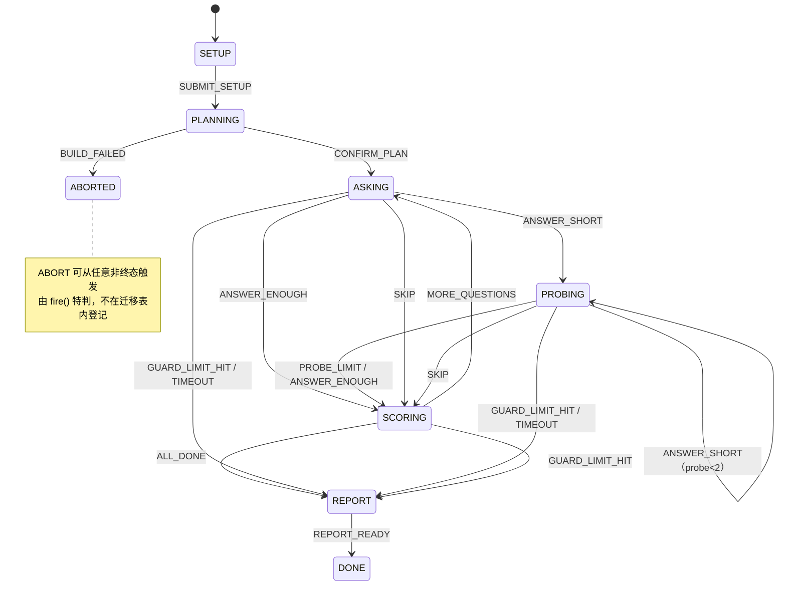

# AI 模拟面试系统 · 设计文档

> **历史文档，已被 v2.0 多文件设计替代。** 当前开发依据见[设计总入口](项目设计/README.md)，接手请读[新版交接](项目设计/记录/交接文档.md)。下文保留旧方案与当时状态，不代表现行规则；未经修改的原始快照见[归档](项目设计/archive/设计文档-v1.5.6.md)。

| 项    | 内容                                                               |
| ---- | ---------------------------------------------------------------- |
| 版本   | v1.5.6                                                           |
| 日期   | 2026-11-15                                                       |
| 状态   | **P0 已实现**（骨架 / 日志 / 链路观测），P1 待开始                                |
| 技术栈  | Python 3.12 · LangChain v1 · DeepSeek · FastAPI · FAISS · SQLite |
| 对应演示 | `demo/overview.html`（说明书）· `demo/index.html`（可交互 Demo）           |

> 此前本文件作为编码依据；自 2026-11-17 起，以新版设计总入口索引的正文为准。

---

## 1. 项目概述

### 1.1 一句话定位

一个面向技术岗求职者的 AI 模拟面试系统：按岗位 JD 逐题提问、针对回答追问、按 rubric 打分、输出可执行报告；同时是一个「敢上线」的 Agent 工程样板——全链路可追踪、质量可度量、改动可回归。

### 1.2 设计原则

| #  | 原则               | 含义                             | 反例（明确不做）                     |
| -- | ---------------- | ------------------------------ | ---------------------------- |
| G1 | **流程与智能分离**      | 六阶段由确定性状态机编排，模型只在节点内完成出题/追问/评分 | 让一个 Agent 自主决定「现在该问什么、要不要打分」 |
| G2 | **每步产出结构化对象并落库** | 任何阶段的结果都能被查询、回放、续跑             | 把整场对话塞进一个 list 放在内存里         |
| G3 | **模型不参与流程判定**    | 状态迁移条件由代码判断（字数、轮次、是否命中要点）      | 让模型输出「我们进入下一阶段」              |
| G4 | **旁挂可观测，不侵入业务**  | 日志与 trace 只能读，不能改变业务行为         | 为了指标好看而修改业务逻辑                |

> **为什么用 `G` 而不是 `P`**（v1.5.6 修正）：14 章的开发阶段已经占用 `P0`–`P7`，而设计原则原先也叫 `P1`–`P4`——**两个 `P3` 指「模型不参与流程判定」和「评分报告阶段」两件完全不同的事**。同一个符号在不同章节指两个对象，写代码注释和查文档时必定出错。
>
> 改用 `G`（Guideline）之后，`P*` 只表示开发阶段，`G*` 只表示设计原则，**全文档无歧义**。

### 1.3 能力边界

**做**：单人模拟面试 · 三种材料输入（示例/模板/上传）· 四类语料分层处理（JD 注入、简历白名单提取、题库与面经入索引）· 三种题型出题（通用/改写/生成）· 语音提问 · 语音/文字作答 · 双轨评分（知识题要点比对 + 项目题 STAR）· 报告导出 · 全链路追踪 · 项目自评测

**不做**（本期明确排除）：多用户与权限 · 真实招聘流程/ATS 对接 · 岗位爬虫 · 视频面试 · 多面试官协同 · 模型微调

### 1.4 术语

| 术语        | 含义                            |
| --------- | ----------------------------- |
| Session   | 一场面试，从配置到报告的全生命周期             |
| Turn      | 一道题的一轮完整交互：1 次提问 + 0–2 轮追问 + 对应作答 |
| Probe     | 追问，针对同一道题的深挖，上限 2 轮           |
| Plan Item | 面试大纲中的一道题的位置与状态（含题型、维度、难度）    |
| **Question Form** | 题型：`generic` 通用 / `rewrite` 改写 / `experience` 生成（见 5.6） |
| **Dimension** | 考察维度，8 个受控枚举之一（见 4.7.1）；也是分片索引的 key |
| **Profile** | 面试画像 `岗位族.面试类型`，决定考什么、怎么问（见 4.7） |
| **Draft ID** | 材料预览阶段生成的临时 id，确认后成为真实的 `session_id`（见 8.1） |
| Span      | 链路中的一个可计时节点（一次模型调用、一次检索、一次合成） |
| Trace     | 一场面试的全部 span 组成的树             |

---

## 2. 总体架构

### 2.1 分层视图

```
┌─────────────────────────────────────────────────────────────┐
│ 接入层  模板页面（配置/大纲/面试/报告） · 路由 · SSE/WS      │
├─────────────────────────────────────────────────────────────┤
│ 编排层  状态机（唯一决定流程） · 阶段 Prompt · 护甲 · Trace  │
├─────────────────────────────────────────────────────────────┤
│ 能力层  agents/（出题·追问·评分·报告）                       │
│         kb/（解析·分块·索引·召回）                           │
│         voice/（分句·TTS·ASR·缓存）                          │
├─────────────────────────────────────────────────────────────┤
│ 存储层  SQLite（业务） · FAISS（向量） · 文件（音频）        │
└─────────────────────────────────────────────────────────────┘
        ┆ 旁挂（只读，不参与判定）
        ┆ observability/（TraceLab） · eval/（自评测）
```

### 2.2 依赖规则（硬约束）

1. **单向依赖**：接入层 → 编排层 → 能力层 → 存储层。反向 import 一律禁止。
2. **编排层不 import voice**。语音属于表现层，由路由层调用。状态机只产出文本。
3. **能力层不感知流程**。`interviewer.next_question()` 不知道自己是第几题，参数由编排层注入。
4. **observability 与 eval 只能被编排层/接入层调用，不能反向调用业务**。

违反第 2 条的后果：文字版测试跑不动，语音一挂整个业务挂。

### 2.3 目录结构

```
ai-interview/
├── src/app/
│   ├── main.py                 # FastAPI 入口 + Jinja2 模板 + StaticFiles 挂载
│   ├── config.py               # pydantic-settings，读 .env
│   ├── core/
│   │   ├── state_machine.py    # Stage/Event/TRANSITIONS + 迁移执行
│   │   ├── llm.py              # 模型工厂（role 路由 + 重试）
│   │   ├── middleware.py       # 四层护甲装配
│   │   └── tracing.py          # trace_id / span 上下文
│   ├── agents/
│   │   ├── interviewer.py      # 出题
│   │   ├── prober.py           # 追问判定
│   │   ├── evaluator.py        # 四维评分
│   │   └── reporter.py         # 全场报告
│   ├── kb/
│   │   ├── pdf.py              # PDF/DOCX 解析 → 纯文本（含扫描件判定）
│   │   ├── extract.py          # 白名单结构化提取（5.9.4）
│   │   ├── validate.py         # 抽取式校验 verify()/normalize()（5.9.5）
│   │   ├── pii_scan.py         # 落库前检测（5.9.7），只检测不改写
│   │   ├── chunker.py          # Q+A 成对切分
│   │   ├── index.py            # FAISS 建库 / 增量 / 重建
│   │   └── retriever.py        # 查询构造 + 多路召回 + 融合
│   ├── voice/
│   │   ├── segmenter.py        # 增量分句
│   │   ├── tts.py              # 适配器：edge-tts / volc
│   │   ├── asr.py              # 适配器：faster-whisper
│   │   └── cache.py            # 固定话术音频缓存
│   ├── observability/
│   │   ├── callbacks.py        # LangChain CallbackHandler
│   │   ├── spans.py            # @span 装饰器 / 上下文
│   │   ├── store.py            # 异步队列 + 批量写盘
│   │   └── viewer/routes.py    # /observe 页面（HTML）+ /api/v1/observe（JSON）
│   ├── eval/
│   │   ├── datasets/*.jsonl
│   │   ├── metrics/{retrieval,generation,latency,extract}.py
│   │   ├── runners/{rag,scoring,extract,e2e}_runner.py
│   │   ├── baseline.json       # 当前基线，通过门禁后更新（10.4）
│   │   ├── experiments.jsonl   # 调参决策链（10.5）
│   │   └── report.py
│   ├── db/
│   │   ├── models.py           # SQLAlchemy 2.0
│   │   └── repository.py       # 只为编排层提供方法
│   ├── api/v1/
│   │   ├── sessions.py         # 含 /preview（不落库）
│   │   ├── turns.py / kb.py / voice.py / reports.py / eval.py
│   │   └── observe.py
│   ├── schemas/                # Pydantic 请求/响应/LLM 输出
│   └── prompts/                # 9 个 Prompt 文件（见 4.1）+ profiles/ + domains/
├── templates/                  # Jinja2 模板，服务端渲染（见 2.5）
│   ├── base.html               # 公共骨架：head / 导航 / CSS 引用，其余页面 extends 它
│   ├── history.html            # 首页：历史列表（进行中置顶）+ 新建入口
│   ├── setup.html              # 配置 + 材料输入 + 提取确认
│   ├── planning.html           # 选维度 + 大纲确认
│   ├── interview.html          # 对话 + 录音 + 播放（最复杂，占前端 80%）
│   └── report.html             # 报告展示
├── static/
│   ├── css/app.css
│   └── js/
│       ├── history.js          # 列表渲染、继续/放弃/删除
│       ├── setup.js
│       ├── planning.js
│       ├── interview.js        # SSE 流 + MediaRecorder + TTS WebSocket
│       └── report.js
├── data/
│   ├── questions/seed.md       # 题库种子（30 道手写）
│   ├── samples/                # 示例材料：sample_resume.md / sample_jd.md
│   ├── blanks/                 # 空白简历模板：resume_template.md / jd_template.md
│   ├── profiles/               # 面试画像 YAML（见 4.7）
│   ├── index/                  # 8 个维度分片 .faiss + metadata
│   ├── uploads/                # 会话上传的原始文件（随会话删除）
│   ├── traces/                 # 原始 trace 事件 JSONL，用于重放（9.3）
│   ├── graph.db                # LangGraph checkpoint（2.4），只存编排状态，不存业务数据
│   └── audio/                  # 录音与合成缓存
├── logs/                       # app-YYYYMMDD.jsonl
├── docs/
├── tests/
│   └── fixtures/               # 固定输入：*.txt（已清洗文本）+ *.pdf（4 份小样本，见 13 章）
├── .env.example
├── requirements.txt
└── README.md
```

**v1.5 补进目录的三类东西，都是前面章节定了、但目录里没有落点的：**

| 新增 | 对应设计 |
|---|---|
| `kb/pdf.py` `extract.py` `validate.py` `pii_scan.py` | 5.9 的四步流水线，一步一个文件，方便单独测试 |
| `data/samples/` `data/blanks/` | 5.9.1 的三种入口里，示例与空白模板需要静态内容。**不叫 `templates/`**，避免与根目录的 Jinja2 `templates/` 混淆 |
| `eval/metrics/extract.py` | 10.2 的抽取校验通过率 |

### 2.4 编排框架选型（v1.1 补充）

**结论：LangGraph 做编排 + LangChain 做节点内能力，不引入 LlamaIndex。**

先澄清一个常见误解：**LangChain v1 的 `create_agent` 内部就是建在 LangGraph 上的**，`langchain` 已把 `langgraph` 作为依赖。所以「用 LangChain 还是 LangGraph」不是二选一，而是**用高层封装还是低层原语**。

| 框架               | 本质                                         | 在本项目的位置                 | 用不用         |
| ---------------- | ------------------------------------------ | ----------------------- | ----------- |
| **LangChain v1** | 模型 / 工具 / 消息 / 中间件的统一抽象                    | 节点内：出题、追问、评分、结构化输出、四层护甲 | ✅ 用         |
| **LangGraph**    | 有状态的图运行时，带 checkpoint / interrupt / stream | 编排：六阶段状态机               | ✅ 用（只当状态机用） |
| **LlamaIndex**   | 面向文档的数据框架，强在 ingestion 与 query engine      | 知识层                     | ❌ 不用        |

**为什么 LlamaIndex 不用**：它的价值在超大规模异构文档的摄取与复杂检索。本项目只有两类语料、百来条 chunk、单一 FAISS TopK，用 `RecursiveCharacterTextSplitter + FAISS` 约 100 行就能写完。引入它反而带来两个问题：一套平行的 `Document` / `Node` 抽象与 LangChain 并存；检索细节被 `QueryEngine` 藏起来，而我们要展示的恰恰是「chunk_size / K 怎么影响召回率」。

**为什么不自己写纯 Python 状态机**：11 条迁移边写 `dict` 当然更透明，但断点续跑、人工介入暂停、流式输出这三件事都要自己实现。LangGraph 的 `checkpointer` / `interrupt` / `stream` 免费提供，且 `add_conditional_edges` 与我们的 `TRANSITIONS` 表几乎一一对应。

**边界：业务表仍是唯一事实来源**。LangGraph 的 state 只存「编排所需的运行时信息」（当前阶段、plan_item id 列表、probe 计数），`session / turn / evaluation` 仍写自己的表。禁止把业务数据只存在 checkpoint 里——那会让观测、评测、报告全部失去数据源。

**这条边界同时解决了 P2 的续跑问题**（v1.5 澄清）：P2 阶段还没有 checkpointer，但断点续跑照样能做——

```python
# 进程重启后，从业务表恢复，不依赖任何框架状态
session = repo.get_session(sid)
session.stage          # 停在哪一步
session.setup_step     # SETUP 内部的子步骤
session.planning_step  # PLANNING 内部的子步骤
items = repo.list_plan_items(sid, status="pending")   # 还剩哪些题
```

**P2.5 接上 checkpointer 之后，恢复逻辑不用改**——checkpointer 只是让「恢复」更快、更细（连 LangGraph 节点内部的中间态也能存），但**业务表始终是权威**。这也是为什么 2.4 敢把顺序定成「先纯 Python、后 LangGraph」。

```python
# 迁移表 → 图，几乎 1:1
graph = StateGraph(InterviewState)
graph.add_node("ask", ask_node)
graph.add_node("probe", probe_node)
graph.add_conditional_edges("ask", route_after_ask, {"probe": "probe", "score": "score"})
app = graph.compile(checkpointer=SqliteSaver.from_conn_string("data/graph.db"))
```

**落地节奏：P2 先写纯 Python 迁移表，P2.5 再平移到 LangGraph**（v1.5 补，否则读者不知道 3.3 的 dict 和这里的图是什么关系）：

| 阶段 | 做法 | 理由 |
|---|---|---|
| **P2** | 按 3.3 的 `TRANSITIONS` dict + `fire()` 跑通全流程 | 11 条边能穷举单测，调试时一眼看到状态怎么变的；此时还没验证流程正确性，先别叠框架 |
| **P2.5** | 平移到 `StateGraph`，checkpointer 接 `data/graph.db` | 逻辑已验证，迁移只是换执行引擎；能白拿断点续跑、`interrupt()`、`stream()` |
| **触发提前** | 如果 P2 里「存状态 / 恢复 / 暂停等待」写了 150 行还没写对 | 说明确实需要 LangGraph，立刻迁 |

**为什么不一开始就上 LangGraph**：会在「流程没跑通」和「框架没搞懂」两个问题上同时卡住，分不清是谁的锅。

> ⚠️ 落地前核对：`langgraph.checkpoint.sqlite` 需单独安装 `langgraph-checkpoint-sqlite`；v1 各包的依赖关系以实际安装版本为准。

### 2.5 前端结构：MPA + Jinja2（v1.5.2 新增）

**结论：五个服务端渲染的页面（MPA），不是单页应用（SPA），且不引入任何前端构建工具。**

#### 2.5.1 为什么不用 SPA

先看事实：这五个界面之间**几乎不共享状态**。

```
历史页 → 配置页 → 大纲页 → 面试页 → 报告页
   └───────┴────────┴────────┴────────┘
         只传一个 session_id
```

每个页面都是「拿到 `session_id`，自己去拉自己的数据」。而 SPA 的价值在于「视图间频繁切换 + 共享大量内存状态」（Gmail 的列表/详情、Notion 的文档树）——本系统不满足这个前提。

| 判据 | 本系统 | SPA 是否划算 |
|---|---|---|
| 视图间共享状态 | 只有一个 `session_id` | ❌ 用不上 |
| 切换频率 | 一场面试只切 3 次 | ❌ 用不上 |
| 各页面复杂度 | **面试页占 80%** | ❌ 独立成文件反而更好维护 |
| 是否需要 SEO | 本地工具，不需要 | ❌ 无关 |

**还有一个决定性理由：SPA 的经典顽疾在这里无法承受。**

> SPA 切换视图时若忘记 `removeEventListener`，第二次进入该页面会重复绑定——点一次录音按钮触发两次，直接卡死。这类 bug 只在**第二次进入**时出现，第一次测试永远正常。
>
> MPA 每次换页，浏览器销毁整个 JS 环境重建，**物理上不可能有状态残留**。
>
> 对一个人、3 天要交付的前端，这个风险降低比省下 100ms 白屏值钱得多。

**MPA 的代价**（都可控）：

| 代价 | 实际情况 |
|---|---|
| 3 次整页加载 | 本地静态文件，各约 80–150ms，体感是「闪一下」 |
| 4 份重复的 `<head>` / 导航 | 用 Jinja2 `` 消除 |
| 每次进页面要重拉 state | 本地 5ms；这本来就是「断点续跑」需要的调用 |

#### 2.5.2 五个页面 ↔ 八个 Stage 的映射

状态机有 8 个阶段，但用户只看得到 5 个界面：

| 页面 | 覆盖的 Stage | 主要交互 |
|---|---|---|
| `history.html` | ——（不占 Stage，导航层） | 看历史 → 继续未完成的 / 查看报告 / 再面一次 / 删除；顶部「开始新面试」 |
| `setup.html` | `SETUP(INPUT)` · `SETUP(REVIEW)` | 三入口选材料 → 看提取结果 → 编辑字段（`minor` 标黄）→ 确认 |
| `planning.html` | `PLANNING(CHOOSE_DIM)` · `PLANNING(CONFIRM_OUTLINE)` | 勾选 3–5 个维度 → 看大纲 → 换题/调难度 → 开始 |
| `interview.html` | `ASKING` · `PROBING` · `SCORING` | 流式出题 → 作答（语音/文字）→ 追问 → 等评分 → 下一题；**角落有「结束面试」+ 二次确认**（v1.5.3） |
| `report.html` | `REPORT` · `DONE` · `ABORTED` | 三分数 → 维度明细 → 改进清单 → **跨场趋势（底部，见 5.10）** → 导出 |

**`history.html` 的三种状态**（v1.5.4）：

同一个列表，不同状态要给不同的下一步。

| status | 主按钮 | 次按钮 | 说明 |
|---|---|---|---|
| `done` | 查看报告 | 再面一次 | —— |
| `active` | **继续** | 放弃 | 继续 = `redirect_to_page()` 跳到对应页面；放弃 = 调 `/abort` 拿部分报告 |
| `aborted` | 查看报告（无报告时置灰） | 再面一次 | 一题没答就中止的场次没有报告 |

**排序：`active` 置顶，其余按 `created_at DESC`。** 用户关掉页面回来，最想找的就是那个「进行中 3/5」——把它埋在第十行等于没做。

**「再面一次」是这个页面最值的功能**：复制上一场的 `jd_text` + `resume_profile_json` + `selected_dimensions` + `profile_id`，直接进 `PLANNING`，**跳过材料输入和维度选择**。

用户第二次面试时最烦的就是「又要粘一遍 JD 和简历」，而这个操作的成本几乎为零——数据本来就在库里。

**`active` 行不显示删除**（7.3.3）：破坏性操作不该出现在「面试正在进行」的状态下。

**注意 `SCORING` 归在面试页**：它是后台评分，用户无感，界面仍停在面试页等下一题。只有评完且 `ALL_DONE` 时才跳报告页。

**「结束面试」按钮的设计**（v1.5.3）：

| 项 | 决定 | 理由 |
|---|---|---|
| 位置 | 面试页**角落**，次要样式（灰字 / 小号） | 每道题旁边都放「结束」会让用户分心；真想中止的人会去找它 |
| 二次确认文案 | 「结束后本场无法继续，已答的 2 题会生成一份部分报告。确定吗？」 | **必须说清两件事**：不能继续、有部分报告 |
| 与关闭页面的区别 | 关闭浏览器 = 暂停（可续）；点这个 = 中止（不可续） | 用户默认以为「关了就是结束了」，界面上要有一句提示：「离开页面不会丢失进度」 |

**这条提示值得单独做**：如果用户以为关页面=放弃，他就不敢中途去回个消息；如果以为关页面=保留，他就不会误点「结束面试」。**两种误解都会让功能白做。**

#### 2.5.3 路由守卫由服务端做，不由前端判断

每个页面进入时，服务端先检查「当前 stage 是否属于这个页面」：

```python
@app.get("/interview", response_class=HTMLResponse)
def page_interview(s: str, request: Request):
    session = repo.get_session(s)
    if session.stage not in (Stage.ASKING, Stage.PROBING, Stage.SCORING):
        # 不在该阶段，302 到它真正该在的页面
        return RedirectResponse(redirect_to_page(session))
    return templates.TemplateResponse("interview.html", {"request": request, "session": session})
```

**为什么必须服务端守**：前端守的话，用户手改 URL 就能跳过阶段。而 `fire()` 本来就会拒绝非法迁移（3.6），结果是**页面打开了但每点一次都抛异常**——比直接 302 难查得多。

**页面路由表**（v1.5.4 重写）：

| 路径 | 页面 | 守卫条件 |
|---|---|---|
| `GET /` | `history.html` 或 `setup.html` | **没有任何会话** → `setup.html`（第一次用零摩擦）；**有会话** → `history.html` |
| `GET /new` | `setup.html` | 无（主动新建） |
| `GET /planning?s=` | `planning.html` | `stage ∈ {PLANNING}` |
| `GET /interview?s=` | `interview.html` | `stage ∈ {ASKING, PROBING, SCORING}` |
| `GET /report?s=` | `report.html` | `stage ∈ {REPORT, DONE, ABORTED}` |

**为什么首页是历史而不是配置页**：这个工具的核心价值不是「面一次」，而是「**反复面、看到进步**」。把历史放首页，是在告诉用户它不是一个一次性工具。第一次用的用户没有历史，自动落到 `setup.html`，零摩擦。

**顺带解决了 2.5.3 原来的一个漏洞**：v1.5.2 曾写「多场并存 → setup.html + 顶部『继续上次面试』入口」，但那个入口需要列表数据，而当时没有列表接口。现在首页本身就是列表，这个特判不必要了。

`redirect_to_page()` 只在「继续」时用：把 `stage` 映射成页面路径（`setup_step` / `planning_step` 只影响页面内的初始视图，不影响跳哪个页面）。

#### 2.5.4 页面间只传 session_id，POST 后必须重定向

| 规则 | 原因 |
|---|---|
| URL 只带 `?s={session_id}` | 状态全在服务端，URL 保持可分享、可刷新 |
| 所有表单提交用 **POST → 302 → GET** | 防止刷新重复提交（PRG 模式） |
| 不用 `localStorage` 存进度 | 那是前端状态，会与服务端不一致；进度只有一个权威来源：`interview_session.stage` |

#### 2.5.5 零构建：不用打包工具，但可以用第三方库

```html
<!-- base.html 里，直接引静态文件 -->
<link rel="stylesheet" href="/static/css/app.css">
<script src="/static/js/interview.js" defer></script>
```

**先把三件事分开，它们经常被混为一谈**（v1.5.5 修正）：

| 类别 | 例子 | 本项目 | 原因 |
|---|---|---|---|
| **构建工具** | npm / vite / webpack | ❌ 不引入 | 它解决的唯一硬问题是「用 npm 包」和「源码打包」，这两个问题在本项目规模下不存在 |
| **第三方库** | Chart.js / marked / dayjs | ✅ **允许** | 放 `static/vendor/`，下载一次，零构建、离线可用 |
| **UI 框架** | React / Vue | ❌ 不用（但非禁止） | MPA + 5 个页面，框架的抽象成本大于收益 |

> ⚠️ **v1.5.2 曾写「明确不装 npm/vite/webpack/TypeScript/React/Vue」，那句话是错的**——它把「不要打包流程」和「不许用任何库」混成了一条。**不用构建 ≠ 自缚手脚**，Chart.js 的 UMD 文件往 `static/vendor/` 一放就能用，不需要 npm。

**为什么用 Jinja2 + 原生 JS，而不是 React**

| 事实 | 影响 |
|---|---|
| 本项目作者熟悉 Flask | **Flask 的默认模板引擎就是 Jinja2**，模板语法零学习成本 |
| `render_template` → `TemplateResponse` | 只差参数写法，`` / `{{ var }}` 完全一致 |
| 前端是配套，不是主线 | 价值在 Agent 工程 / RAG / 评测，前端工程化投入产出比低 |

**引入构建工具的代价（如实记，不美化）**：

| 代价 | 具体 |
|---|---|
| 多一个 Node 运行时 | README 从「三条命令」变「装 Node → `npm install` → `npm run build` → 起 Python」 |
| `node_modules` 体积 | Vite + React 基础项目约 **150–300MB** |
| 改代码要等编译 | dev server 热更新 0.3–1 秒；原生是刷新即生效 |
| 多一个产物目录 | `dist/` 要和 `templates/` 对齐，部署容易漏 |
| 版本漂移 | 半年后 `npm install` 可能因依赖升级装不上 |

**什么情况下该改用构建工具**（判据，不是「永不引入」）：

| 触发条件 | 说明 |
|---|---|
| 页面 > 10 个 | 模板继承开始难管 |
| 前端 JS > 5000 行 | 没有模块系统会很痛苦 |
| 需要多人协作 | 没有统一构建保证不了一致性 |
| 要做移动端 / 小程序 | 需要跨端编译 |
| 需要复杂跨视图状态 | 手写 store 会失控 |

**任意一条成立就引入。现在一条都不成立**——但如果将来 P4a 之后前端膨胀到这个量级，这个决定该重新算。

#### 2.5.6 与 `/observe` 的关系

| | 产品页面 | 观测台 |
|---|---|---|
| 路径 | `/setup` `/planning` `/interview` `/report` | `/observe` |
| 渲染 | Jinja2 模板 | Python f-string 拼接（P0 现状） |
| 是否需要 JS | 是（SSE / 录音 / 播放） | 否（纯展示） |
| 是否改造 | —— | **保持不动**，一个页面不值得上模板引擎 |

**两套渲染方式并存是有意的**：观测台是运维工具，零 JS 反而好维护；产品页面要交互，才需要模板继承。

#### 2.5.7 `demo/index.html` 是 P4a 的起点，不是要重写

`demo/index.html`（868 行）已经跑通了五屏流程和视觉样式。P4a 的工作是**拆分 + 接真接口**，不是从零写：

| demo 里 | 改造成 |
|---|---|
| 硬编码的假数据 | 拆进 `setup.js` / `planning.js`，换成真 API |
| `setTimeout` 假装建库 | 接 `POST /api/v1/sessions/preview` |
| 五屏塞在一个文件里 | 拆成 4 个模板 + 4 个 JS，公共部分进 `base.html` |
| 浏览器 `speechSynthesis` | 换成 `/ws/tts` 流式音频 |
| 模拟的语音输入 | 换成 `MediaRecorder` + `POST /api/v1/asr` |

**P4a 排 2 天的依据就是这个**——样式和流程已经验证过，只剩拆除和接线。语音单独拆成 P4b，是因为它是唯一一块没有现成代码可抄的部分（demo 用的是浏览器 `speechSynthesis`，要换成 WebSocket 流式音频）。

---

## 3. 核心状态机

### 3.1 阶段定义

```python
class Stage(str, Enum):
    SETUP    = "SETUP"      # 配置：岗位/级别/题数/材料输入与确认
    PLANNING = "PLANNING"   # 建库 + 生成大纲，等待用户确认
    ASKING   = "ASKING"     # 已出题，等待作答
    PROBING  = "PROBING"    # 已追问，等待作答
    SCORING  = "SCORING"    # 收尾当前题（评分 / 跳过）
    REPORT   = "REPORT"     # 生成全场报告
    DONE     = "DONE"       # 正常结束
    ABORTED  = "ABORTED"    # 已终止；可能有部分报告，也可能没有（见 3.3）
```

**`ASKING` 的语义必须钉死为「已出题、等作答」，不包含「正在出题」。**

这是一个看起来吹毛求疵、但 P4a 一定会撞上的问题：流式出题要 1–2 秒，这段时间系统处于什么状态？

| 方案 | 做法 | 评价 |
|---|---|---|
| **A（采用）** | 出题过程不占状态；题目生成完毕才置 `ASKING` | 状态恒等于「前端可以接受输入」 |
| B | 拆成 `ASKING`（出题中）+ `WAITING`（等作答） | 更精确，但要多加 2 条边和一组单测 |

**选 A**，理由是：前端只需要知道「能不能输入」，而这个判断用一条规则就够了——**收到题目前禁用输入框，收到之后启用**。状态机不必为「正在加载」这种纯前端表现多担一个状态。

代价：`ASKING` 期间如果出题失败，系统是「卡在上一阶段的 SCORING 出不来」。这要靠 E3001（模型超时）的重试机制兜住，而不是靠状态机。

#### 子状态：SETUP 与 PLANNING 内部的多步

`SETUP` 和 `PLANNING` 都需要等待用户**两次**输入。解法不是新增 Stage，而是在 Stage 内部用子字段区分子步骤（v1.4 新增 `setup_step`）。

```python
class SetupStep(str, Enum):
    INPUT   = "INPUT"           # 等用户提供材料（示例 / 模板 / 上传）
    REVIEW  = "REVIEW"          # 等用户核实提取结果并确认

class PlanningStep(str, Enum):
    CHOOSE_DIM       = "CHOOSE_DIM"         # 等用户勾选考察维度（见 4.7）
    CONFIRM_OUTLINE  = "CONFIRM_OUTLINE"    # 等用户确认题目大纲
```

**为什么用子字段而不新增 Stage**：新增 Stage 意味着迁移表要多加 N 条边、单测要多写 N 组；而子步骤是**同一状态内的顺序推进**，不涉及分支，用子字段表达更贴切。

**规则**：子字段只允许「顺序推进 + 回退到上一步」，不允许跳跃。任何跳跃都视为非法，按 E5001 处理。

### 3.2 迁移图



### 3.3 迁移表（代码即文档）

```python
TRANSITIONS: dict[tuple[Stage, Event], Stage] = {
    (Stage.SETUP,    Event.SUBMIT_SETUP):   Stage.PLANNING,
    (Stage.PLANNING, Event.CONFIRM_PLAN):   Stage.ASKING,
    (Stage.ASKING,   Event.ANSWER_SHORT):   Stage.PROBING,
    (Stage.ASKING,   Event.ANSWER_ENOUGH):  Stage.SCORING,
    (Stage.PROBING,  Event.ANSWER_SHORT):   Stage.PROBING,   # 自环，受 guard 保护
    (Stage.PROBING,  Event.ANSWER_ENOUGH):  Stage.SCORING,
    (Stage.PROBING,  Event.PROBE_LIMIT):    Stage.SCORING,
    (Stage.SCORING,  Event.MORE_QUESTIONS): Stage.ASKING,
    (Stage.SCORING,  Event.ALL_DONE):       Stage.REPORT,
    (Stage.REPORT,   Event.REPORT_READY):   Stage.DONE,

    # 用户主动跳过：不评分，直接推进到下一题（v1.5 补）
    (Stage.ASKING,   Event.SKIP):           Stage.SCORING,
    (Stage.PROBING,  Event.SKIP):           Stage.SCORING,

    # 护栏与超时：进行中的阶段都能被拦截收尾（v1.5 补全）
    (Stage.ASKING,   Event.GUARD_LIMIT_HIT): Stage.REPORT,
    (Stage.PROBING,  Event.GUARD_LIMIT_HIT): Stage.REPORT,
    (Stage.SCORING,  Event.GUARD_LIMIT_HIT): Stage.REPORT,
    (Stage.ASKING,   Event.TIMEOUT):         Stage.REPORT,
    (Stage.PROBING,  Event.TIMEOUT):         Stage.REPORT,
    (Stage.PLANNING, Event.BUILD_FAILED):    Stage.ABORTED,
}
# ABORT 事件不在表里登记：它对所有非终态生效，由 fire() 开头特判
```

**为什么 SKIP 复用 `SCORING` 而不直接跳回 `ASKING`**

因为「推进到下一题」的逻辑（查 `plan_item` 剩余 → `MORE_QUESTIONS` / `ALL_DONE`）本来就写在 `SCORING` 里。跳过的题走同一条推进路径，只是**跳过评分环节**：

```python
# 注意：这段在 scoring_node() 里，不在 fire() 里。
# fire() 是通用迁移执行器，只做「查表 + 落库 + 改状态」，不含任何业务判断。
def scoring_node(session: SessionState, plan_item: PlanItem) -> None:
    if plan_item.status == "skipped":
        fire(session, Event.MORE_QUESTIONS if _has_next else Event.ALL_DONE)
        return                                   # 跳过评分器，直接推进

    ev = evaluator.score(turn, plan_item)         # 正常评分
    repo.save_evaluation(ev)
    fire(session, Event.MORE_QUESTIONS if _has_next else Event.ALL_DONE)
```

代价是 `SCORING` 的语义变宽——它实际含义是「**收尾当前题**」，包含「评分」和「跳过」两种结局。**这个代价比复制一套推进逻辑小。**

**刻意不提供 `REDO`（重答）**：重答时用户已经知道上一轮怎么答的，分数不再可比；真实面试也不允许重答。想重来，正确做法是**开一场新面试**。

**v1.4 修掉的三处缺陷**（都会在实现时直接导致 500 或功能不可用）：

| 问题 | 后果 | 修法 |
|---|---|---|
| 只有 `(SCORING, GUARD_LIMIT_HIT)` | 出题阶段撞上限流 → `IllegalTransition` → 白屏 | 补 `ASKING` / `PROBING` 两条 |
| 45 分钟超时没有对应事件 | 3.5 写了「超时转 REPORT」，但表里无此边，实现者不知道该往哪加 | 新增 `Event.TIMEOUT` + 两条边 |
| `ABORT` 只在注释里承诺 | `fire(s, Event.ABORT)` 会走 `key not in TRANSITIONS` 抛异常，**中止功能完全不可用** | 在 `fire()` 开头特判（见 3.6） |

**为什么 ABORT 用特判而不是补 8 条边**：它能从任意非终态触发，补边会让迁移表膨胀一倍且全是重复语义。**特判是「对所有状态成立」的规则，迁移表只描述「状态相关」的规则**——这个边界要划清。

#### ABORT 的执行顺序：先出报告，再迁移（v1.5.3 补）

`ABORTED` 原先注释写「已产出阶段报告」，但**没人执行这件事**——`Event.ABORT` 只改状态，不生成任何东西。这里把顺序钉死：

```python
def abort(sid: str, reason: str = "user_cancel") -> str | None:
    session = repo.get_session(sid)

    # ① 进行中那道题标 skipped（没答完的不算分，也不进报告分母）
    repo.mark_current_turn_skipped(sid)

    # ② 已评分 ≥1 题 → 生成部分报告；0 题 → 不出（没内容可写）
    report_id = gen_partial_report(sid, reason) if repo.scored_count(sid) else None

    # ③ 最后迁移。报告生成抛异常也照样迁移——否则用户会卡在「中止不了」
    fire(session, Event.ABORT)
    return report_id
```

**顺序不能反**，与 3.3 的 `SUBMIT_SETUP`（先落库再迁移）是同一条原则：**副作用没做完就改状态，一旦失败会留下「状态对了但数据没有」的会话。**

**`ABORTED` 是否带报告，看它是从哪条路来的**：

| 入口 | 有报告吗 | 前端应显示 |
|---|---|---|
| 用户主动中止（`ASKING` / `PROBING` / `SCORING`） | ✅ 已答 ≥1 题 → 部分报告 | 「本场提前结束」+ 查看报告 |
| 用户中止但一题没答（`SETUP` / `PLANNING`） | ❌ | 「已取消，没有产生报告」 |
| `BUILD_FAILED`（建库失败） | ❌ **连题都没有，谈不上报告** | 「建库失败，请重试」 |

**这就是注释必须改的原因**：「已产出阶段报告」在 `BUILD_FAILED` 路径上根本不成立。前端不能看到 `ABORTED` 就去请求报告——得先判断 `report` 表里有没有对应记录。

#### 「暂停」不等于「中止」

用户关掉页面时状态**不变**，仍停在 `ASKING`，回来靠 `GET /state` 接着答。只有显式调 `/abort` 才进入 `ABORTED`。

**这个区分必须做对**：如果把「关闭页面」当中止，用户会莫名其妙丢掉一场已经答了三题的面试。反过来，如果只有中止没有暂停，用户就不敢中途离开。

**v1.4 语义澄清：`SUBMIT_SETUP` 的触发点在 `SETUP.REVIEW` 完成时，不在 `SETUP.INPUT`。**

```
SETUP(INPUT)  --用户提供材料-->  SETUP(REVIEW)  --确认 + 落库成功-->  SUBMIT_SETUP  -->  PLANNING(CHOOSE_DIM)
```

也就是说：**用户确认「这份提取结果是对的」、PII 检测通过、画像成功落库，这三件事都完成后，才产生 `SUBMIT_SETUP`。**

点「确认」按钮触发的是 `POST /sessions`，该接口内部按序执行：**PII 检测 → 落库 → `fire(SUBMIT_SETUP)`**。

| 情况 | 结果 |
|---|---|
| PII 检测命中（E2005） | **不落库、不迁移**，停回 `SETUP(REVIEW)` 让用户改 |
| 落库失败（DB 异常） | 同上，返回 **E2006**（会话创建失败），可重试 |
| 全部成功 | 迁移到 `PLANNING(CHOOSE_DIM)` |

**这条保证了「未确认 / 有问题的数据永不落库」**（见 5.9.6）。如果先迁移再落库，一旦落库失败，会话就会停在 `PLANNING` 却没有画像可用——那是最难查的一类状态错乱。

### 3.4 事件判定逻辑（模型不参与）

| 事件                | 判定条件                                    | 代码位置                |
| ----------------- | --------------------------------------- | ------------------- |
| `ANSWER_SHORT`    | 去空白后字数 < 80 **或** 未命中任何 `answer_points` | `prober.classify()` |
| `ANSWER_ENOUGH`   | 命中 ≥1 个要点 **且** 字数 ≥ 80                 | 同上                  |
| `PROBE_LIMIT`     | `turn.probe_count >= 2`                 | 状态机内部计数             |
| `MORE_QUESTIONS`  | `scored_items < plan_total`             | 状态机查询 plan_item     |
| `ALL_DONE`        | `scored_items == plan_total`            | 同上                  |
| `SKIP`            | 用户点了「跳过这题」（v1.5）                        | 接入层                 |
| `TIMEOUT`         | 单场 wall-clock 超过 45 分钟（v1.5）            | 定时器（系统层）            |
| `GUARD_LIMIT_HIT` | 中间件抛出 `ModelCallLimitError`             | 异常捕获层               |

**注意：这一整列「代码位置」里没有一个是模型。** 这就是 G3 原则（模型不参与流程判定）的落地证据——**事件判定表本身就是 G3 的证明**。

### 3.5 防死循环的三道闸

1. `probe_count >= 2` → 强制 `SCORING`
2. `ModelCallLimitMiddleware(run_limit=6/题)` → 抛错转 `GUARD_LIMIT_HIT`
3. 单场 wall-clock 上限 45 分钟 → 定时器在 `ASKING` / `PROBING` 触发 `Event.TIMEOUT`

**第 2 道的 6 次是怎么算出来的**（v1.5 修正，原来写 4 次，等于正常路径的精确值）：

| 环节 | 正常次数 | 重试余量 |
|---|---|---|
| 出题（含改写自检） | 1–2 | +1 |
| 追问判定（代码先判轮次，仅 `probe_count < 2` 时调用） | 1–2 | +1 |
| 评分 | 1 | — |
| **合计** | **3–5** | **上限取 6** |

**原来写 4 会导致：正常路径刚好用满，一次 E3001 重试就撞限流。** 那不是「防跑飞」，是「防正常运行」。上限必须留出重试余量，否则限流本身成了故障源。

**三道的区别与失败后果**：

| 闸 | 保护对象 | 触发时 | 缺了会怎样 |
|---|---|---|---|
| 1 追问上限 | 单题节奏 | 应用层 | 用户答一句追一句，出不来 |
| 2 模型调用限流 | 单题成本 | 框架层 | 一次跑飞烧掉整场预算 |
| 3 墙钟超时 | 整场时长 | 系统层（定时器） | 用户卡在某题，会话永不结束 |

**三层都要有，因为每一层都可能被绕过**：`probe_count` 可能因 bug 未累加；模型调用可能绕过中间件直连；而单题限流管不住「5 道题各拖 10 分钟」。**纵深防御的前提是假设每一层都会失效。**

**为什么「token 预算」（E5002）不算第四道闸**：它触发时的动作是**降级**（切 flash + 减少追问），不是**终止**。闸的作用是「强制结束当前流程」，而预算只是「改变后续策略」。两者性质不同，混在一起会让状态机多出一条本不该有的出口。

### 3.6 迁移执行算法

```python
def fire(session: SessionState, event: Event) -> Stage:
    # 1. ABORT 对所有非终态生效，先特判（否则表里没有它，会误抛异常）
    if event is Event.ABORT:
        if session.stage in (Stage.DONE, Stage.ABORTED):
            raise IllegalTransition(session.stage, event)     # 终态不能再中止
        _persist(session, Stage.ABORTED, event)
        return Stage.ABORTED

    # 2. 终态不接受任何其他事件
    if session.stage in (Stage.DONE, Stage.ABORTED):
        raise IllegalTransition(session.stage, event)

    # 3. 查表
    nxt = TRANSITIONS.get((session.stage, event))
    if nxt is None:
        raise IllegalTransition(session.stage, event)

    _persist(session, nxt, event)
    return nxt


def _persist(session: SessionState, nxt: Stage, event: Event) -> None:
    log_event("state.transition", from_=session.stage, to=nxt, event=event)
    session.stage = nxt
    session.save()
```

**所有非法迁移必须抛异常，不允许静默兜底。** 静默兜底会把状态错乱藏起来，等发现问题时已经找不到原因。

`ABORT` 必须放在第一步特判——**如果先查表再特判，`fire(s, ABORT)` 会因为表中无此键而抛异常，中止功能直接失效**。这是个很容易写反的顺序。

---

## 4. Prompt 体系

### 4.1 组织方式

- 一职责一文件，共 9 个（v1.4 清单）：

  ```
  prompts/base/
  ├── setup_extract.md        # 材料结构化提取（5.9.5）
  ├── outline.md              # 大纲生成
  ├── ask_generic.md          # 出题·通用（5.6.2）
  ├── ask_rewrite.md          # 出题·改写
  ├── ask_experience.md       # 出题·生成
  ├── probe.md                # 追问判定
  ├── score_knowledge.md      # 评分·知识题（4.4）
  ├── score_experience.md     # 评分·项目题（4.4.1）
  └── report.md               # 报告生成
  ```

- 变量用 `{{slot}}` 占位，由 `PromptBuilder` 填充，**禁止 f-string 拼接**
- 每个 Prompt 文件顶部写一行版本注释，例如 `<!-- 版本: v2 / 2026-11-20 加入简历优先规则 -->`，改 Prompt 必须记一行

**为什么出题要拆三个而不是一个**：三种形态的约束互相冲突——通用题禁止改写、改写题要求改写但禁止换考察点、生成题允许自由发挥。塞进同一个模板，模型会在三类指令之间摇摆，输出形态不稳定。详见 5.6.2。

**这 9 个文件在本文档里的完成度**（如实标注，避免「以为照着做就行」）：

| 文件 | 本文档是否含全文 | 说明 |
|---|---|---|
| `setup_extract.md` | ❌ 待补（P1） | 5.9.5 给了「只摘录不改写」三条约束，但完整 Prompt 要 P1 写 |
| `outline.md` | ❌ 待补（P2） | 5.6.4 给了配比规则，题面生成逻辑要 P2 写 |
| `ask_generic.md` | ✅ 4.2 | |
| `ask_rewrite.md` | ⚠️ 部分 | 4.2 给骨架，5.6.3 给四条改写约束与禁止项 |
| `ask_experience.md` | ❌ 待补（P2） | 需讲清「围绕哪个项目、追问什么细节」，比通用题难写 |
| `probe.md` | ✅ 4.3 | |
| `score_knowledge.md` | ✅ 4.4 | |
| `score_experience.md` | ✅ 4.4.1 | |
| `report.md` | ❌ 待补（P3） | 要聚合两个分数、维度短板、学习路径，结构最复杂 |

**四个「待补」不是遗漏，是刻意的**：它们都强依赖真实运行数据——`outline.md` 要知道题库长什么样才好写，`report.md` 要先看到 10 份真实报告才知道该说什么。**在 P0 阶段把它们写成「看起来很完整」的样子，反而会误导实现者。**

### 4.2 出题 Prompt 的公共结构（三个模板共用）

下面以**通用题版本**为例。三个模板共享同一套槽位，差别只在「改写规则」那一段（见 5.6.3）。

```
你是「{{job_title}}」岗位的{{level}}级技术面试官，正在问第 {{index}} 题（共 {{total}} 题）。

【岗位要求】
{{jd_text}}

【候选人画像】（结构化画像序列化后的 Markdown，见 5.9.4）
{{resume_profile}}

【题库素材】（检索结果，仅供参考，不要照抄原文）
{{retrieved_chunks}}

【当前考察维度】{{dimension}}

【已经问过的题目】
{{asked_list}}

【要求】
1. 只问一个问题，不要在一句话里塞多个子问题；
2. 必须与岗位要求相关，且不与已问过的题目重复；
3. 如果简历里有相关项目，优先围绕它提问；
4. 口语化，像真人面试官，不要用「请简述」这类书面语；
5. 全文不超过 60 字。

只输出题目本身。不要编号，不要解释，不要加引号。
```

> v1.2 起，实际实现的模板会把「问法要求 / 举例偏好 / 禁止项 / 长度」抽成 `{{slot}}`，由 profile 与 domain 填充，见 **4.7**。上面的完整版保留，用于理解上下文结构；三个模板的差异见 **5.6**。

### 4.3 追问判定 Prompt（probe.md）

```
你是面试官。候选人刚回答了上一题，请判断是否需要追问。

【原问题】{{question}}
【应答要点】{{answer_points}}
【候选人回答】{{answer}}
【已追问轮次】{{probe_count}}/2

【判定规则】
- 回答未覆盖任何应答要点：追问缺失的要点；
- 覆盖了要点但停留在概念层面：追问具体场景、权衡或数字；
- 覆盖要点且有具体细节：不追问；
- 追问只能问一个问题，20 字以内，不得重复原问题。

输出 JSON：
{"should_probe": true|false, "reason": "一句话说明依据", "probe_question": "追问内容或空串"}
```

> **「轮次已达 2 就不再追问」这条规则不在这个 Prompt 里**（v1.5 修正）。
>
> 它由代码在调用本 Prompt **之前**判断：
>
> ```python
> if turn.probe_count >= 2:
>     fire(session, Event.PROBE_LIMIT)      # 直接收尾，不调模型
> else:
>     verdict = probe_llm.invoke(prompt)    # 只有 probe_count < 2 才问模型
> ```
>
> **为什么必须这样**：如果把轮次判断也交给模型，就等于「同一件事两处实现」——代码一处、模型一处。而模型的判断不可靠（它会算错轮次，或在 `2/2` 时说「还可以再问一点」）。**能用一个 `if` 解决的事，不要交给模型。**


### 4.4 知识题评分 Prompt（score_knowledge.md）

```
你是「{{job_title}}」岗位的资深面试官，请对候选人的回答打分。

【题目】{{question}}
【考察维度】{{dimension}}
【应答要点】{{answer_points}}
【候选人回答】{{answer}}

【评分维度，各 25 分】
- 正确性：是否答对，有无事实错误
- 深度：是否讲清原理、权衡、边界条件
- 结构：是否有层次，是否先结论后展开
- 匹配度：是否覆盖岗位要求的能力点

【要求】
1. 每个维度必须引用回答中的具体语句作为依据；
2. 分数只能取 5 的倍数；
3. 若回答与题目无关，四维均不超过 10 分；
4. 点评不超过 80 字，必须指出一个具体问题，不要说「继续加油」这类空话；
5. must_fix 给 2 条，必须可执行（能改、能验证）。

严格按给定 JSON Schema 输出。
```

### 4.4.1 项目题评分 Prompt（score_experience.md）· v1.4 新增

**为什么需要第二套评分器**：项目题（来自简历经历、公司业务场景）没有题库的 `answer_points`，如果沿用 4.4 的「要点比对」，就会退化成**模型自己编要点、自己判卷**——分数不可信也不可复现。

改用行为面试的 STAR 结构：**不看有没有说到某个知识点，看有没有把一件事讲完整。**

```
你是「{{job_title}}」岗位的资深面试官，正在评估候选人对项目经历的陈述。

【题目】{{question}}
【候选人回答】{{answer}}

【评分维度，各 25 分】
- S 情境：是否讲清事情发生的背景、要解决的问题、规模量级
- T 任务：是否说明自己在其中的具体职责（不是「团队做了」，是「我做了」）
- A 行动：是否说明具体怎么做的、用了什么技术、为什么这么选
- R 结果：是否有可衡量的结果，且数字能对上（不要「效果显著」）

【加分信号（不单独计分，写入 highlights）】
- 主动讲了被否决的方案，以及为什么否决（权衡意识）
- 主动讲了方案的边界或遗留问题（边界意识）

【扣分信号（每条 -5，最多 -15）】
- 全程用「我们」，看不出个人贡献
- 结果只有形容词，没有任何数字
- 把背景讲成了公司介绍

【要求】
1. 每个维度必须引用回答中的原句作为依据，没有依据的维度给 0 分；
2. 分数只能取 5 的倍数；
3. 回答明显答非所问时，四维均不超过 10 分；
4. 点评不超过 80 字，必须指出一个具体缺口，不许写「表述可以更清晰」这类空话；
5. must_fix 给 2 条，且必须是下一次面试能改的动作。

严格按给定 JSON Schema 输出。
```

**与 4.4 的三个关键差异**

| 项 | 知识题（4.4） | 项目题（本节） |
|---|---|---|
| 判据来源 | 题库的 `answer_points` | STAR 结构（无需标准答案） |
| 「正确性」怎么判 | 事实对不对 | **不判正确性**，判讲得完不完整 |
| 特殊扣分 | 答非所问封顶 10 分 | 全程「我们」/ 无数字 / 背公司介绍 |

**`temperature=0.1`**，与知识题一致——评分必须可复现。

**一个必须承认的局限**：STAR 评分衡量的是「表达完整性」，不是「技术正确性」。候选人把一个错误方案讲得结构完整，也能拿高分。这是设计上的取舍——**项目题的目的不是验证技术正确，而是还原真实面试官的判断方式**（真实面试官也很难在 10 分钟内验证方案对错）。这个局限要写进报告页脚。

### 4.5 结构化输出契约

```python
# ── 知识题（score_knowledge.md） ──
class KnowledgeScore(BaseModel):
    correctness: int = Field(ge=0, le=25, multiple_of=5)
    depth:       int = Field(ge=0, le=25, multiple_of=5)
    structure:   int = Field(ge=0, le=25, multiple_of=5)
    fit:         int = Field(ge=0, le=25, multiple_of=5)
    evidence:    dict[str, str]        # 维度 -> 引用原句

class KnowledgeEvaluation(BaseModel):
    scores:   KnowledgeScore
    total:    int = Field(ge=0, le=100)
    comment:  str = Field(max_length=200)
    must_fix: list[str] = Field(min_length=2, max_length=2)


# ── 项目题（score_experience.md，v1.4） ──
class ExperienceScore(BaseModel):
    situation: int = Field(ge=0, le=25, multiple_of=5)
    task:      int = Field(ge=0, le=25, multiple_of=5)
    action:    int = Field(ge=0, le=25, multiple_of=5)
    result:    int = Field(ge=0, le=25, multiple_of=5)
    evidence:  dict[str, str]
    highlights: list[str] = []         # 权衡意识 / 边界意识，不参与计分

class ExperienceEvaluation(BaseModel):
    scores:   ExperienceScore
    total:    int = Field(ge=0, le=100)
    comment:  str = Field(max_length=200)
    must_fix: list[str] = Field(min_length=2, max_length=2)
```

**两套 Schema 独立，不合并成一个带 Union 的类。** 原因：`with_structured_output` 对 Union 的支持不稳定，容易生成出「两套字段都填一半」的对象。**按题型选 Schema，比让模型自己判断填哪套更可靠。**

调用方式：

```python
schema = KnowledgeEvaluation if scorer == "knowledge" else ExperienceEvaluation
llm.with_structured_output(schema, method="function_calling").invoke(prompt)
```

落库时统一写 `evaluation.scorer` + `evaluation.scores_json`（7.1），两条路径共用一张表。

> ⚠️ 落地前需核对：DeepSeek 的 function calling 对 `multiple_of` 等 JSON Schema 约束可能不支持，若不支持则改为后置校验（分数非 5 倍数时向下取整并记 `score.adjusted` 事件）。

### 4.6 各阶段 Prompt 与 temperature

| 阶段   | 文件                 | temperature | 说明         |
| ---- | ------------------ | ----------- | ---------- |
| 材料提取 | `setup_extract.md` | 0.1         | 输出结构化画像，**必须摘录不改写**（见 5.9.5） |
| 大纲生成 | `outline.md`       | 0.3         | 需要一点多样性的选题 |
| 出题·通用 | `ask_generic.md`   | 0.3         | 只是在原题上做措辞微调，不需太高温度 |
| 出题·改写 | `ask_rewrite.md`   | 0.5         | 要换切入角度，但受四约束限制（见 5.6.3） |
| 出题·生成 | `ask_experience.md`| 0.7         | 完全现场生成，温度低了会反复问同一段经历 |
| 追问判定 | `probe.md`         | 0.0         | 判定类任务，要稳定  |
| 评分·知识 | `score_knowledge.md` | 0.1       | 要可复现       |
| 评分·项目 | `score_experience.md` | 0.1      | 同上；STAR 四维判定不能飘 |
| 报告   | `report.md`        | 0.3         | 需要归纳与表达    |

**三种出题形态的 temperature 不同，是个刻意的设计**：通用题只是微调措辞，温度高了会改跑偏；生成题需要多样性，温度低了五道题会问同一段经历。**把温度当「分布宽度」来调，而不是当成一个全局开关。**

### 4.7 面试画像（Profile）与行业场景包（v1.2 补充）

**问题**：出题规则目前写死在 Prompt 里，只适用于「AI 应用工程师」。要扩展到其他岗位或行业时，直接复制一份 Prompt 会导致多份平行版本各自漂移，改一处漏三处。

**结论：主分类不是行业，是「岗位族 + 面试类型」；行业只作为第二维的场景修饰。**

原因是决定问法的是岗位而非行业：

| 对比 | 差异量级 |
|---|---|
| 字节的 AI 应用工程师 vs 阿里的 AI 应用工程师 | 小。都问 RAG、Agent、工程落地，只差业务场景词 |
| 同公司的 AI 应用工程师 vs 前端工程师 | **大**。考察维度、问法、评分标准几乎不重叠 |

行业影响「拿什么举例」，岗位影响「考什么」，二者不在同一层。

#### 两维模型

```
profile（面试画像）  ×  domain（行业场景包）
  决定考什么、怎么问        决定举什么例子
```

| 维度 | 内容 | 举例 |
|---|---|---|
| **profile** | 考察维度集、评分权重、问法风格、题数、追问上限、禁问清单 | `ai_app_engineer.tech` / `backend.tech` / `algo.tech` |
| **domain** | 场景词表、业务约束、偏好举例、避免举例 | `finance` / `ecommerce` / `education` |

profile 的命名是「岗位族.面试类型」两段式——同一岗位的技术面与 HR 面问法完全不同，这个区分比行业重要：

```
ai_app_engineer.tech      技术面
ai_app_engineer.project   项目深挖面
ai_app_engineer.hr        HR 面
```

#### 4.7.1 维度池：8 个受控枚举，用户从中选 3–5

**这是 v1.5 补上的最大一块缺口。** 此前文档在这一点上前后不一：4.7 写 4 个维度、5.4.2 按 4 个分片、5.7.2 的覆盖矩阵却是 8 个；而状态机里有 `PlanningStep.CHOOSE_DIM`，却没说用户到底在选什么。这里统一定义。

**维度池（8 个，来自 52 份岗位 JD 的标签聚类）**

| 维度 id | 名称 | 别名词表（用于匹配 JD） | 覆盖岗位 |
|---|---|---|---|
| `agent` | Agent 工程 | Agent / 智能体 / 工具调用 / Function Calling / 多智能体 / MCP / 任务规划 | 50/52 |
| `model_prompt` | 模型与提示 | Prompt 工程 / LLM / CoT / 思维链 / 上下文工程 | 30 |
| `backend` | 后端基础 | Python / FastAPI / Flask / API 设计 / 并发 | 25 |
| `rag` | RAG 与检索 | RAG / 检索增强 / 知识库 / 向量库 / 召回 / 重排 | 22 |
| `framework` | 框架与集成 | LangChain / LangGraph / Dify / Coze / LlamaIndex | 20 |
| `delivery` | 工程化与交付 | Docker / 部署 / 可观测 / 性能 / 成本 | 15 |
| `evaluation` | 评测与质量 | 评测 / Benchmark / BadCase / gold set / A-B / 回归 | 11 |
| `finetune` | 模型微调 | 微调 / LoRA / SFT / 数据标注 | 5 |

**为什么是 8 个而不是更多**

```
维度数 × 难度 3 = 格子数
120 题 ÷ 格子数 = 每格题量

8 维  → 24 格 → 每格 5 题   ← 可接受
16 维 → 48 格 → 每格 2.5 题 ← 覆盖被稀释，检索失去选择空间
```

**用户怎么选（`PLANNING.CHOOSE_DIM` 子步骤的全部内容）**

```
① 系统把 8 个维度的定义 + 别名 + JD 全文 一起喂给模型（全量注入，不检索）
        ↓
② 输出候选：覆盖到的维度 + 匹配度 + 一句推荐理由
   「你的 JD 提到『搭建 RAG 知识库』，建议考察 RAG 与检索」
        ↓
③ 用户勾选 3–5 个（可调权重，默认按匹配度）
        ↓
④ 写入 interview_session.selected_dimensions → 进入 CONFIRM_OUTLINE
```

**三条硬规则**

| 规则 | 理由 |
|---|---|
| 用户**不能自由输入新维度** | `dimension` 是分片索引的 key，词表一旦失控，检索直接失效（5.4.2） |
| 每场选 **3–5 个** | 少于 3 个覆盖不足；多于 5 个则每题只剩 1 道，无法体现选择 |
| 选中维度**必须落库** | 不记 `selected_dimensions`，报告无法解释「这场为什么没考 RAG」，评分权重也无法复现 |

**评测口径顺带明确**：召回评测按维度分开算（RAG 维度的 Recall@3 可能 0.9，工程化只有 0.6）。混在一起的平均值会掩盖问题。

**两个边界情况的处理**（v1.5 补）：

| 情况 | 处理 |
|---|---|
| 选中的维度题量不足（如 `finetune` 只有 5 题，却要出 2 道） | **按缺口比例把题数转移到题量充足的维度**，并在报告里注明「本场 `finetune` 仅覆盖 1 题」；缺口 > 50% 时降级为生成题（`form_reason=degraded`） |
| 选中的维度与 JD 完全不相关（JD 没提微调，用户却选了 `finetune`） | **允许，但给出提示**：「你的 JD 未提及该方向，这部分题目可能偏通用」。**不禁止**——用户可能就是想补弱项，这正是模拟面试的价值 |

**为什么不禁止后者**：如果只允许考 JD 里写的东西，那这个工具就只是「JD 复读机」。**允许用户主动补弱项，是它比真实面试更有用的地方。**

#### 结构：共享骨架 + 参数替换

**不是每个行业一份 Prompt。** 只有一份骨架，其余都是数据。

```
prompts/
├── base/
│   ├── ask_generic.md         # 三个模板各自槽位化，共用同一批 {{slot}}
│   ├── ask_rewrite.md
│   └── ask_experience.md
├── profiles/
│   ├── ai_app_engineer.tech.yaml
│   └── backend.tech.yaml
└── domains/
    ├── finance.yaml
    └── ecommerce.yaml
```

**注意：profile 是「一份」，模板是「三份」——两者是乘的关系，不是叠加。** 三个模板都从同一个 profile 取值（`style_guide` / `banned_list` / `max_chars`），区别只在题型约束。新增一个 profile 不需要复制三个模板，只加一个 YAML。

`ask.md` 槽位化后的关键部分：

```
【问法要求】
{{style_guide}}

【举例偏好】（可选，仅用于让问题更贴业务，不要生硬植入）
{{scenario_hint}}

【禁止】
{{banned_list}}

【长度】不超过 {{max_chars}} 字，只输出题目本身。
```

```yaml
# profiles/ai_app_engineer.tech.yaml
id: ai_app_engineer.tech
display_name: AI 应用工程师 · 技术面

# 维度（见 4.7.1）
dimension_pool: [agent, model_prompt, backend, rag, framework, delivery, evaluation, finetune]
dimension_default: [rag, agent, delivery]     # 用户未改动时的默认勾选
dimension_min: 3
dimension_max: 5

question_count_default: 5
probe_limit: 2
max_chars: 60
form_mix: {generic: 1, rewrite: 2, experience: 2}   # 题型配比（见 5.6.4）

rubric_weights:              # 覆盖默认的 25/25/25/25
  correctness: 0.25
  depth: 0.35                # AI 应用岗更看深度
  structure: 0.15
  fit: 0.25
style_guide: |
  口语化，像真人技术面试官；
  优先围绕候选人简历里的项目提问，而不是通用八股。
banned_list:
  - 一次问多个子问题
  - 使用「请简述」「请详细说明」这类书面语
```

```yaml
# domains/finance.yaml
id: finance
scenario_hints: [风控, 对账, 合规审计, 资金一致性]
preferred_examples: [交易幂等, 流水核对, 审计留痕]
avoid: [游戏化, 社交裂变]
```

组合方式：

```
profile + domain + 岗位名 + 简历 + 召回片段  →  最终 Prompt
```

#### 状态机不做配置化

| 项 | 是否可变 | 说明 |
|---|---|---|
| 六阶段本身 | ❌ 不变 | 配置 → 大纲 → 出题 ⇄ 追问 → 评分 → 报告，是所有面试的共性 |
| 题数 / 追问上限 / 单题时长 | ✅ 可变 | 来自 profile |
| 增加或删除阶段 | ⚠️ 不做 | 见下 |

**不允许通过配置增减状态。** 一个可配置的状态机会让 11 条迁移边变成 11×N 条，单测从 11 个变成 11×N 个，且编码时无法确定某个状态是否存在。

「HR 面不问技术题」这类需求，改 `dimensions` 配置即可，不需要动状态机。

#### 落地节奏（重要）

当前只有一个 profile，一个样本做抽象必然抽错。因此：

| 阶段 | 做法 | 理由 |
|---|---|---|
| **现在（P2）** | 只实现 `ai_app_engineer.tech` 一个 profile，写在 Python 常量里；**但三个出题模板从一开始就槽位化** | 改 Prompt 结构贵，改 YAML 便宜，槽位必须提前留 |
| 出现第 2 个 profile 时 | 抽成 YAML + registry | 两个样本才看得出共性 |
| 出现第 3 个 profile 时 | 才考虑配置管理界面 | 三个才有稳定模式 |

#### 扩展的真实成本

**每个 profile 需要独立的评测数据集，不能共用。** 召回率是按「该召回的片段」算的，不同岗位的题库不同。

所以扩展一个岗位的成本不是「写 20 分钟 YAML」，而是「标 30 条评测样本约 2 小时」。忽略这点，最终会得到「10 个 profile 但只有 1 个有评测」的局面。

---

## 5. 知识库

### 5.1 四类文档的分流

| 来源    | 体量       | 处理策略                            | 是否入向量库 |
| ----- | -------- | ------------------------------- | ------ |
| JD    | 0.5–2k 字 | 保留全文（过滤联系方式行）→ 全量注入 Prompt + 抽 `dimension` 列表 | 否      |
| 简历    | 0.5–3k 字 | **白名单提取成结构化画像（5.9），不存原文** → 序列化后注入 Prompt | 否      |
| 题库种子  | 50–200 题 | 结构化存储 + 向量化                     | 是      |
| 面经逐字稿 | 可增长      | Q+A 成对切分后向量化                    | 是      |

**JD 与简历不进向量库的原因**：它们只有一两千字，全量注入比检索更准；检索一旦漏召回，Agent 就完全不知道简历写了什么，追问会当场崩掉。向量库只负责跨场复用的公共语料。

> **v1.4 补充：这两类资料的存储方式不同，原因是不对称。**
>
> - **简历 PII 密集**（手机 / 邮箱 / 身份证 / 年龄 / 教育经历），采用**白名单提取**：只保留技能、项目、年限、学历，原文丢弃（详见 5.9）。
> - **JD 不是 PII 载体**（最多一个投递邮箱），保留全文更划算——职责和要求是出题的关键上下文，结构化反而丢语义。
>
> 一句话：**按 PII 密度决定处理方式，不按文件类型一刀切。**

### 5.2 分块策略

| 文档类型 | chunk_size | overlap | 切分器                | 说明                    |
| ---- | ---------- | ------- | ------------------ | --------------------- |
| 逐字稿  | 400        | 60      | 按「问：/答：」成对切        | **一轮问答一个 chunk，绝不拆开** |
| 题库   | 一题一 chunk  | —       | 结构化构造              | 保持题目完整性               |

> **v1.4：删掉了「JD 切 500/50」这一行。**
>
> JD 既不进索引、也不检索（见 5.1），**没有 chunk 这个概念**。原表里保留它，会让实现的人误以为 JD 也要走切分流程。抽维度是对全文做一次抽取，不是对 chunk 做检索。

逐字稿拆开问答的后果：检索回来只有问题没有答法，评分时拿不到参考要点，等于白建。

### 5.3 Chunk metadata Schema

```json
{
  "chunk_id": "c_000031",
  "source_type": "qbank | transcript",
  "source_url": "https://...",
  "session_id": null,
  "title": "分库分表全局唯一 ID",
  "job_tags": ["AI应用工程师", "后端"],
  "dimension": "RAG",
  "difficulty": 2,
  "q": "……",
  "a": "……",
  "created_at": "2026-11-11T20:00:00"
}
```

`source_url` 与 `chunk_id` 必须写进 `kb_chunk` 表——**没有来源就无法溯源，报告里的「引用」就是假的**。

**`job_tags` 当前不参与检索，是预留字段**（v1.5 澄清）。原因：

| 如果用它过滤 | 会发生什么 |
|---|---|
| 用户岗位写「AI 应用工程师」，chunk 标「后端」 | 过滤后可能一条都不剩，检索直接空 |
| 岗位名写法不统一（「AI 应用」「算法工程」） | 标签匹配不上，等于把题库割裂成互不相通的小块 |

**现在靠 `dimension` 分片就够**（4.7.1），维度是受控枚举，不存在写法不一致。`job_tags` 留给将来「多岗位共用一套题库、需要按岗位做粗排」时用——那时候也得先解决岗位名归一化，不是加个过滤条件就完事。

### 5.4 向量索引：分片 + 会话隔离 + 原子重建（v1.3 修订）

#### 5.4.1 先回答：为什么不用现成的向量数据库

FAISS 不是数据库，是**向量检索算法库**：只按相似度排序，不认 metadata，不提供事务。而我们确实需要「只在某个维度里检索」。

先列需求，再对比：

| 我们需要的能力 | FAISS | Chroma | 本项目是否刚需 |
|---|---|---|---|
| 按固定枚举字段过滤（`dimension` 是 8 个受控值，见 4.7.1） | ❌ 原生不支持 | ✅ `where` | ✅ 刚需 |
| 按任意字段组合过滤 | ❌ | ✅ | ❌ 不需要 |
| 删除单条向量 | ⚠️ 可删但留空洞 | ✅ | 用「删文件」替代 |
| 并发写安全 | ❌ | ⚠️ | ❌ 写入离线，不需要 |
| 部署成本 / 依赖体积 | 零 / ~30MB | 零 / ~80MB | 都接受 |

**结论：留在 FAISS，但把用法改对——按 `dimension` 分片。**

理由：唯一刚需是「按枚举过滤」，而枚举分片可以**精确等价**地实现它，代价约 20 行索引管理代码；换成 Chroma 能省这 20 行，但要新增 80MB 依赖与一套新 API，收益不划算。

**什么条件下必须换**（写在这里，避免以后变成技术债）：

1. 过滤条件不再是固定枚举，而是「任意字段组合」
2. 需要多用户并发写同一个索引
3. chunk 量级超过 10 万（FAISS 单机仍可，但运维复杂度上来了）

#### 5.4.2 分片索引：用「前置过滤」替代「事后筛选」

错误做法（事后筛选）：

```python
hits = index.search(vec, k * 3)                       # 先取 9 条
hits = [h for h in hits if meta[h.id].dimension == d]  # 再筛
# 问题：如果该维度片段本来就少，筛完可能只剩 1 条，凑不够 K
```

正确做法（前置分片）：

```python
import faiss

# 维度池的 8 个值是唯一的定义处（见 4.7.1），分片按它建
DIMENSIONS = ["agent", "model_prompt", "backend", "rag",
              "framework", "delivery", "evaluation", "finetune"]

def _load(path: str) -> faiss.Index:
    """用 IndexIDMap2 包一层，才能让 chunk_id 当检索结果的主键。"""
    return faiss.read_index(path)          # 已封装；新建时用 _new()

def _new(dim: int = 384) -> faiss.Index:
    return faiss.IndexIDMap2(faiss.IndexFlatIP(dim))

INDEXES: dict[str, faiss.Index] = {d: _load(f"data/index/{d}.faiss") for d in DIMENSIONS}

def search(question: str, dimension: str, k: int = 3) -> list[Hit]:
    """只在目标维度分片内检索，天然精确过滤。"""
    vec = embed(question)
    scores, ids = INDEXES[dimension].search(vec, k)   # ids 就是 chunk_id（int 编码）
    return [Hit(chunk_id=decode(i), score=float(s)) for s, i in zip(scores[0], ids[0]) if i != -1]
```

> ⚠️ **必须用 `IndexIDMap2` 包一层，不能裸用 `IndexFlatIP`。**
>
> `IndexFlatIP.search()` 返回的是**向量在数组里的行号**，一旦重建索引、增删条目，行号全部错位，`kb_chunk.faiss_id` 就指向了错误的 chunk。
>
> `IndexIDMap2` 允许显式指定 ID（这里用 `chunk_id` 的整数编码），重建后 ID 不变。**这是「重建索引」这个设计能成立的前提**——否则每次重建都要重写全表的 `faiss_id`。

**`chunk_id` ↔ FAISS 整数 ID 的编码规则**（v1.5 补，不说清两边会对不上）：

```python
def to_faiss_id(chunk_id: str) -> int:      # "c_000031" -> 31
    return int(chunk_id.removeprefix("c_"))

def from_faiss_id(fid: int) -> str:         # 31 -> "c_000031"
    return f"c_{fid:06d}"
```

**不用哈希，用自增数字的原因**：哈希会撞（概率低但存在），一旦撞了两个 chunk 抢同一个 id，搜索结果会串；而自增 id 唯一且有顺序，`c_000031` 一看就知道是第 31 条。

**分片按「池子」建，不按「每场选中的维度」建。** 8 个分片文件常驻磁盘（8 × 几百 KB，可忽略），查询时只碰选中的那 3–5 个。这样换一场面试不需要建/删任何分片文件。

> **上面这个 `search(question, dimension, k)` 是分片内部的便捷函数，不是对外接口。**
>
> 对外统一走 5.4.5 的 `VectorStore.search(query, k, where)`——`where` 里的 `dimension` 由 `FaissShardedStore` 翻译成「选哪个分片文件」。**调用方永远不直接碰 `INDEXES`**，否则换库时会发现业务代码里到处是 FAISS 的类型。

副作用要说清：**跨维度查询（"随便问一题"）需要合并多个分片的结果再统一排序**。本期不需要这个场景，若将来需要，用 `heapq.merge` 按分数归并即可。

#### 5.4.3 会话隔离

| 层 | 内容 | 生命周期 | 更新方式 |
|---|---|---|---|
| 公共分片 `data/index/{dimension}.faiss` | 题库 + 全部面经 | 长期 | 内容变更时**离线全量重建** |
| 会话分片 `data/index/session_{id}/` | 本场专属资料 | 随会话 | 会话结束直接删目录 |

分片的理由是**生命周期不同**，不是技术限制：公共语料长期可用、变更需重建；会话资料一场一批、用完即弃。

#### 5.4.4 原子重建

重建时绝不能覆盖正在被读的文件：

```python
index.save("data/index/RAG.faiss.tmp")
os.replace("data/index/RAG.faiss.tmp", "data/index/RAG.faiss")   # 原子替换
```

`os.replace` 在 Windows / Linux 上都是原子的：正在检索的请求要么读到旧索引，要么读到新索引，不会读到半个文件。

#### 5.4.5 抽象层（必须）

不管用哪个实现，检索入口统一到协议，换库成本 = 改一个文件：

```python
class VectorStore(Protocol):
    def add(self, chunks: list[Chunk]) -> None: ...
    def search(self, query: str, k: int, where: dict | None = None) -> list[Hit]: ...
    def delete(self, where: dict) -> int: ...
    def rebuild(self, chunks: list[Chunk]) -> None: ...
```

`FaissShardedStore` 是当前实现；将来换 Chroma 只需再加一个 `ChromaStore`。

### 5.5 检索与融合

```python
def retrieve(store: VectorStore, ctx: QueryContext, k_route: int = 3) -> list[Chunk]:
    """两路 query：① 岗位该考什么  ② 你会什么。只在目标维度分片内检索。"""
    routes = [build_query(job=ctx.job_title), build_query(skills=ctx.resume_skills)]
    hits: list[Hit] = []
    for q in routes:
        # 公共分片：题库 + 全部面经（scope=public 由 store 翻译成对应分片文件）
        hits += store.search(q, k=k_route, where={"dimension": ctx.dimension, "scope": "public"})
        # 会话分片：本场专属资料，通常只有几条，K 取小
        if ctx.session_id:
            hits += store.search(q, k=2, where={"dimension": ctx.dimension, "scope": ctx.session_id})
    return fuse(hits, weights={"transcript": 1.2, "qbank": 1.0})[:5]
```

**`where` 的两级含义**（这是 5.4 分片设计在检索层的落点）：

| 条件 | 由谁实现 | 说明 |
|---|---|---|
| `dimension` | **选择分片文件** | 5.4.2 的分片索引，等价于精确前置过滤 |
| `scope` | 选择公共分片 or 会话分片 | 5.4.3 的会话隔离 |

调用方只写 `where`，**不需要知道底下是几个 FAISS 文件**——这是 5.4.5 抽象层的价值。将来换 Chroma，把 `where` 翻译成它的原生 `where` 即可。

融合规则：按 chunk_id 去重 → 相似度 × 来源权重 → 截断到 5 条 → 保留 `source_url`。

**召回为空时必须记 `rag.retrieve.empty` 并在 trace 中标红**，这是最常见的线上故障来源。

**v1.4 新增：召回为空时不阻断，降级为纯 LLM 出题**，并在该题的 `question_form` 上标记、报告里注明「本题无题库依据」。这条与 5.6 的 C 类题处理是同一条链路。

---

### 5.6 出题的三种形态（v1.4 新增）

外界题库里的题是「无主」的，而真实面试是「长在人身上」的。所以出题不能只有一种形态。

#### 5.6.1 三类题目

| 形态 | 来源 | `answer_points` 从哪来 | 评分方式 | 可信度 |
|---|---|---|---|---|
| **A 通用题** | 题库原题，不做改动 | 题库人工标注 | 要点比对（4.4） | 高 |
| **B 改写题** | 题库原题 + 简历/JD **改写题干** | **沿用原题要点，一个字不改** | 要点比对（4.4） | 高 |
| **C 生成题** | 纯 LLM（简历项目 / 公司业务） | LLM 现场生成 | STAR（4.4.1） | 中，需标注 |

**B 类是本项目的主力形态**，因为它同时拿到了两样东西：

```
题干换成"你简历里那个 FAISS 项目，召回不准怎么排查？"   ← 个性化
answer_points 仍是 [切分问题, embedding 问题, Prompt 问题]  ← 评分有依据
```

**关键不变量：题干可以变，评分依据不能变。** 一旦改写时连要点也一起改了，评分立刻失去可比性。

#### 5.6.2 三个模板文件，不是一个万能模板

```
prompts/base/
├── ask_generic.md     # A 类：直接使用题库原题，最多做措辞微调
├── ask_rewrite.md     # B 类：注入简历/JD，改写题干
└── ask_experience.md  # C 类：围绕简历项目/公司业务现场生成
```

**为什么拆成三个**：三种形态的约束完全不同——A 类禁止改写，B 类要求改写但禁止换考察点，C 类允许自由生成。塞进一个模板里，模型会互相干扰。

#### 5.6.3 改写的四条硬约束（B 类的全部风险都在这）

```
【改写规则】
1. 只能改变提问的切入角度和措辞，不得更换考察的知识点；
2. 不得增加原题没有的子问题；
3. 改写后必须仍能用原题的 answer_points 作答；
4. 若简历中找不到与原题相关的经历，放弃改写，直接用原题（记为 A 类）。

【禁止】
- 把"RAG 召回怎么优化"改写成"你怎么设计一个检索系统"（知识点从调优变成了设计）
- 在题干里塞入三个以上从句（念出来会超过 60 字）
- 生硬植入简历关键词（"你简历里提到 Python，那 chunk_size 怎么调？"）
```

**第 3 条要配一道机器自检**，不能只靠 Prompt：

```python
def verify_rewrite(new_question: str, answer_points: list[str]) -> bool:
    """让模型判断：新题干是否仍能用原要点回答。答否 → 丢弃改写，退回 A 类。"""
```

**这里用模型做判定，为什么不违反 G3（模型不参与流程判定）？**

因为 P3 禁的是「**模型决定下一步去哪**」——状态迁移。而这里的判定结果是「这道改写题能不能用」，属于**内容质量判定**：

| | 流程判定（P3 禁止） | 质量判定（这里允许） |
|---|---|---|
| 输出影响什么 | 状态迁移（`ASKING` → `PROBING`？） | 只影响这一题的题干用哪一版 |
| 判错了后果 | 会话卡死或乱走 | 这道题问得别扭一点 |
| 能否兜底 | 会导致整场不可用 | 有明确兜底：**退回 A 类通用题** |

**允许用模型做质量判定，但必须满足三条**：

1. 结果**不影响状态迁移**（改写失败仍走 `ASKING`，只是换了题干）
2. 有**确定性兜底**（`verify_rewrite` 返回 false → 直接用原题）
3. 判定结果**落库**（写 `plan_item.form_reason = "verify_failed"`，事后能查「这题为什么没用改写版」）

这三条与 3.4 的「事件判定必须由代码完成」不冲突——因为**它压根不产生事件**。

**第 4 条是最容易被忽略的**：简历和题目无关时（比如简历全是前端，题目是 RAG），强行改写会得到一句非常别扭的话。**宁可退回通用题，也不要硬套。**

#### 5.6.4 配比规则

5 题的默认配比：

```
A 通用题     1 题   （知识兜底，确保核心知识点不漏）
B 改写题     2 题   （主力）
C 生成题     2 题   （简历项目 / 公司业务）
```

8 题则为 `2 : 3 : 3`。

**C 类的实际数量是动态的**，取决于材料完备度：

| 条件 | C 类题数 |
|---|---|
| 简历有项目经历 + 提供了公司/业务信息 | 2 题（1 项目 + 1 业务场景） |
| 简历有项目经历 + 无业务信息 | 2 题（1 项目 + 1 通用场景题） |
| 简历项目经历为空（模板未填完） | **0 题**，全部转 B 类 |

最后一行对应的校验在 5.9.3——项目经历是硬门槛，正常不会走到。

#### 5.6.5 题型必须落库

`plan_item` 增加 `question_form` 字段（`generic` / `rewrite` / `experience`）。三个用途：

1. 报告里按形态分组统计（"你的项目题得分明显低于知识题"）
2. 评测时只统计 A/B 类的召回指标——**C 类没有 ground truth，混进去会把指标稀释掉**（见 10.1）
3. 事后排查"这道题为什么问得怪"，能立刻知道它属于哪条生成路径

---

### 5.7 题库与要点管理（v1.4 新增）

#### 5.7.1 题库从哪来：三条来源，一条主干

| 来源 | 量 | 作用 |
|---|---|---|
| **手写种子题** | 30 道 | 定标准。告诉 LLM「什么算一道好题、要点该写多细」 |
| **逐字稿提炼** | 40–60 道 | 真实面试官的问法，最贴真实场景 |
| **LLM 批量生成 + 人工筛** | 补到位 | 填覆盖矩阵的空格 |

**种子题只需要 30 道，不需要 120 道。** 它的作用不是凑数量，是给后续生成锚点。没有锚点直接生成 120 道，会得到一堆「什么是 RAG」。

#### 5.7.2 覆盖矩阵：先数空格，再决定生成什么

```
维度（8）× 难度（3）= 24 格
```

| 维度 id | 名称 | 覆盖岗位 | 目标题量 | 建评测集 |
|---|---|---|---|---|
| `agent` | Agent 工程 | 50/52 | 25 | ✅ |
| `model_prompt` | 模型与提示 | 30 | 20 | ✅ |
| `backend` | 后端基础 | 25 | 15 | ✅ |
| `rag` | RAG 与检索 | 22 | 20 | ✅ |
| `framework` | 框架与集成 | 20 | 15 | ✅ |
| `delivery` | 工程化与交付 | 15 | 10 | ✅ |
| `evaluation` | 评测与质量 | 11 | 10 | ✅ |
| `finetune` | 模型微调 | 5 | **5** | ❌ |

合计 **120 题**。

**唯一的例外是 `finetune`**：它只覆盖 5/52 的岗位，一场里几乎不会被选中。为它建一套 20 条的评测集是浪费——**目标 5 题，不建评测集**。

这也修正了 14 章 P1 验收口径：**「每维度 ≥8 题」只对前 7 个维度成立**，`finetune` 按 5 题计。如果不写这个例外，验收标准永远无法达成。

**生成顺序按「空格数 × 维度权重」排**，先填最空的、且最常考的格子。

**覆盖度报表**是 P1 的验收物之一——每个格子现有几题，一眼看出缺口在哪。

#### 5.7.3 每条要点必须可溯源

生成题目时**必须同时输出 `source_chunk_ids`**——这道题的要点来自哪几段资料。

```json
{
  "content": "分库分表如何生成全局唯一 ID？",
  "answer_points": ["雪花算法：时间戳+机器ID+序列号", "号段模式：数据库预分配区间", "权衡：有序性 / 时钟回拨 / 跨机房"],
  "source_chunk_ids": ["c_000031", "c_000032"]
}
```

这个字段一份两用：

| 用途 | 在哪用 |
|---|---|
| 题库可靠性的凭证（要点有出处，可抽查） | 建库时人工抽检 |
| 评测的 ground truth（召回该命中哪些） | 10.2 的 Recall@K |

**同一份数据同时解决「可靠性」和「可评测」**，这是整个设计里最省事的一笔。

#### 5.7.4 要点状态三态

从外部导入的题库**通常只有题目，没有答案要点**。必须标记状态，否则分不清分数是基于什么算的。

| 状态 | 含义 | 怎么来 | 评分时 |
|---|---|---|---|
| `verified` | 人工撰写或人工逐条校对 | 种子题、人工筛过的生成题 | 正常评分 |
| `generated` | LLM 补的要点，已过人工一遍 | 批量生成后抽检 | 正常评分 |
| `missing` | 只有题目，要点未处理 | 外部题库刚导入 | **降级**：分数标注「本题要点缺失」 |

**不做这个标记，报告的可信度就没了**——你不知道 78 分是基于可靠要点算的，还是基于模型现编的要点算的。

#### 5.7.5 导入外部题库的流程

```
① 解析（纯文本 / JSON / CSV）→ 统一成 {content, dimension, difficulty, answer_points?}
② 维度映射：外部题库的标签 → 我们的 8 个维度（映射不上的进"待归类"）
③ 要点处理：缺 answer_points 的标 missing，可选让 LLM 批量补（补完标 generated）
④ 去重：与已有题算相似度，> 0.9 的丢弃
⑤ 人工过一遍（重点看维度映射对不对）
⑥ 入库 + 重建分片索引（走 5.4 的原子替换）
```

**第 ② 步是外部题库最大的坑**——别人的标签体系和我们不一样。映射不上的不要硬塞，进「待归类」区，人工处理。

#### 5.7.6 三道质量闸门

生成或导入的题，入库前必须过：

| 闸门 | 判据 | 不通过怎么办 |
|---|---|---|
| 要点可溯源 | 三类来源分别判定（见下表） | 打回重新生成 |
| 要点完整性 | `answer_points` ≥ 2 条 | 同题重试一次，仍缺则弃用 |
| 去重 | 与已有题相似度 < 0.9 | 丢弃 |

**「要点可溯源」对三类来源的标准不同**（v1.5 补，否则种子题会全部卡在闸门外）：

| 来源 | 判据 | 为什么不同 |
|---|---|---|
| 手写种子题 | `answer_points ≥ 2` 且 `status=verified` | 没有上游 chunk 可溯源，溯源对象是**作者本人** |
| 逐字稿提炼 | `source_chunk_ids` 非空 | 必须指向提炼它的那段问答 |
| LLM 批量生成 | `source_chunk_ids` 非空 | 同上，防止凭训练记忆编题 |

**种子题豁免溯源，是有代价的**：它是整个题库的质量锚点，一旦写错，后面生成的题会跟着错。所以 30 道种子题必须**逐条人工核对**，这是建库阶段唯一不能省的全量人工环节。

**人工抽检不可省**：100 道里毙掉 20 道是正常比例。半自动生成的最大风险是「看起来很像题，实际是废话」。

---

### 5.8 两套评分器与总分合成（v1.4 新增）

#### 5.8.1 分工

| | 知识题评分器 | 项目题评分器 |
|---|---|---|
| 对应题型 | A 通用 / B 改写 | C 生成 |
| Prompt | `score_knowledge.md`（4.4） | `score_experience.md`（4.4.1） |
| 输入 | 题目 + `answer_points` + 回答 | 题目 + 回答 |
| 判据 | 是否命中要点、有无事实错误 | STAR 四维是否完整 |
| 输出字段 | `correctness / depth / structure / fit` | `situation / task / action / result` |

**两套的输出字段名不同**，是为了让报告能分别展示——「知识深度」和「经历完整度」是两种能力，混在一个字段里就没法解读了。

#### 5.8.2 总分不能简单平均

两个 100 分制的基准不一样：

- 知识题 100 分 = 「说得对且说得深」
- 项目题 100 分 = 「讲得完整」

直接平均会让两件事互相污染。**必须分开算，再加权合成。**

```json
{
  "knowledge_score": 78,
  "experience_score": 71,
  "overall": 75,
  "weights": { "knowledge": 0.6, "experience": 0.4 }
}
```

**权重 0.6 / 0.4 的理由**：与题目配比（知识 3 : 经历 2）对齐。这样单题分数和总分口径一致，用户不会疑惑「我每题都 80，总分怎么 72」。

#### 5.8.3 报告必须把三个数都写出来

不能只给一个揉在一起的总分。因为用户真正想知道的是：

> 「我知识够不够硬？」「我项目讲得清不清？」

这是两个完全不同的问题，改进动作也完全不同——前者去补八股，后者去练表达。

**报告页结构**（以 5 题配置为例；实际按 `question_count` 动态生成，8 题时为 `2 通用 : 3 改写 : 3 经历`）：

```
总分 75
├── 知识能力 78   （5 题中 3 题）
│   └─ 正确性 82 / 深度 71 / 结构 80 / 匹配 79
└── 经历表达 71   （5 题中 2 题）
    └─ 情境 75 / 任务 65 / 行动 78 / 结果 66   ← 明显短板在"任务"和"结果"
```

**这个拆解才是「改进清单」的来源**——总分 75 告诉你「还行」，但「任务 65」告诉你「下次要说清自己做了什么，而不是团队做了什么」。

#### 5.8.4 单类缺失时的处理

| 情况 | `overall` 怎么算 |
|---|---|
| 两类都有 | `0.6×K + 0.4×E` |
| C 类题数为 0（全部退化为 B 类） | `overall = knowledge_score`，报告标「本场无项目题」 |
| 只有 1 道项目题 | 权重不变，但报告标注「项目题样本少，参考价值有限」 |

**禁止**在某一类缺失时悄悄用另一类顶替——那会让用户以为自己的项目表达被评过了。

#### 5.8.5 部分报告：提前结束时也要说清楚（v1.5.3 新增）

用户主动中止（3.3）或超时收尾时，如果已答 ≥1 题，仍给他一份报告——**但不能让这份报告看起来像一场完整的面试**。

**结构上完全复用 5.8.3，只在顶部加一条横幅**：

```
⚠️ 本场提前结束（用户主动，已答 2/5 题）
以下分数仅基于已完成的 2 题，参考价值有限

总分 71
├── 知识能力 73   （2 题中 1 题）
│   └─ 正确性 78 / 深度 65 / 结构 76 / 匹配 73
└── 经历表达 69   （2 题中 1 题）
    └─ 情境 72 / 任务 60 / 行动 74 / 结果 68
```

**三条硬规则**：

| 规则 | 原因 |
|---|---|
| 横幅**必须写「已答 X/Y 题」** | 「2 题算出 71 分」和「5 题算出 71 分」在用户眼里是一样的数字，不写题数他会拿去做横向比较 |
| 维度明细里的题数**逐类写**（`2 题中 1 题`） | 加权是按 0.6/0.4 算的，用户看到「经历表达 69」会以为是 2 题的平均，其实只有 1 题 |
| **不做「如果再答 3 题大概能到多少」的推测** | 模型没有依据，纯粹是编。宁可说「样本不足」，也不给一个看起来精确的假数字 |

**中止原因要进报告**：`abort_reason = too_hard` 时，报告的「改进清单」应该先给**降低难度的建议**（「当前难度可能偏高，建议先用 `junior` 级别跑一遍」），而不是继续列技术短板——**用户中止往往说明题目本身不合适**。

**一题都没答就不出报告**：一份全是「暂无数据」的报告比没有报告更糟，它会让用户以为系统坏了。

---

### 5.9 材料输入与预处理（v1.4 新增）

#### 5.9.1 三种输入入口

| 入口 | 预填程度 | 适用 |
|---|---|---|
| **示例材料** | 100%（一份完整虚构简历 + JD） | 想立刻体验、手头没材料 |
| **模板填写** | 0%（空壳 + 引导语） | 有经历但没写简历 |
| **上传文件** | —— | 有现成 PDF / DOCX / 文本 |

**技术上不是三套东西**：三条路只在最左边不同，之后**汇聚成同一条流水线**。

```
示例 / 模板 / 上传
      ↓  归一化
统一的结构化对象（见 5.9.4）
      ↓  抽取式校验 → 用户确认 → PII 检测 → 落库
（下游全部只认这个对象）
```

**示例材料里不写任何联系方式。** 手机号、邮箱对出题零价值，写上去只会让演示画面变脏。这样一来「示例要不要脱敏」这个问题自然消失——没东西可脱。

#### 5.9.2 为什么用白名单，不用脱敏

原方案是「存全文 + 正则打码」。**改成「只存白名单字段，全文不落库」，安全模型从黑名单换成白名单。**

| | 黑名单（脱敏） | 白名单（本方案） |
|---|---|---|
| 做法 | 识别敏感信息 → 打码 → 存全文 | 只提取需要的字段 → 存字段，全文不落库 |
| 安全性依赖 | 正则能否穷举所有 PII 形式 | 不需要穷举，未提取的压根不存 |
| 漏检风险 | 永远存在（`+86` 前缀、全角数字、图片里的号码） | **结构上不存在** |
| 额外成本 | 打码规则 + 幂等测试 + 二次确认 | 只留提取 |

**「全文不落库」不等于「一个字都不留」**，边界必须划清楚，否则下面 5.9.4 的 `raw_excerpt` 会看起来自相矛盾：

| 丢弃 | 保留 |
|---|---|
| 简历标题区的电话 / 邮箱 / 住址 / 生日 / 照片 | 项目名称、时间段 |
| 页眉页脚、PDF 元数据 | **项目描述段落的原文摘录**（`raw_excerpt`） |
| 与项目无关的段落（自我评价、兴趣爱好） | 技能列表、工作年限、学历专业 |

**为什么项目段落必须留原文**：摘录是为了保住「用 pgvector 替代 FAISS，因为要支持多租户过滤」这类细节——一旦摘要成「使用了向量数据库」，最好的面试题就没了（详见 5.9.4）。**而项目段落里通常没有 PII**——这也是为什么只截取这一段是安全的。

**白名单字段（唯一允许入库的内容）：**

| 字段 | 用途 |
|---|---|
| 技能列表 | 出题、检索关键词 |
| 项目经历（背景 / 做法 / 结果 / 原文摘录） | **改写题与经历题的核心素材** |
| 工作年限 | 判断级别匹配、题目难度 |
| 学历 / 专业 | 岗位匹配度评分 |
| 姓名（或直接「候选人」） | 界面显示 |

**明确不采集**：手机号、邮箱、身份证、住址、年龄、性别、婚育、政治面貌。

后四项不只是「没用」，是**就业歧视敏感信息，本来就不该采集**。

> **这条能这么讲**：「我不是做了脱敏，我是从 schema 上就不存这些字段。」前者是「我努力了但可能漏」，后者是架构级保证。

#### 5.9.3 三个入口的差异化处理

| 入口 | 处理 |
|---|---|
| **示例** | 示例数据本身就按白名单字段写，无 PII，直接进校验 |
| **模板** | 硬门槛校验 + 软默认值（见下） |
| **上传** | PDF / DOCX 解析 → 提取。**原文只在内存，不落盘** |

**模板的字段分级：**

| 级别 | 字段 | 规则 |
|---|---|---|
| **硬门槛**（必填，无默认值） | 项目经历 ≥ 1 条，且每条含「做法」与「结果」 | 不满足不能下一步 |
| **软默认**（可空，自动补） | 姓名、工作年限、学历 | 补默认值，不打扰用户 |

**硬门槛对三条路径一视同仁**（v1.5 澄清）：

| 路径 | 不满足时 |
|---|---|
| 模板 | 表单校验拦下，提示「至少填一个项目，并写清做法和结果」 |
| 上传 | 提取结果里 `projects` 为空 → **不阻断上传，但阻断 `POST /sessions`**，提示「没能从这份简历里提取出项目经历，请手动补一条」 |
| 示例 | 示例本身已满足，不会触发 |

**为什么上传路径不在解析阶段就拦**：解析成功后用户可能还想改画像（确认页），过早拦截会让他丢掉已提取的技能/年限。**门槛设在「确认提交」那一刻最合适。**

**为什么项目经历必须卡死**：它承担 5 题中 2 题的素材（`1 通用 : 2 改写 : 2 经历`）。没有它，C 类题归零，个性化卖点消失。

而「做法」和「结果」是**追问的抓手**——没有「结果」，问不出「你这个数字怎么来的」；没有「做法」，问不出「为什么不用另一个方案」。所以这两个子项要单独必填，不能只要求填个项目名。

**默认值不能给内容性字段**：给技能列表塞一个默认 `Python`，出题会全部跑偏到语言基础。默认值只适用于格式性字段。

#### 5.9.4 归一化：统一成一个结构化对象

三条路的产物形态各异（JSON / 表单 / PDF 二进制），下游只认一种。归一化这一步就是**适配器**。

```json
{
  "candidate": {
    "name": "候选人",
    "years": 3,
    "education": "本科 · 计算机科学与技术",
    "skills": ["Python", "FastAPI", "LangChain", "FAISS", "pgvector"]
  },
  "projects": [
    {
      "name": "内部文档检索系统",
      "period": "2025.03 – 2025.09",
      "background": "客服团队每天查 400 份 SOP 文档，平均找一条要 3 分钟",
      "action": "FAISS 建索引，chunk_size 400 / overlap 60；后因多租户过滤需求换成 pgvector",
      "result": "召回率 0.72 → 0.86，平均查找时间从 3 分钟降到 20 秒",
      "raw_excerpt": "（该项目描述段落的原文摘录，不含联系方式/页眉页脚；边界见 5.9.2）",
      "verify": { "background": "exact", "action": "exact", "result": "exact" }
    }
  ]
}
```

> **`verify` 是三态的：`exact` / `minor` / `rewritten`，外加第四个 `edited`（v1.5 补）。**
>
> 用户在确认页改过的字段，`verify` 要被重置为 `edited`：
>
> ```python
> for field, val in user_submitted.items():
>     if val != extracted[field]:
>         profile.verify[field] = "edited"     # 用户改过，就不再是「模型摘录」
> ```
>
> **为什么必须重置**：不重置的话，落库的画像里写着 `action: "exact"`，但它其实是用户手打的。以后排查「为什么这句不在原文里」时，会误以为是模型改写导致的，方向完全跑偏。**`edited` 是个诚实的标记，它承认「这段内容不由我负责」。**

> **`raw_excerpt` 是整个画像里唯一保留原文的字段**，也是白名单方案里最需要说清的一处。
>
> 它存在的理由是「摘要会丢细节」——但它的存在也意味着：**如果原文在项目段落里写了联系方式，它会被带进来**。这就是 5.9.7「落库前 PII 检测」这最后一道闸的唯一用途。

**出题时序列化成 Markdown 注入 Prompt**（不注入 JSON——LLM 读 Markdown 更准，且省 20–30% token）：

```markdown
## 候选人画像
3 年经验 · 本科 · 计算机科学与技术
技能：Python / FastAPI / LangChain / FAISS / pgvector

### 项目 1：内部文档检索系统（2025.03 – 2025.09）
- 背景：客服团队每天查 400 份 SOP 文档，平均找一条要 3 分钟
- 做法：FAISS 建索引，chunk_size 400 / overlap 60；后因多租户过滤需求换成 pgvector
- 结果：召回率 0.72 → 0.86，平均查找时间从 3 分钟降到 20 秒
```

**这个序列化函数是唯一出口**——出题、追问、评分、报告全用它。格式一变全变，所以它必须有单测。

#### 5.9.5 抽取式校验：要求「别改写」必须能被机器验证

Prompt 里写「只摘录不改写」是不够的，模型照样会概括。必须加一道机器校验。

**核心逻辑：提取出的每段文本，都要能在原文中精确找到。**

```python
def verify(extracted: str, source: str) -> str:
    """返回 exact / minor / rewritten 三档之一。"""
    a, b = normalize(extracted), normalize(source)
    if a in b:
        return "exact"
    if len(a) < 10:
        return "rewritten"          # 太短无法可靠判定，宁可重试
    # 关键：用「最长公共片段占 a 的比例」，不能用整体 ratio
    longest = SequenceMatcher(None, a, b).find_longest_match(0, len(a), 0, len(b)).size
    return "minor" if longest / len(a) >= 0.8 else "rewritten"


def normalize(s: str) -> str:
    s = re.sub(r"\s+", "", s)      # Python3 的 \s 默认已覆盖全角空格 \u3000，不必单独 replace
    for a, b in [("，", ","), ("：", ":"), ("；", ";"), ("。", "."), ("、", ","),
                 ("（", "("), ("）", ")"), ("！", "!"), ("？", "?"), ("「", '"'), ("」", '"')]:
        s = s.replace(a, b)
    return s
```

**两个容易踩的点：**

| 点 | 说明 |
|---|---|
| `\s` 已含全角空格 | 写 `s.replace("\u3000", " ")` 再 `re.sub(r"\s+", "")` 是重复劳动，第一行可省 |
| 标点要归一化全 | 只做中文逗号/冒号/括号不够。模型常把 `。` 换成 `.`、把 `「」` 换成 `""`，漏掉就会误判成 `rewritten` |

**`source` 必须和 `extract` 的输入是同一份文本**：即「PDF 解析 + 清洗（去页眉页脚、修双栏）之后」的那一份。如果 `extract` 看的是清洗版、`verify` 比的是 PDF 原始提取版，页眉页脚的残留会让大量本该 `exact` 的字段判成 `rewritten`。**这条不写清，P1 会调很久。**

> ⚠️ **别用 `SequenceMatcher(...).ratio()` 直接比对**——这是最容易写错的地方。
>
> 假设 `a` 是 15 字的摘录、`b` 是 2000 字的简历全文，`ratio = 2×匹配数 / (len(a)+len(b))`，分母被原文长度撑大，即使 `a` 是原文的完整子串，`ratio` 也只有 0.015。
>
> **结果是 `minor` 档永远不会触发，所有非精确匹配都被判成 `rewritten`。** 必须改用「最长公共片段 / len(a)」这个口径。

**为什么必须 `normalize`**：PDF 提取出的换行位置很随机，模型摘录时自然会去掉换行、顺手把全角逗号改成半角。拿原始串直接比对会大量误判成「改写」。归一化之后，**只有真正的改写才会失败**。

**三档判定的处理：**

| 判定 | 条件 | 处理 |
|---|---|---|
| `exact` | 归一化后完全命中 | 直接通过 |
| `minor` | 最长公共片段覆盖 `len(a)` ≥ 80% | 保留，**确认页标黄**，展示差异让用户判断 |
| `rewritten` | 覆盖 < 80%，或字段短于 10 字且非精确匹配 | 丢弃该字段，**只重试该字段**一次；仍失败则置空 |

**留中间档的理由**：模型常做「把 `\n` 换成 `；`」这种无害调整。一刀切丢弃会浪费好数据，全放过又违背「不改写」的初衷。**标黄让用户决定**，这是最经济的做法。

**失败升级策略：**

| 情况 | 动作 |
|---|---|
| 单字段 `rewritten` | 只重试该字段（省一半成本） |
| 重试仍失败 | 该字段置空，确认页提示「这段没能从原文定位，请手动补充」 |
| ≥ 2 个字段失败 | 判定整体提取不可信 → **E2004**，建议改用「粘贴纯文本」 |

**它防不住什么（已知限制）**：模型把项目 B 的描述摘到项目 A 下面——文字确实来自原文，校验通过，但归属错了。不做段落归属校验（成本高、PDF 段落边界本身模糊），靠用户在确认页发现。**这个限制要如实写进文档，不能装作没有。**

**顺带收益**：既然已经拿到差异位置，确认页可以直接展示对比：

```
项目 1 · 做法
  AI 提取：优化了检索性能，响应更快
  原文对应：召回率从 0.72 提升到 0.86，平均响应从 3 秒降到 0.4 秒
  ⚠️ 与原文不完全一致，请确认
```

这一屏比任何技术术语都有说服力——**用户最本能的疑虑是「你怎么证明 AI 没改我的简历」，直接把对比摆在他面前。**

#### 5.9.6 用户确认：这一步同时解决三个问题

确认页展示的是**结构化字段**（不是原文全文），用户可编辑。它是三件事的合流点：

| 解决什么 | 具体 |
|---|---|
| 提取准确性 | 提取错了，用户改 |
| 代码校验的盲区 | `minor` 标黄的字段，用户判断要不要留 |
| 内容完整性 | PDF 提取被截断，用户能看出来并补上 |

**确认之后才落库。** 确认前的一切（解析结果、提取结果）只存在于内存和临时对象里，不写数据库——这样「用户中途退出」不需要清理任何东西。

#### 5.9.7 落库前的 PII 检测（最后一道闸）

白名单解决了 99%，但有一个口子：`raw_excerpt` 里可能混进用户自己写的联系方式（如「项目负责人：张三 138xxxx」）。

**这里不做脱敏，只做检测：**

```python
def check_before_save(profile: CandidateProfile) -> list[str]:
    """扫描待入库的 JSON，只检测不改写。正常情况返回空列表。"""
    return scan_pii(json.dumps(profile.model_dump(), ensure_ascii=False))
```

| 结果 | 动作 |
|---|---|
| 无命中（绝大多数） | 直接落库 |
| 有命中 | **阻断保存**（E2005），提示「项目 1 的原文摘录中疑似含手机号，请回确认页删除」 |

**和「第二轮脱敏」的区别**：这是**低频、阻断式**的兜底（只在真检测到时触发），不是常规路径上的自动改写。它不增加正常流程的任何成本。

#### 5.9.8 完整流程

```
① 选入口（示例 / 模板 / 上传）
        ↓
② 归一化
   ├─ 示例：读预置数据
   ├─ 模板：表单 → 结构（先过硬门槛校验）
   └─ 上传：解析（内存，不落盘）→ 白名单提取
        ↓
③ 抽取式校验（exact / minor / rewritten + 失败重试）
        ↓
④ 用户确认（结构化字段可编辑；minor 标黄；显示原文对比）
        ↓
⑤ PII 检测（命中则阻断）
        ↓
⑥ 落库（只有结构化画像，原文与临时文件销毁）
        ↓
⑦ SUBMIT_SETUP → PLANNING
```

**每一节的目的都是具体的，没有一步是「为了看起来严谨」。**

---

### 5.10 跨场趋势与稳定短板（v1.5.5 新增）

#### 5.10.1 单场报告发现不了的问题

单场报告的「短板」可能是运气——这道题正好不会，那项就低了。用户按它去补，可能补错方向。

**连续 N 场都低的那一项，才是真短板。**

```
第 1 场：结构 78  深度 60   ← 深度差，可能只是抽到难题
第 2 场：结构 75  深度 72
第 3 场：结构 70  深度 65   ← 结构在跌，但它从来不是最低分，报告不会提
第 4 场：结构 68  深度 80

单场结论：「深度需要加强」（错，深度其实在涨）
跨场结论：「结构四场连跌 78→68」（对，而且单场永远发现不了）
```

**「结构一直不是最低分」恰恰是它被忽略的原因**——5.8.3 的报告只指最差那一项。**跨场聚合是唯一的发现路径。**

这就是「多场对比」的价值，不是并排两个总分。

#### 5.10.2 五类不可比

对比前必须筛掉不可比的场次，否则会得出错误结论：

| 不可比的情况 | 为什么 |
|---|---|
| 不同 `profile_id`（岗位/面试类型） | AI 应用工程师 vs 后端，考的东西不一样 |
| 不同 `level` | junior 的 75 和 senior 的 75 不是一个水平 |
| 不同 `selected_dimensions` | 选 RAG+Agent 和选 后端+工程化，分数不能放一起 |
| 不同 `question_count` | 3 题和 5 题的均分，信度不同 |
| `is_partial = 1` | 部分报告只有 2 题，混进趋势会拉歪曲线 |

**默认规则：只聚合「同 profile + 同 level + 同维度组合 + 非部分报告」。**

**跨配置对比允许，但必须标注**：

```
⚠️ 这 3 场配置不同（级别 junior / senior），趋势仅供参考
```

**不禁止是因为跨级别对比本身有意义**（「我面 junior 75，面 senior 60，差 15 分」）；但不能假装没这回事——否则用户看到一条向下的曲线，会以为自己退步了。

#### 5.10.3 稳定短板的判定

```python
def persistent_weak(reports: list[dict], threshold: int = 70, min_n: int = 3) -> list[dict]:
    """最近 N 场里，该维度每一场都低于阈值，才算稳定短板。"""
    if len(reports) < min_n:
        return []
    hits = []
    for dim in DIMS:
        vals = [r["dims"][dim] for r in reports if r["dims"].get(dim) is not None]
        if len(vals) >= min_n and all(v < threshold for v in vals):
            hits.append({"dim": dim, "avg": round(mean(vals), 1), "n": len(vals)})
    return sorted(hits, key=lambda x: x["avg"])[:2]
```

**`all(v < threshold)` 是刻意的，不能用「平均值 < 阈值」**：

| 数据 | 平均值法 | `all` 法 | 哪个对 |
|---|---|---|---|
| 60 / 85 / 65 | 70 → 判为短板 | 不判（有一场 85） | **`all` 对** |
| 68 / 69 / 65 | 67.3 → 短板 | 短板 | 两者一致 |
| 90 / 55 / 60 | 68.3 → 短板 | 不判 | **`all` 对** |

**「有一场超过阈值」说明你其实能做到，只是不稳定。** 这和「根本不会」的改进动作完全不同——前者练水平发挥，后者补知识。**混为一谈会让建议方向错。**

**`min_n = 3` 不能降**：2 场里的「连续偏低」和单场没本质区别。

#### 5.10.4 展示：图给感觉，表给数字

**只画 2–3 条线**（涨最多的、跌最多的、最稳的）。画 8 条等于没画——用户看不出哪条是自己该关心的。

```
深度    ●────●        79   ↑ +19
       /      \
      ●        ●     65
     /
    ●                60
  ─────────────────────
   11-10  11-12  11-14  11-15

结构    ●──●──●──●     78
              ↘        68   ↓ -10
```

**表格必须有**，因为图表读不出精确值：

```
        11-10  11-12  11-14  11-15   趋势
正确性    78     80     79     82     → 平稳
深度      60     72     65     79     ↑ +19
结构      78     75     70     68     ↓ -10
匹配      75     76     78     79     → 平稳
```

**图表用原生 SVG 手写（约 40 行），不引图表库**。理由见 2.5.5：这个规模的折线图不值得一个 200KB 的依赖——但如果将来要画雷达图 / 热力图，`static/vendor/` 放一份 Chart.js 是允许的。

#### 5.10.5 三条不做

| 不做 | 原因 |
|---|---|
| **不做「再练多久能到 85」的预测** | 模型没有依据，纯属编造。宁可说「样本不足」，也不给看起来精确的假数字 |
| **不做「你和同岗位平均分对比」** | 没有真实人群数据，编一个「平均 72」只会误导 |
| **不为 1–2 场生成趋势** | `min_n=3` 是下限；不到就显示「再面一场就能看到趋势」+「再面一次」按钮 |

**空态必须给人出路**：一个空白图表会让用户以为功能坏了。「再面一场」的按钮既是引导，也是把空态变成入口。

#### 5.10.6 放在哪

**嵌在 `report.html` 底部，不单独开页**：

| 方案 | 评价 |
|---|---|
| **嵌在报告页底部**（采用） | 用户看完报告正是「想知道我进步了吗」的时机；少一个页面、少一个路由 |
| 独立 `/trend` 页 | 多一个模板，且用户不一定想得到去看 |

报告页的结构因此变成：**三分数 → 维度明细（本节）→ 改进清单（5.8.3）→ 跨场趋势（本节）**。

代价是报告页变长，但滚动即可，不影响阅读顺序。

---

## 6. 语音

### 6.1 链路与延迟预算

| 环节          | 目标         | 实现                         |
| ----------- | ---------- | -------------------------- |
| LLM 首 token | 300–600ms  | `deepseek-flash`           |
| 增量分句        | ≈0ms       | 收到 `。？！；` 即切；首句满 12 字即切（见 6.2） |
| TTS 首包      | 200–400ms  | WebSocket 流式               |
| 传输解码        | 100–200ms  | 16kHz mp3                  |
| **首字可听**    | **< 1.2s** | P95 指标                     |

### 6.2 分句规则

```python
END_PUNCT = "。？！；…\n"
MAX_LEN   = 30          # 无标点时的强制切分阈值（兜底）

def segment(buf: str, first: bool) -> tuple[list[str], str]:
    out, start = [], 0
    need = 12 if first else 18          # 首句阈值更小，让第一声尽快出来
    for i, ch in enumerate(buf):
        if ch in END_PUNCT and i - start >= need:
            out.append(buf[start:i + 1].strip())
            start, need = i + 1, 18     # 切过一次之后，后续都用 18
        elif i - start >= MAX_LEN:      # 兜底：超过 30 字仍无标点，硬切
            out.append(buf[start:i + 1].strip())
            start = i + 1
    return out, buf[start:]
```

**`MAX_LEN` 这一支不是可选的。** 模型偶尔会输出一长串不带标点的文本（尤其在 JSON 转义、英文术语密集时）。没有这条兜底，`out` 会一直是空列表，**音频一句都不播，而日志里没有任何错误**——这是最难查的一类线上问题。

代价是硬切可能切在词中间（如「Lang-Chain」被切成两半）。但**「读得有点突兀」远好于「完全没声音」**，而且 TTS 对短碎片的重音处理通常还能听。

**首句阈值更小的理由**：用户感知的是**第一个字**，不是最后一句话。12 字 ≈ 2–3 秒语音，是「听起来像在思考」和「听起来卡住了」的分界线。

### 6.3 TTS 适配器

```python
class TTSProvider(Protocol):
    async def stream(self, text: str) -> AsyncIterator[bytes]: ...
    async def close(self) -> None: ...

class EdgeTTS(TTSProvider):    # 开发期，免费
class VolcTTS(TTSProvider):    # 定稿，流式，音色接近真人
```

**`stream()` 是「一句一调」，不是「一次会话一调」**（v1.5 说明）：

```
一条 WebSocket 连接（8.3）
   ├─ 收到 {"text":"你可以先说说。","seq":1} → 调 stream() 拿第 1 句音频 → 推给前端
   ├─ 收到 {"text":"RAG 的召回……","seq":2}  → 调 stream() 拿第 2 句音频 → 推给前端
   └─ 收到 {"done":true}                      → 调 close()
```

分割点来自 6.2 的 `segment()`。**为什么不是「整个回答一次性喂给 TTS」**：那样要等 LLM 全部生成完才能出声，首字延迟直接退化到 5 秒以上。**分句 + 逐句合成，是「首字 < 1.2s」唯一可行的路径。**

切换只改 `.env` 的 `TTS_PROVIDER`，业务代码不动。

### 6.4 ASR 与降级

`faster-whisper`（small 模型，CPU 可跑）。接口：

```python
async def transcribe(audio: bytes, lang: str = "zh") -> ASRResult:
    """返回 text + confidence + duration_ms；失败抛 ASRError"""
```

**降级链**：ASR 失败 → 返回 `E4001` → 前端提示「语音识别失败，请改用文字作答」→ 输入框保持可用。绝不让语音故障阻塞整场面试。

### 6.5 打断（barge-in）

播放期间持续读 `AnalyserNode` 音量，超过阈值（相对静音基线 +12dB）持续 200ms → 立即 `pause()` 并清空音频队列。前端实现，后端不参与。

---

## 7. 数据模型

SQLite，SQLAlchemy 2.0。**每个连接建立后必须执行这两条 PRAGMA**：

```sql
PRAGMA journal_mode = WAL;     -- 读写不互相阻塞
PRAGMA foreign_keys = ON;      -- 让 REFERENCES 真正生效（SQLite 默认是关的！）
```

> **`foreign_keys=ON` 不能省**：不开的话，所有 `REFERENCES` 只是注释——删主表不报错、不级联，子表里静静躺着孤儿行，只在做统计时表现为「数据对不上」，而且极难定位。
>
> 但**即使开了，也不要用 `ON DELETE CASCADE`**（原因见 7.3.4）。

### 7.1 业务表（8 张）

```sql
CREATE TABLE interview_session (
  id            TEXT PRIMARY KEY,           -- s_20261111_a1
  job_title     TEXT NOT NULL,
  level         TEXT NOT NULL,              -- junior/mid/senior
  profile_id    TEXT NOT NULL,              -- 面试画像，如 ai_app_engineer.tech（见 4.7）
  domain_id     TEXT,                       -- 行业场景包，可为空
  question_count INTEGER NOT NULL,
  selected_dimensions TEXT,                 -- JSON 数组，本场选中的 3-5 个维度（见 4.7.1）
  input_mode    TEXT NOT NULL,              -- sample/template/upload（见 5.9.1）
  jd_text       TEXT NOT NULL,              -- JD 全文（已过滤联系方式行）
  resume_profile_json TEXT NOT NULL,        -- 结构化候选人画像（见 5.9.4），不存简历原文
  stage         TEXT NOT NULL,
  setup_step    TEXT,                       -- INPUT/REVIEW，仅 SETUP 阶段有效（见 3.1）
  planning_step TEXT,                       -- CHOOSE_DIM/CONFIRM_OUTLINE，仅 PLANNING 有效
  status        TEXT NOT NULL,              -- active/done/aborted
  trace_id      TEXT NOT NULL,
  created_at    TEXT NOT NULL,
  updated_at    TEXT NOT NULL
);
```

> **v1.4 变更说明**
>
> 1. `resume_text` → `resume_profile_json`：简历**不存原文**，只存白名单提取后的结构化画像（见 5.9.2）。原文在用户确认后销毁。
> 2. 新增 `input_mode`：记录材料是怎么来的。不记这个字段，以后看到一份奇怪的画像时无法判断是「PDF 提取错了」还是「用户模板没填完」。
> 3. JD **保留全文**（只过滤联系方式行），不做结构化提取。理由是两边 PII 密度不对称：**简历是 PII 密集的，JD 不是**——JD 里最多一个投递邮箱，而它的正文（职责、要求）是出题的关键上下文，结构化会丢语义。
> 4. 新增 `setup_step` / `planning_step`：子状态落库，否则断点续跑时不知道用户停在哪一步。

```sql
CREATE TABLE plan_item (
  id            TEXT PRIMARY KEY,
  session_id    TEXT NOT NULL REFERENCES interview_session(id),
  seq           INTEGER NOT NULL,
  question_id   TEXT REFERENCES question(id),
  dimension     TEXT NOT NULL,
  difficulty    INTEGER NOT NULL,
  question_form TEXT NOT NULL,               -- generic/rewrite/experience（见 5.6）
  form_reason   TEXT,                        -- 为什么是这个形态：matched/no_related_resume/verify_failed/degraded（v1.5）
  status        TEXT NOT NULL,               -- pending/asked/scored/skipped
  UNIQUE(session_id, seq)
);
```

> **`form_reason` 是 v1.5 补的**，承接 5.6.3 里「改写判定结果必须落库」这条要求。
>
> | 值 | 含义 |
> |---|---|
> | `matched` | 简历有相关经历，改写成功 |
> | `no_related_resume` | 简历与题目无关，主动退回通用题（5.6.3 第 4 条） |
> | `verify_failed` | 改写后自检不通过，退回通用题 |
> | `no_project` | 简历无可用的项目经历，C 类归零、全部转 B 类（5.6.4） |
> | `degraded` | 检索为空 / 题库缺，降级生成（5.5） |
>
> **没有这个字段，「为什么这题没用改写版」就只能靠翻 trace**——而 trace 有保留期限，`plan_item` 是永久的。

```sql
CREATE TABLE turn (
  id          TEXT PRIMARY KEY,
  session_id  TEXT NOT NULL,
  plan_item_id TEXT NOT NULL,
  seq         INTEGER NOT NULL,
  question    TEXT NOT NULL,                -- 实际问出的题（改写题的题干与此不同，原文在 plan_item.question_id）
  answer      TEXT,                         -- 最终采纳的答案
  probes_json TEXT,                         -- 追问明细：[{"q":"...","a":"...","reason":"...","ts":"..."}]
  probe_count INTEGER DEFAULT 0,
  answer_mode TEXT,                         -- voice/text：这题是用说的还是打的（v1.5 由 input_mode 改名）
  latency_ms  INTEGER,
  tokens_in   INTEGER,
  tokens_out  INTEGER,
  created_at  TEXT NOT NULL
);
```

> **`answer_mode` 原名 `input_mode`，与 `interview_session.input_mode` 撞名了。**
>
> 那两个字段含义完全不同——session 级是「材料从哪来」（sample/template/upload），turn 级是「这题怎么答的」（voice/text）。同名会让 `**kwargs` 传递和日志字段直接混淆（`log.info(..., input_mode=x)` 到底记的是哪个？）。改名成本为零，混淆成本很高。

> **`probes_json` 是 v1.5 补的（此前缺失）。**
>
> 原设计只有 `probe_count`，追问的具体内容无处存放——这会导致两个后果：① 报告无法回溯「为什么追了这一句」（4.3 里 `reason` 字段的价值全部丢失）；② 断点续跑时不知道上一轮问到了哪里。
>
> 追问最多 2 轮，用 JSON 数组而非独立表，是因为它**永远跟着 turn 走**，不会被单独查询。

```sql
CREATE TABLE evaluation (
  id          TEXT PRIMARY KEY,
  turn_id     TEXT NOT NULL REFERENCES turn(id),
  scorer      TEXT NOT NULL,                -- knowledge / experience：用了哪个评分器（v1.5 由 form 改名）
  scores_json TEXT NOT NULL,                -- knowledge: correctness/depth/structure/fit
                                            -- experience: situation/task/action/result
  total       INTEGER NOT NULL,
  comment     TEXT,
  must_fix_json TEXT,
  evidence_json TEXT,
  model       TEXT,
  created_at  TEXT NOT NULL
);
```

> **`scorer` 原名 `form`，与 `plan_item.question_form`（题型）撞名。**
>
> 更麻烦的是 `experience` 这个词在两处含义不同：`question_form=experience` 指「生成题」，`form=experience` 指「用了 STAR 评分器」。虽然当前两者一一对应（生成题必然用 STAR 评分器），但**一旦将来允许「通用题用 STAR 评分」或者「生成题用要点比对」，同名字段就会让人写出错误的 JOIN**。改成 `scorer` 之后语义单一：它只回答「用了哪个评分器」。

```sql
CREATE TABLE report (
  id               TEXT PRIMARY KEY,
  session_id       TEXT NOT NULL UNIQUE,    -- 一场面试只有一份报告
  is_partial       INTEGER NOT NULL DEFAULT 0,  -- 1=提前结束的部分报告（v1.5.3，见 3.3）
  answered_count   INTEGER NOT NULL,        -- 实际已评分的题数，部分报告必须展示
  abort_reason     TEXT,                    -- user_cancel/too_hard/no_time，仅部分报告有值
  knowledge_score  REAL,                    -- 知识题均分；本场无知识题时为 NULL
  experience_score REAL,                    -- 项目题均分；本场无项目题时为 NULL
  overall          INTEGER NOT NULL,        -- 加权合成结果（见 5.8.2）
  weights_json     TEXT,                    -- {"knowledge":0.6,"experience":0.4}
  dim_avg_json     TEXT NOT NULL,           -- 两类各自的维度均分
  strengths_json   TEXT,
  gaps_json        TEXT,
  plan_json        TEXT,
  markdown         TEXT,
  created_at       TEXT NOT NULL
);
```

> **`is_partial` / `answered_count` / `abort_reason` 是 v1.5.3 加的。**
>
> 没有这三个字段，「2 题算出 71 分」和「5 题算出 71 分」在库里长得一模一样——用户会拿它们互相比，得出错误结论。**`answered_count` 必须落库而不是运行时数**，因为面试结束后 `plan_item` 可能被后续操作改动。

```sql
CREATE TABLE question (
  id            TEXT PRIMARY KEY,
  content       TEXT NOT NULL,
  dimension     TEXT NOT NULL,              -- 维度池 id：agent/rag/backend/...（见 4.7.1，勿写中文名）
  difficulty    INTEGER NOT NULL,           -- 1/2/3
  job_tags_json TEXT,
  answer_points_json TEXT NOT NULL,
  answer_points_status TEXT NOT NULL,       -- verified/generated/missing（见 5.7.4）
  source_chunk_ids_json TEXT,               -- 评测 ground truth
  created_at    TEXT NOT NULL
);

CREATE TABLE kb_document (
  id          TEXT PRIMARY KEY,
  session_id  TEXT,                         -- null 表示公共库
  source_type TEXT NOT NULL,                -- qbank/transcript（入索引的只有这两类）
  source_url  TEXT,
  title       TEXT,
  raw_chars   INTEGER,
  created_at  TEXT NOT NULL
);

CREATE TABLE kb_chunk (
  id            TEXT PRIMARY KEY,
  document_id   TEXT NOT NULL REFERENCES kb_document(id),
  content       TEXT NOT NULL,
  metadata_json TEXT NOT NULL,
  faiss_id      INTEGER,                    -- 对应 IndexIDMap 内 ID
  created_at    TEXT NOT NULL
);
```

> **`kb_document` 在 v1.4 去掉了 `jd` / `resume` 两种 `source_type`。**
>
> 这两个不进向量索引（5.1），也不存原文：JD 存在 `interview_session.jd_text`，简历只存结构化画像。`kb_document` 因此语义变单一——**只要这张表里有记录，就一定有对应的 chunk 进了索引**。

**`evaluation` 与 `report` 在 v1.4 的改造理由**

| 表 | 改动 | 为什么必须改 |
|---|---|---|
| `evaluation` | 四个固定列 → `scorer` + `scores_json` | 知识题是 `correctness/depth/structure/fit`，项目题是 `situation/task/action/result`，列名不同，固定列存不下第二套 |
| `report` | `total` → `knowledge_score` / `experience_score` / `overall` | 5.8.3 要求报告展示三个数，只存一个 `total` 无法还原拆解 |

`scores_json` 用 JSON 而非加八列，是因为两套维度互斥，加八列会导致每题都有一半是 NULL。**聚合查询只依赖 `total` 列**，明细走 JSON，这是刻意的取舍。

### 7.2 观测表（独立 schema，同库不同表）

```sql
CREATE TABLE trace (
  id          TEXT PRIMARY KEY,
  session_id  TEXT,
  name        TEXT NOT NULL,
  status      TEXT NOT NULL,          -- ok/error/aborted
  started_at  TEXT NOT NULL,
  duration_ms INTEGER,
  total_tokens INTEGER,
  cost_est    REAL,
  guard_hits_json TEXT,
  error       TEXT
);

CREATE TABLE span (
  id          TEXT PRIMARY KEY,
  trace_id    TEXT NOT NULL,
  parent_id   TEXT,
  name        TEXT NOT NULL,          -- turn.ask / llm.invoke / tool.search
  type        TEXT NOT NULL,          -- chain|llm|tool|extract|index|tts|asr|db|guard
  started_at  TEXT NOT NULL,
  duration_ms INTEGER,
  input_json  TEXT,                   -- 受 OBSERVE_STORE_IO 控制
  output_json TEXT,
  tokens_in   INTEGER,
  tokens_out  INTEGER,
  model       TEXT,
  status      TEXT NOT NULL,
  tags_json   TEXT,                   -- v1.5：如 ["empty_recall"]、["pii_hit"]，供 Viewer 筛选
  error       TEXT
);
CREATE INDEX idx_span_trace ON span(trace_id);
```

> **`tags_json` 是 v1.5 补的，为了支持 9.4 的筛选器。**
>
> 原设计只有 `status`（ok/error/aborted），但「召回为空」是一个**正常完成、没有报错、结果却没用的** span——它既不是 ok，也不该算 error。用 tag 标记而不是新状态，因为 tag 可以叠加（`["empty_recall","slow"]`），状态不能。

---

### 7.3 数据删除（v1.5.4 新增）

**「删除一场面试」不是删一行，是删 10 个地方。** 漏任何一处都会造成「用户以为删了，其实还在」。

#### 7.3.1 删除范围

| # | 数据 | 位置 | 必须删的理由 |
|---|---|---|---|
| 1 | 会话本身 | `interview_session` | 主记录，含 `resume_profile_json` |
| 2 | 大纲 | `plan_item` | 题目位置与形态 |
| 3 | 问答明细 | `turn` | 含**追问内容** `probes_json` |
| 4 | 评分 | `evaluation` | `comment` 与 `must_fix` 里常引用候选人原话 |
| 5 | 报告 | `report` | `markdown` 全文可能引用简历原句 |
| 6 | 会话语料 | `kb_document` + `kb_chunk` | `session_id` 非空的那批 |
| 7 | 观测链路 | `trace` + `span` | **`output_json` 里有 Prompt 摘要，含画像内容** |
| 8 | 音频 | `data/audio/{sid}/` | 录音与 TTS 缓存 |
| 9 | 原始上传 | `data/uploads/{sid}/` | 上传的 PDF 原件 |
| 10 | 会话索引 | `data/index/session_{sid}/` | 若存在则删（5.4.3） |

**第 7 项最容易被忘，也最该删**：`OBSERVE_STORE_IO=false` 时 trace 只存 500 字摘要，但那段摘要里就有简历画像。用户说「删掉」，结果 `/observe` 里还躺着一条带画像的链路——这就没删干净。

#### 7.3.2 执行顺序：先删文件，再删数据库

```python
def delete_session(sid: str) -> None:
    # ① 文件先删。失败则整个操作中止——此时数据库还没动，可安全重试
    shutil.rmtree(f"data/audio/{sid}", ignore_errors=False)
    shutil.rmtree(f"data/uploads/{sid}", ignore_errors=False)
    shutil.rmtree(f"data/index/session_{sid}", ignore_errors=True)   # 可能不存在

    # ② 再删数据库（顺序由子到父）
    with db.begin():
        db.execute("DELETE FROM kb_chunk WHERE document_id IN "
                   "(SELECT id FROM kb_document WHERE session_id = :sid)", {"sid": sid})
        db.execute("DELETE FROM kb_document WHERE session_id = :sid", {"sid": sid})
        db.execute("DELETE FROM span WHERE trace_id IN "
                   "(SELECT id FROM trace WHERE session_id = :sid)", {"sid": sid})
        db.execute("DELETE FROM trace WHERE session_id = :sid", {"sid": sid})
        db.execute("DELETE FROM evaluation WHERE turn_id IN "
                   "(SELECT id FROM turn WHERE session_id = :sid)", {"sid": sid})
        db.execute("DELETE FROM turn WHERE session_id = :sid", {"sid": sid})
        db.execute("DELETE FROM plan_item WHERE session_id = :sid", {"sid": sid})
        db.execute("DELETE FROM report WHERE session_id = :sid", {"sid": sid})
        db.execute("DELETE FROM interview_session WHERE id = :sid", {"sid": sid})
```

**为什么文件必须在前面**：

| 顺序 | 失败场景 | 后果 |
|---|---|---|
| **文件 → 数据库**（采用） | 文件删失败 | 数据库未动，操作可重试，状态一致 |
| 数据库 → 文件 | 文件删失败 | 数据库已提交无法回滚，留下孤儿文件 |
| 数据库 → 文件 | 数据库删一半失败 | 更糟，可能留下孤儿行 |

孤儿文件无害（下次启动可扫描清理），孤儿**行**有害（会被查询命中，用户以为没删掉）。

#### 7.3.3 三条边界

| 边界 | 规则 | 理由 |
|---|---|---|
| **进行中的能删吗** | **不能。** `active` 的行只给「继续」和「放弃」，不显示删除 | 破坏性操作不该出现在「面试正在进行」的状态下；放弃还能拿到部分报告，多一层缓冲 |
| **trace 一起删吗** | **一起删** | 用户要的是「这东西不存在了」。保留但抹掉 IO 字段的方案太绕，用户不会理解「为什么删了还有一条记录」 |
| **连带其他场次的画像吗** | **不连带。** 只删这一份副本 | 同一份简历可能面了 5 场，删 3 场不影响另 2 场。真想彻底清掉某份简历，那是「清空所有数据」的事（第 6 项） |

#### 7.3.4 两条实现约束

**① SQLite 外键默认不生效**

7 章开头必须加 `PRAGMA foreign_keys=ON`，否则 `REFERENCES` 只是注释——**删了 `interview_session` 不会级联，也不会报错，`turn` 里静静躺着孤儿行，而且没人会发现**。

**但即使开了外键，也不要用 `ON DELETE CASCADE`**：10 张表一起级联，出问题时无法知道到底删了什么。**显式手删 + 事务**，删了什么一目了然。

**② 不做软删**

不加 `deleted_at` 字段。软删要处理「已标记删除但报告还在」「多场统计里算不算」「用户清缓存后恢复出什么」一堆边界，复杂度远大于收益；而且它有欺骗性——**用户以为删了，文件还在**。

代价是误删不可恢复，所以：

| 保险 | 做法 |
|---|---|
| 二次确认 | 弹窗写明「将永久删除这场的所有记录（含报告、评分、音频），不可恢复」 |
| 要求输入确认 | 删除按钮旁要求输入场次名或点选「我确认」勾选框（不做输入框，太烦） |

#### 7.3.5 与「清空所有数据」的区别

| 操作 | 范围 | 在哪 |
|---|---|---|
| **删除单场** | 这 10 处中属于该场次的部分 | 历史列表每行 |
| **清空所有数据** | 全部会话 + 全部 trace + 全部音频 + **公共索引** | 设置页（第 6 项讨论） |

**两者不能共用一个接口**。单场删除是高频操作（面得不好想删），清空是核按钮——混在一起必然有人误点。

---

## 8. 接口契约

统一前缀 `/api/v1`，统一响应包：

```json
{ "ok": true, "data": {...}, "error": null, "trace_id": "t_..." }
{ "ok": false, "data": null, "error": {"code":"E3001","message":"模型调用超时","retryable":true} }
```

### 8.1 会话与流程

| 方法    | 路径                              | 说明                                  |
| ----- | ------------------------------- | ----------------------------------- |
| GET   | `/api/v1/sessions`              | **历史列表**（v1.5.4）：分页 + 进行中置顶，字段精简见下 |
| POST  | `/api/v1/sessions/preview`      | **材料预览**：提交材料 → 归一化 + 提取 + 校验 → 返回结构化画像与三档判定结果，**不落库** |
| POST  | `/api/v1/sessions`              | **确认后**创建会话（岗位/级别/题数/JD/已确认画像）→ 返回 session_id |
| GET   | `/api/v1/sessions/{id}/dimensions` | **取候选维度**：返回 8 个池子维度的匹配度 + 推荐理由（见 4.7.1） |
| POST  | `/api/v1/sessions/{id}/dimensions` | **提交勾选**：3–5 个维度 + 权重 → `planning_step` 推进到 `CONFIRM_OUTLINE` |
| GET   | `/api/v1/sessions/{id}/plan`    | 取大纲（题目列表 + 维度 + 难度 + 题型）                 |
| PATCH | `/api/v1/sessions/{id}/plan/{item_id}` | 换题 / 调难度                            |
| POST  | `/api/v1/sessions/{id}/start`   | 确认大纲，进入 ASKING                      |
| GET   | `/api/v1/sessions/{id}/state`   | 当前阶段 + 子步骤 + 进度（用于断点续跑）                   |
| POST  | `/api/v1/sessions/{id}/abort`   | **主动中止**：已答 ≥1 题先出部分报告再迁移；一题没答则直接终止，不产生报告 |
| DELETE | `/api/v1/sessions/{id}`        | **永久删除**（v1.5.4）：连带 10 处数据，不可恢复，见 7.3 |
| POST  | `/api/v1/kb/rebuild`            | **离线重建公共索引**（dev / admin 用，见下）      |

**`GET /sessions` 的返回契约**（v1.5.4）：

```json
GET /api/v1/sessions?status=&limit=20&offset=0

{
  "items": [{
    "id": "s_20261115_a1",
    "job_title": "AI 应用工程师",
    "level": "mid",
    "profile_display": "AI 应用工程师 · 技术面",
    "status": "done",
    "progress": { "scored": 5, "total": 5 },
    "overall": 82,
    "is_partial": 0,
    "resume_hint": "3 年 · 内部文档检索系统",
    "created_at": "2026-11-15T14:20:00"
  }],
  "total": 12
}
```

| 规则 | 原因 |
|---|---|
| **不返回** `jd_text` / `resume_profile_json` | 两者合计 3–5KB，12 场就是 60KB，列表页一个字用不上 |
| `resume_hint` 只给一行摘要 | 用户靠它分辨「这是哪份简历面的」，不是要读完整画像 |
| 排序 `(status='active') DESC, created_at DESC` | **进行中置顶**——用户关掉页面回来，最想找的就是它 |
| `progress` 由 `plan_item` 聚合 | 列表要显示「3/5」，不能只给状态 |

**`DELETE /sessions/{id}` 的三条前置校验**：

| 校验 | 不过时返回 |
|---|---|
| `status = active` | **409**：`{"code":"E2007","message":"请先结束这场面试"}` |
| 不存在 | 404 |
| 已删除 | 幂等返回 204，不报错 |

**删除不提供「恢复」**。二次确认在前端做（7.3.4）。

**`/abort` 的返回与副作用**（v1.5.3）：

```json
POST /api/v1/sessions/s_001/abort
{ "reason": "too_hard" }              // 可选：user_cancel | too_hard | no_time

→ { "ok": true,
    "data": { "report_id": "r_007" },  // 一题没答时为 null
    "error": null }
```

| 行为 | 说明 |
|---|---|
| 进行中那道题 | 标 `skipped`，不进报告分母 |
| 已答 ≥1 题 | 生成**部分报告**（`is_partial=1`），顶部标注已答/总题数 |
| 一题没答 | 不生成报告，`report_id` 返回 `null` |
| 状态 | 迁移到 `ABORTED`，不可恢复 |
| 幂等 | 已 `ABORTED` 再调 → 返回同一个 `report_id`，不重复生成 |

**`reason` 是给报告用的，不是给用户看的**：如果多场中止里「`too_hard`」占比高，那是题目难度的问题，不是用户的问题。这个字段是唯一能发现这点的数据。

**`PLANNING` 的两个子步骤对应两个接口**（v1.5 补，此前只有 `CHOOSE_DIM` 这个状态却没有接口）：

| 子步骤 | 接口 | 提问的就是 | 完成后 |
|---|---|---|---|
| `CHOOSE_DIM` | `GET` + `POST /sessions/{id}/dimensions` | 这场考哪几个维度 | → `CONFIRM_OUTLINE` |
| `CONFIRM_OUTLINE` | `GET /plan` + `PATCH /plan/{item}` + `POST /start` | 这些题目行不行 | → `ASKING` |

**`/kb/rebuild` 是唯一能改索引内容的入口，而且它不是会话级的**（v1.5 澄清）：

| 疑问 | 回答 |
|---|---|
| 用户能上传自己的面经进库吗？ | **不能。** 题库与面经是平台资产，由你离线维护（5.7.1） |
| 那 `POST /sessions/{id}/kb` 是什么？ | **已删除**。它原本让人以为能按会话灌语料，但 5.9 的三种输入入口只涉及 JD 和简历，两者都不入索引——留着只会造成误解 |
| 用户自己的资料进哪里？ | 简历 → 结构化画像（5.9）；JD → `jd_text`。都**不进向量库** |

**为什么要单设 `/kb/rebuild` 而不是复用建库脚本**：重建要配合原子替换（5.4.4），必须由服务进程执行，不能在另一个终端跑脚本——否则两边同时写同一个索引文件，`os.replace` 也救不了。

**为什么拆成 `preview` + `sessions` 两步**：材料没确认前绝不落库（5.9.6）。`preview` 是幂等的、不产生任何持久化副作用的；`sessions` 才是真正开始一场面试。这样「用户点了上传又关掉页面」不需要清理任何数据。

**`preview` 阶段的 trace 怎么关联（v1.5 补）**

`preview` 不落业务表，但解析、提取、校验都要记 trace。此时 `session_id` 还不存在，会导致 `/observe` 里出现一堆无法归属的孤立链路。

解法：**`preview` 一进来就生成 `draft_id`，它既是本次 trace 的 `session_id`，也是确认后要创建的真实 `session.id`。**

```
POST /sessions/preview
   → 生成 draft_id = "s_20261115_x7"
   → trace.session_id = draft_id        （只写观测表，不写业务表）
   → 返回 { draft_id, profile, verify }
        ↓ 用户确认
POST /sessions { draft_id, ... }
   → interview_session.id = draft_id    （同一个 id，trace 天然接上）
```

**代价与取舍**：用户中途放弃时，会留下一条 `session_id` 指向不存在的业务记录的 trace。这是**可接受的**——观测数据本来就该独立于业务数据存在（G4 原则），而且这条 trace 恰好记录了「用户在哪一步放弃了」，是有价值的信息。

**绝不能用「先建一条 status=draft 的 session」来绕这个**——那就破坏了「未确认的数据不落库」这条硬约束。

### 8.2 问答

| 方法   | 路径                            | 说明                                          |
| ---- | ----------------------------- | ------------------------------------------- |
| POST | `/api/v1/sessions/{id}/next`         | **触发下一题**：立即返回 `turn_id` + `stream_url`，**不阻塞**；真正的题目内容从 SSE 拿 |
| GET  | `/api/v1/turns/{turn_id}/stream`     | **SSE**：`token` / `question_done` / `error`，出题内容全部从这条流推送 |
| POST | `/api/v1/turns/{turn_id}/answer`     | 提交作答 → 返回 `{action: "probe" \| "score", probe_question?}` |
| POST | `/api/v1/turns/{turn_id}/skip`       | **跳过本题**（v1.5）→ 返回下一题或报告进度；不可撤销 |
| GET  | `/api/v1/turns/{turn_id}/evaluation` | 单题评分（默认前端不展示，报告页用）                          |

**`/next` 不阻塞是关键**（v1.5 修正）。原写法是「阻塞直到出题完成再返回整道题」，与 SSE 重复且更差：

| | 阻塞式 `/next` | 非阻塞 `/next` + `/stream` |
|---|---|---|
| 首字可见 | 等全部生成完（1–2 秒空白） | 逐字出现 |
| 超时风险 | HTTP 要等 2 秒，容易撞网关超时 | 立即返回，流自己管 |
| 与语音配合 | 拿不到增量文本，无法分句合成 | 每来一个 token 就能进分句器 |

**所以 `/next` 只做「分配这个 turn 并启动生成」，内容一律走 SSE。** 前端拿到 `turn_id` 后立刻订阅 `/stream`。

**`/skip` 对应 3.3 的 `Event.SKIP`，不提供 `/redo`**——重答会让分数失去可比性（同 3.3）。

SSE 事件示例：

```
event: token
data: {"t":"你"}

event: token
data: {"t":"好，"}

event: question_done
data: {"turn_id":"t_01","text":"你好，我们从 RAG 开始……","sentences":3}
```

### 8.3 语音

| 方法   | 路径        | 说明                                                          |
| ---- | --------- | ----------------------------------------------------------- |
| WS   | `/ws/tts` | 客户端发送 `{"text":"...","seq":1}`，服务端回二进制音频帧 + `{"done":true}` |
| POST | `/api/v1/asr`    | multipart 上传音频，返回 `{text, confidence, duration_ms}`         |

**WebSocket 是唯一不走 `/api/v1` 的接口**（v1.5 说明）：WS 的握手地址一旦带上版本号，客户端重连逻辑就要跟着版本变；而 WS 协议本身的兼容性由消息格式（`{"seq":n}` / `{"done":true}`）保证，不靠 URL。**REST 走版本前缀，WS 走消息版本号**——这是两套不同的版本策略，不必强求一致。


### 8.4 报告与观测

| 方法 | 路径 | 说明 |
|---|---|---|
| GET | `/api/v1/sessions/{id}/report` | 报告 JSON |
| POST | `/api/v1/reports/{id}/export` | 生成 Markdown（触发 HITL 确认） |
| GET | `/api/v1/stats/trend` | **跨场趋势**（v1.5.5）：见 5.10，支持 `profile_id`/`level`/`limit` |
| GET | `/api/v1/observe/traces` | 列表（支持 `status`、`min_ms`、`guard=1` 过滤） |
| GET | `/api/v1/observe/traces/{id}` | span 树 |
| GET | `/api/v1/observe/spans/{id}` | 单 span 详情（输入/输出/异常） |
| POST | `/api/v1/eval/run` | 仅 dev 环境可用 |
| GET | `/observe` · `/observe/traces/{id}` | **观测台的 HTML 页面**，不带 API 前缀 |

**`GET /stats/trend` 的返回契约**（v1.5.5）：

```json
GET /api/v1/stats/trend?profile_id=ai_app_engineer.tech&level=mid&limit=10

{
  "sample_n": 4,
  "comparable": true,          // 4 场配置是否一致；false 时前端必须显示警告
  "sessions": [
    { "id": "s_a1", "created_at": "2026-11-15T14:20:00", "overall": 82,
      "dims": { "correctness": 82, "depth": 79, "structure": 68, "fit": 79 } }
  ],
  "trend": {
    "depth":     { "values": [60, 72, 65, 79], "delta": 19,  "dir": "up" },
    "structure": { "values": [78, 75, 70, 68], "delta": -10, "dir": "down" }
  },
  "persistent_weak": [{ "dim": "structure", "avg": 70.5, "n": 4 }],
  "biggest_gain": { "dim": "depth", "delta": 19 }
}
```

| 字段 | 用途 |
|---|---|
| `sample_n` | < 3 时前端显示空态 + 「再面一场」按钮，不画图（5.10.5） |
| `comparable` | 由服务端判断配置是否一致，**不让前端算**——前端拿不到历史配置 |
| `persistent_weak` | 已按 5.10.3 的 `all(v < threshold)` 逻辑算好，最多 2 条 |
| `biggest_gain` | 首场 vs 最新场，哪个维度涨最多 |

**为什么 `comparable` 必须服务端给**：判定要比较 `profile_id` / `level` / `selected_dimensions` / `question_count` / `is_partial` 五项，前端要么重复实现这套逻辑，要么拿到全部历史配置——两者都不划算。

**观测台有两套路径，职责不同**（v1.5 澄清）：

| 路径 | 类型 | 谁用 |
|---|---|---|
| `/observe` | HTML 页面（服务端渲染） | 人在浏览器里看 |
| `/api/v1/observe/*` | JSON 接口 | 前端脚本、命令行、未来的独立面板 |

**HTML 页面不走 `/api/v1`**，因为它是给人看的页面，不是 API。这个例外要在路由注册时显式分开——否则 `/api/v1/observe` 打开会是一坨 JSON。P0 已按此实现。

---

## 9. 可观测

### 9.1 日志规范

| 项 | 规定 |
|---|---|
| 实现 | 标准库 `logging` + 自定义 `JSONFormatter` |
| 输出 | stdout + `logs/app-YYYYMMDD.jsonl`（10MB × 5 轮转） |
| 必填字段 | `ts` `level` `event` `trace_id` `span_id` `session_id` `turn_seq` `stage` `duration_ms` |
| 事件命名 | 点分小写下划线：`llm.call.failed` / `rag.retrieve.empty` / `tts.first_byte` / `state.transition` |
| 级别 | INFO=业务里程碑 · WARNING=降级/重试 · ERROR=单点失败已兜住 · CRITICAL=整场崩 |

**三条铁律**

1. INFO 级别绝不落 Prompt 全文（体积 + 噪声）
2. **日志与 trace 里的文本先过 `mask_filter`**（手机号 / 邮箱 / 身份证）
3. **每个 `except` 必须先 `log` 再抛或降级**，禁止静默吞异常

> **第 2 条与 5.9 的白名单方案不冲突，它们是两道不同的防线：**
>
> | 层 | 机制 | 防什么 |
> |---|---|---|
> | 存储层（业务表） | **白名单**：只存结构化画像，简历全文不落库 | 从源头不采集 PII |
> | 日志层（logs / trace） | **mask_filter**：文本落盘前打码 | Prompt 里必然带画像内容（含 `raw_excerpt`），日志不能原样写出去 |
>
> **存储层不需要脱敏，是因为它压根不存；日志层需要脱敏，是因为它必然会记录 Prompt 和模型输出。** 如果把这条理解成「存储层也要打码」，就会重复实现两套逻辑。

**第 3 条最容易违反，也最致命**：没有 log 的 `except` 是黑洞——线上出问题时你连「它进过这个分支」都不知道。

### 9.2 Span 类型枚举

| type | 典型 name | 采集方式 |
|---|---|---|
| `chain` | `turn.ask`、`turn.score`、`setup.extract` | 手工 `with span(...)` |
| `llm` | `llm.invoke` | CallbackHandler 自动 |
| `tool` | `tool.search_questions` | CallbackHandler 自动 |
| `extract` | `extract.parse_pdf`、`extract.profile`、`extract.verify` | 装饰器（v1.5 补，P1 起用） |
| `index` | `index.rebuild`、`index.search` | 装饰器（v1.5 补） |
| `tts` | `tts.stream` | 装饰器 |
| `asr` | `asr.transcribe` | 装饰器 |
| `db` | `db.write_turn` | 装饰器（只记耗时，不记 SQL） |
| `guard` | `guard.pii.mask`、`guard.limit.hit` | 中间件内埋点 |

**为什么 `extract` 要单列而不并进 `chain`**（v1.5）：材料提取是 P1 最关键、也最不稳定的环节（PDF 解析、OCR、抽取、校验四步）。它会失败，而且失败原因高度集中——单列之后才能在 `/observe` 里筛出「所有提取失败的链路」，这是 `chain` 做不到的。

**枚举的价值不在分类，在能按类型聚合**：「这周 `extract` 平均耗时涨了 3 倍、`llm` 没变」——只有枚举了类型，这句话才说得出来。

### 9.3 采集与写盘

```python
class TraceCollector:
    """线程安全；span 完成后进内存队列，后台线程每 200ms 或 50 条批量 flush。"""
    def start_span(self, name, type_, input_=None) -> SpanCtx: ...
    def end_span(self, ctx, output=None, error=None): ...
```

- **绝不逐 span commit**：语音场景下每场会产生 40+ span，逐条写会把面试拖慢
- `OBSERVE_STORE_IO=false` 时只存前 500 字摘要
- 原始事件另写 `data/traces/{trace_id}.jsonl`，用于重放

### 9.4 Viewer

`/observe` 页面：列表（时间/状态/耗时/token/成本/护栏命中）→ 详情（左 span 树、右瀑布、下详情面板）。
筛选器必备：失败 / 慢（>3s）/ 触发限流 / **召回为空**。

| 筛选项 | 实现 |
|---|---|
| 失败 | `span.status = 'error'` |
| 慢 | `span.duration_ms > 3000` |
| 触发限流 | `span.type = 'guard' AND span.name = 'guard.limit.hit'` |
| **召回为空** | `span.tags_json LIKE '%empty_recall%'`（v1.5，靠 7.2 的 `tags_json` 字段） |

`OBSERVE_UI=false` 时整组路由不注册。

---

## 10. 评测体系

### 10.1 数据集

`eval/datasets/rag_golden.jsonl`（30 条）

```json
{"query": "chunk_size 怎么调", "source_chunk_ids": ["c_000031", "c_000032"], "dimension": "rag"}
```

> 注意 `dimension` 用**维度池的小写 id**（`rag` / `agent` / `backend` …，见 4.7.1），不要写中文名 `RAG`——它是分片索引的文件名，大小写不一致会直接找不到分片。

`eval/datasets/scoring_golden.jsonl`（10 条）

```json
{"question_id": "q_012", "answer": "……", "expect_total": [72, 86]}
```

`eval/datasets/refusal_golden.jsonl`（5 条）

```json
{"query": "你们公司的期权怎么算", "expect": "refuse"}
```

**ground truth 从哪来**：题库设计时就带 `source_chunk_ids` 字段，让评估在数据结构层面天然可行，零标注成本。

**v1.4：新增 `scoring_experience_golden.jsonl`（10 条）**，用于评估 STAR 评分器的稳定性：

```json
{"question_id": "q_exp_003", "answer": "（一段项目陈述）", "expect_dims": {"task": [60, 75], "result": [40, 60]}}
```

评测的是「模型给的分数是否落在人工判断的区间内」，不是「分数绝对正确」——**STAR 评分衡量表达完整性，本身没有唯一正确答案**。

> **这里的 `question_id` 指向 `eval/datasets/` 里预置的样本题，不是 `question` 表**（v1.5 澄清）。
>
> C 类题是现场生成的，不进 `question` 表（它没有题库来源）。但测 STAR 评分器又必须有一个稳定的题面。
>
> 解法：**评测样本自带题面**，`question_id` 只是这批样本的内部编号：
>
> ```json
> {"question_id": "q_exp_003",
>  "question": "请讲一个你主导过的技术项目。",
>  "answer": "（一段项目陈述）",
>  "expect_dims": {"task": [60, 75], "result": [40, 60]}}
> ```
>
> **为什么不复用题库里的题**：题库的题都是知识题（有 `answer_points`），用它们测 STAR 评分器，测的就不是 STAR 了。**评测集的题面要和评分器的适用场景一致。**

**v1.4：C 类题（`question_form=experience`）不计入召回指标。** 它们没有题库依据、没有 ground truth，混进 Recall@K 只会把指标稀释成噪声。统计口径固定为：**只有 `generic` 和 `rewrite` 两类进入检索评测。**

### 10.2 指标定义

| 指标 | 公式（N=样本数，R=召回集，G=标注相关集） |
|---|---|
| Recall@K | `sum(|R_i ∩ G_i| / |G_i|) / N` |
| Hit@K | `count(|R_i ∩ G_i| > 0) / N` |
| MRR | `sum(1 / rank_i) / N`，rank 为首个相关片段的排名 |
| ContextPrecision@K | `sum(|R_i ∩ G_i| / K) / N` |
| 空召回率 | `返回空结果的 query 数 / N` |
| **抽取校验通过率（v1.5）** | 主指标 `exact / 总字段`（目标 ≥ 80%）；副指标 `rewritten / 总字段`（目标 ≤ 5%，这才是真正丢字段的） |
| 忠实度 | 答案分句后，能在 chunk 中找到支撑的句子占比 |
| 拒答准确率 | 超纲问题中被正确拒答的比例 |
| 评分一致性 | 同一答案 3 次评分的总体标准差（目标 ≤ 3） |
| 评分准确度 | 与人工标注的 MAE（目标 ≤ 6） |
| **单场成本（v1.5）** | `Σ(prompt_tokens × 单价 + completion_tokens × 单价)`，main / flash 分别计价 |
| TTFT / TTFA | 首 token / 首音频帧延迟，取 P50 与 P95 |

**必做 6 项**：Recall@3、Hit@3、MRR、拒答准确率、TTFA P95、单场成本。

> **「单场成本」要单列，因为它是最容易被忽视、也最容易失控的指标。** 5 题一场的预算是 40000 token（11 章）；如果某次改动让追问多了一轮、检索多召回 2 条，成本可能涨 30%，而**召回率只涨 0.01**。没有这个数，你根本不知道自己是在优化还是在烧钱。

**「抽取校验通过率」是构建期指标，不是每场都跑**（v1.4）：

| 项 | 说明 |
|---|---|
| 何时跑 | 改 `setup_extract.md`、换解析库、换模型时 |
| 样本 | 10 份简历（3 份单栏 / 3 份双栏 / 2 份表格型 / 2 份扫描件） |
| **样本从哪来** | 用公开简历模板自造 + 少量真实简历（脱敏后使用）。**不需要真的找 10 个求职者**——格式覆盖面比内容真实度更重要，因为测的是「解析与摘录」，不是「这个人写得好不好」 |
| 门槛 | **`rewritten ≤ 5%` 且 `exact ≥ 80%`**（双门槛，见下） |
| 为什么必须单列 | 它是「白名单方案」的唯一质量指标——提取质量塌了，整场出题都跟着塌（见 15 章风险） |

**为什么不用「`exact` 必须 ≥ 90%」单门槛**（v1.5 修正）：`minor` 的字段是**保留下来、只标黄让人确认**的，它们并没有丢。用单门槛会把「模型多打了个逗号」也算成失败，指标永远达不到，最后你会去改门槛而不是改质量。

**双门槛的分工**：

| 指标 | 衡量什么 | 门槛 |
|---|---|---|
| `rewritten / 总字段` | **真丢数据**——字段被判改写后置空 | ≤ 5% |
| `exact / 总字段` | **完全无人工干预**的比例 | ≥ 80% |

第一个是硬指标（丢了就是丢了），第二个是效率指标（要人看多少）。

**造这 10 份样本约需 2 小时**，要算进 P1 的工作量。它同时也是 13 章集成测试的 fixture 来源。


### 10.3 CLI

```bash
python -m app.eval run --suite rag --k 1,3,5        # 检索（只统计 generic/rewrite）
python -m app.eval run --suite scoring              # 知识题评分一致性
python -m app.eval run --suite scoring-exp          # 项目题 STAR 评分（v1.5）
python -m app.eval run --suite extract              # 抽取校验通过率（v1.5）
python -m app.eval run --suite perf --concurrency 5
python -m app.eval run --suite all --gate           # 低于基线则 exit 1
```

**`--suite extract` 跑的是 10 份简历的批处理**，输出形如：

```
抽取校验 · 10 份简历 · 47 个字段
exact 38 (80.9%) / minor 7 / rewritten 2 (4.3%)     ✓ 双门槛通过

失败明细：
  resume_03.pdf  项目2.action   rewritten ← 原文"换成 pgvector"，提取为"使用了向量数据库"
  resume_07.pdf  项目1.result   rewritten（重试 1 次后置空）
标黄待确认：
  resume_02.pdf  项目1.background  minor（差 1 个连接词）
```

**这个报告比数字重要**——它直接告诉你「提取 Prompt 在哪类表述上会偷懒」，是调 `setup_extract.md` 的唯一依据。

### 10.4 基线门禁

```python
GATE = {
    "recall3":           -0.03,   # 允许劣化 3 个百分点
    "hit3":              -0.03,
    "ttfa_p95":          +0.20,   # 允许慢 200ms
    "extract_rewritten": +0.03,   # rewritten 占比上涨不超过 3pp（v1.5）
    "extract_exact":     -0.05,   # exact 占比下降不超过 5pp（v1.5）
}
```

**门禁允许小幅劣化（而不是要求持平或提升）是有原因的**：LLM 输出本身有随机性，卡死会导致频繁误报，几次之后你就关掉门禁了。**门禁的意义是拦住真退化，不是拦住噪声。**

通过后自动更新 `eval/baseline.json` 并提交。**没有基线的评测系统三个月后就是一堆没人看的 JSON。**

### 10.5 实验记录

`eval/experiments.jsonl` 每行一条：

```json
{"ts":"2026-11-11T20:30","change":"chunk 300→400, overlap 45→60",
 "recall3":0.86,"hit3":0.93,"prec":0.68,"ttfa_p95":1.08,
 "decision":"keep","note":"Recall +0.07，精度 -0.06，可接受"}
```

**纪律：一次只动一个变量。** 同时改 chunk 和 K，涨了也不知道是谁的功劳。

---

## 11. 配置与密钥

`.env.example`

```env
# ── 模型 ──
DEEPSEEK_API_KEY=
LLM_MODEL_MAIN=deepseek-chat
LLM_MODEL_FAST=deepseek-flash
LLM_TIMEOUT_S=30
LLM_MAX_RETRIES=2

# ── Embedding（v1.5 补，P1 必需）──
# DeepSeek 无 embedding 接口，必须另配；本地 bge 免网络，首次需下载约 100MB
EMBED_PROVIDER=local
EMBED_MODEL=BAAI/bge-small-zh-v1.5
EMBED_DIM=384
EMBED_DEVICE=cpu

# ── 存储 ──
DATABASE_URL=sqlite:///data/app.db
INDEX_DIR=data/index
UPLOAD_DIR=data/uploads
UPLOAD_MAX_MB=10
PDF_OCR_ENABLED=false        # 扫描件是否走 OCR；开启需装 RapidOCR（约 +100MB）

# ── 语音 ──
TTS_PROVIDER=edge            # edge | volc
VOLC_TTS_APP_ID=
VOLC_TTS_TOKEN=
ASR_MODEL=small              # faster-whisper
ASR_DEVICE=cpu

# ── 可观测 ──
OBSERVE_STORE_IO=false       # 只存摘要，防止库体积失控
OBSERVE_UI=true              # 生产环境务必关掉（无鉴权）
LOG_LEVEL=INFO

# ── 预算 ──
MAX_TOKENS_PER_SESSION=40000
MAX_WALL_CLOCK_MIN=45
```

**两处数值的依据（v1.5 调整）**

| 项 | 原值 → 新值 | 依据 |
|---|---|---|
| `MAX_TOKENS_PER_SESSION` | 30000 → **40000** | 5 题实测估算：出题 2100 + 追问判定 1600 + 评分 1800 ≈ 单题 5500，5 题 27500，加报告 2000 ≈ **29500**。原值只剩 1.7% 余量，简历长一点就会撞预算 |
| `OBSERVE_UI` 默认值 | true | 本地开发要开；**部署前必须改 false 或加鉴权**（`/observe` 能看到 trace 里的画像内容） |

**为什么 embedding 必须单列一组配置**：DeepSeek 没有 embedding 接口（15 章风险第 1 条），这是整个项目唯一一个「模型能力缺失」的硬缺口。把它做成可切换的 provider，换 bge / 硅基流动 / 阿里云都只改 `.env`。

**红线**：密钥只从环境变量读，代码里出现 `sk-` 开头字符串视为严重缺陷；`.env` 必须进 `.gitignore`；提交前跑一次 secret 扫描。

---

## 12. 错误码与降级

| 码 | 含义 | 降级动作 |
|---|---|---|
| E1001 | 配置校验失败 | 返回字段级错误，停留配置页 |
| E2001 | 建库失败 | 允许重试；连续 2 次失败提示「先用题库种子继续」 |
| E2002 | 索引为空（未建库 / 索引文件损坏） | **降级为纯 LLM 出题**（5.6 的 C 类），报告标注「本场无题库依据」；同时提示管理员跑 `/kb/rebuild` |
| E2003 | 文档解析失败（扫描件无文字层 / 文件损坏） | **可重试，不终止流程**（此时尚未创建会话）：提示「这份 PDF 读不出文字，请换粘贴文本或图片版」 |
| E2004 | 提取校验大面积失败（≥2 字段 rewritten） | 判定提取不可信，建议改用「粘贴纯文本」重新输入 |
| E2005 | 落库前检测到疑似 PII | **阻断保存**，提示具体位置，要求回确认页删除 |
| E2006 | 会话创建失败（DB 写入异常 / 磁盘满） | 不迁移状态，返回可重试提示；连续 2 次失败提示检查磁盘 |
| E2007 | 删除进行中的会话（v1.5.4） | **拒绝删除**，提示「请先结束这场面试」；返回 409 |
| E3001 | 模型超时 | 重试 1 次 → 仍失败则标 `SKIPPED`，不影响整场 |
| E3002 | 模型限流（护栏） | 优雅收尾 → 生成阶段报告 |
| E3003 | 结构化输出解析失败 | 重试 1 次 → 仍失败给保守分（各维度 10 分）+ 标注 |
| E4001 | 语音识别失败 | 提示改文字作答，输入框保持可用 |
| E4002 | 语音合成失败 | 静默降级为纯文本，不弹错误 |
| E5001 | 会话状态非法 | 回滚到上一个稳定阶段，记录 `state.illegal` |
| E5002 | 超出 token 预算 | 切 flash 模型 + 减少追问 |

**统一原则：单点失败必须兜住，整场不能崩。**

---

## 13. 测试策略

| 层 | 范围 | 工具 | 要求 |
|---|---|---|---|
| 单元 | 状态机迁移表全路径、分句器、指标计算、**抽取式校验** | pytest | 覆盖率 ≥ 80%，**迁移表每条边至少一个用例** |
| 集成 | 会话全流程 | pytest + `GenericFakeChatModel` | **禁止打真实 API**，CI 断网可跑 |
| 评测 | 召回/评分/性能 | `app.eval` | 纳入 CI，带基线门禁 |
| 性能 | 并发 5 路 | 自写脚本 | 错误率 0，P95 在预算内 |

**抽取式校验必须有专项用例（v1.4 新增）**：`verify()` 和 `normalize()` 改一次就可能让全校验失效，必须锁死三档判定：

```python
@pytest.mark.parametrize("extracted,source,expect", [
    ("召回率从 0.72 提升到 0.86", "……召回率从 0.72 提升到 0.86，平均……", "exact"),
    ("召回率从0.72提升到0.86",   "……召回率从 0.72 提升到 0.86，平均……", "exact"),   # 空白差异
    ("优化了检索性能",           "……召回率从 0.72 提升到 0.86，平均……", "rewritten"),
])
def test_verify_levels(extracted, source, expect):
    assert verify(extracted, source) == expect
```

**LLM 必须可注入**：所有调用走 `get_llm(role=...)`，测试时替换为 fake 实现。业务代码里出现 `ChatOpenAI(` 直接视为缺陷。

**文件依赖要在测试里分层断开**（v1.5）：

| 测什么 | 用什么输入 | 是否碰真实 PDF |
|---|---|---|
| `extract` / `verify` / 主流程 | `tests/fixtures/*.txt`（已清洗的纯文本） | ❌ 不碰 |
| `kb/pdf.py` 解析器本身 | `tests/fixtures/*.pdf`（4 份小样本，各 1 页） | ✅ 碰，但文件随仓库提交 |
| 扫描件 OCR | 单独 `@pytest.mark.slow`，默认跳过 | ✅ 碰，但不在 CI 默认路径 |

**为什么必须这样分**：如果把「解析 + 提取 + 校验 + 出题」写成一个集成测试，一旦 PDF 解析库升级导致输出差一个换行，整个测试红，你会以为是提取 Prompt 坏了。**分层断开，是为了让失败信息指向唯一原因。**

小 PDF fixture 要提交进仓库（每份 < 50KB），**不要用 `data/uploads/`**——那里是运行产物，会被清空。

---

## 14. 开发里程碑

| 阶段 | 交付 | 验收标准 |
|---|---|---|
| **P0** 骨架（3d） | 目录、config、日志、trace 采集、fake LLM | 跑一条命令，生成一条带完整 span 的 trace，且在 `/observe` 可见 |
| **P1** 知识库（3d） | 材料输入（提取+校验）+ 解析/切分/索引/检索 + 题库到位 | ① 10 份样本简历的抽取校验达双门槛（`rewritten ≤ 5%` 且 `exact ≥ 80%`）；② CLI 问 3 个问题，召回命中且能打印 `source_url`；③ 题库 **≥120 题**，前 7 个维度各 ≥8 题（`finetune` ≥5 题），全部带 `source_chunk_ids`，**并输出覆盖度报表**（每格几题，缺口一眼可见） |
| **P2** 状态机（2.5d） | 迁移表 + 三种出题形态 + CLI 多轮 | 终端完整面完 5 题（`1 通用 : 2 改写 : 2 经历`），改写题自检通过，`turn` 表有记录且 `question_form` 正确，中途 Ctrl+C 可续跑（读业务表恢复，见 2.4） |
| **P2.5** LangGraph 平移（1d） | `TRANSITIONS` → `StateGraph` + SqliteSaver | 同一场面试在 LangGraph 下跑通，`data/graph.db` 有 checkpoint，业务表数据与 P2 一致 |
| **P3** 评分报告（2.5d） | 两套评分器 + 报告生成 | 知识题输出 4 维 + 要点依据；项目题输出 STAR 4 维；报告同时给出 `knowledge_score` / `experience_score` / `overall` |
| **P3.5** 评测（2.5d） | 指标 + 数据集 + 门禁 | 一份带基线 diff 的报告，`--gate` 能正确拦截劣化；**C 类题不计入召回统计** |
| **P4a** Web 文字版（2d） | 5 个 Jinja2 模板页（2.5）+ 三入口 + SSE 出题流 + 历史/删除；样式与交互复用 demo | **纯文字**走完一场（含示例材料一键体验），页面按 stage 正确守卫，刷新可恢复到当前题，中途点「结束面试」能拿到带题数标注的部分报告，首页能看历史/继续未完成/删除且 10 处数据清干净 |
| **P4b** 语音（1d） | TTS WebSocket 流 + ASR + 分句播放 + 打断 | 首字可听 < 1.2s（P95），语音作答能识别并回填，打断响应 < 300ms；**语音坏不影响文字流程可用** |
| **P4.5** 跨场趋势（1d） | `GET /stats/trend` + 报告页底部趋势区（SVG 折线 + 表格） | 连面 3 场后，报告页底部能看到维度折线、趋势表格、「稳定短板」提示；只有 1–2 场时显示空态而非空图表；配置不一致时有警告 |
| **P5** 护甲（2d） | 四层中间件 | 故意触发限流/检测/确认，trace 里能看到 `guard.*` 事件 |
| **P6** Viewer（2.5d） | `/observe` 页面 | 能从列表下钻到任一失败 span |
| **P7** 收尾（1d） | Docker、README、评测报告入文档 | 新机器按 README 三条命令跑起来 |

合计 **24 天**（P0 3 + P1 3 + P2 2.5 + P2.5 1 + P3 2.5 + P3.5 2.5 + P4a 2 + P4b 1 + P4.5 1 + P5 2 + P6 2.5 + P7 1）。
含 V2 语音输入 2 天则约 **26 天**。

**P4 为什么拆成 P4a / P4b**（v1.5.6）：语音是全文唯一「没有现成代码可抄」的部分——demo 用浏览器 `speechSynthesis`，要换成 WebSocket 流式音频 + 播放队列 + 打断，容易卡在「多段音频拼接断点」这类问题上。拆开之后**文字版先闭环可演示，语音超时不阻塞主线**（与 15 章「语音链路调试困难，文字版先闭环」一致）。

**v1.5 工期变化说明**：P1 +1d（材料提取与校验）、P2 +0.5d（三种题型）、P2.5 +1d（LangGraph 平移，见 2.4）、P3 +0.5d（第二套评分器）、P4.5 +1d（跨场趋势，见 5.10）。**这几笔都不能省**——它们分别对应「个性化」「可续跑」「评分可信」「看得见进步」，砍掉就退化成题库问答机。

**P1 的 3 天偏紧，建议拆开**（v1.5 提示，尚未落表）：

| 拆分 | 内容 | 工期 | 独立验收 |
|---|---|---|---|
| P1a 材料输入 | 解析 + 提取 + 校验 + 确认页（CLI 版） | 1.5d | 10 份简历的抽取通过率 ≥ 90% |
| P1b 知识库 | 切分 + 分片索引 + 检索 + 120 题入库 + 覆盖报表 | 2d | CLI 检索命中且能打印 `source_url` |

理由：原本 3 天里塞了三件互不依赖的事（120 题生成 ≈1.5d、提取校验 ≈1d、索引检索 ≈1d），任何一件卡住都会拖垮整个阶段。拆开后各自可验收，进度能看见。

---

## 15. 风险清单

| 风险 | 影响 | 应对 |
|---|---|---|
| DeepSeek 无 embedding 接口 | P1 阻塞 | 本地 bge-small-zh；备选硅基流动 bge-m3 |
| 结构化输出约束不被支持 | 评分不稳定 | 后置校验 + 分数向下取整 + 记录调整事件 |
| FAISS 无 metadata 过滤 | 检索串维度 | 按维度分片索引（5.4），重建走 `os.replace` 原子替换 |
| **材料提取质量不稳（v1.4 新增）** | 画像错了，整场出题跑偏 | ① 抽取式校验三档判定；② 用户确认页可编辑；③ 大面积失败退回「粘贴纯文本」 |
| **改写题跑偏（v1.4 新增）** | 考察点被换掉，评分失去依据 | 四条硬约束 + `verify_rewrite()` 自检 + 无关时退回通用题 |
| **项目题评分只衡量表达（v1.4 新增）** | 错误方案讲得完整也能高分 | 已知限制，写进报告页脚；不试图用 LLM 判技术正确性 |
| 语音链路调试困难 | 拖慢 P4 | 文字版先闭环，语音后置；TTS/ASR 均可 switch 到 mock |
| 评分主观漂移 | 报告不可信 | rubric 写死判定条件 + golden set 回归 |
| 单场 token 失控 | 成本 | 硬预算 + flash 降级 + 追问上限 |
| 课程笔记中出现明文密钥 | 安全事故 | **相关 key 立即作废**；本项目全程 `.env` |

---

## 16. 附录：评分 Rubric 细则

### 16.1 知识题（对应 4.4）

| 维度 | 0–5 | 10–15 | 20–25 |
|---|---|---|---|
| **正确性** | 核心概念错误 | 概念正确但缺关键条件 | 完全正确，且指出常见误区 |
| **深度** | 只背结论 | 讲了原理但无权衡 | 讲清原理 + 权衡 + 边界 + 一个真实数字 |
| **结构** | 想到哪说到哪 | 分点但顺序混乱 | 先结论后展开，层层递进 |
| **匹配度** | 与岗位无关 | 部分相关 | 正面命中 JD 的能力点，且结合自身项目 |

### 16.2 项目题（对应 4.4.1，STAR）

| 维度 | 0–5 | 10–15 | 20–25 |
|---|---|---|---|
| **情境 S** | 没讲背景，上来就说方案 | 讲了背景但无量级（多大规模、影响多少人） | 背景 + 问题 + 量级，且说明「不做会怎样」 |
| **任务 T** | 全程「我们」，看不出个人贡献 | 说了职责但模糊（「负责后端」） | 说清「我负责哪一块、做到什么程度」 |
| **行动 A** | 只说用了什么技术 | 说了怎么用，但没说为什么这么选 | 做法 + 选型理由 + 遇到的具体阻碍及绕法 |
| **结果 R** | 没有结果，或只有「效果显著」 | 有结果但无数字 | 有可核对的数字，且能说明怎么测的 |

**两道额外的闸（v1.4）**

| 信号 | 影响 |
|---|---|
| 主动讲了被否决的方案及原因 | 写进 `highlights`（**权衡意识**） |
| 主动讲了方案的边界或遗留问题 | 写进 `highlights`（**边界意识**） |
| 全程用「我们」/ 结果全是形容词 / 把背景讲成公司介绍 | 每条 -5，最多 -15 |

**加分项不进分数，只进 `highlights`**——因为它们是「讲得好」的信号，不是「讲完整」的必要条件。把加分项折进分数，会让 25 分制的四维失去刻度意义（比如「行动」本来 20 分，因为提了权衡变成 25，就分不清是做法讲得好还是意识好）。

### 16.3 总分映射

| 分数 | 等级 | 含义 |
|---|---|---|
| ≥85 | A | 可直接二面 |
| 75–84 | B | 基础扎实，深度待补 |
| 60–74 | C | 需重点补强 |
| <60 | D | 不建议投递 |

**这张映射表作用于 `overall`（5.8.2 的加权结果），不作用于单题分数。** 单题只用来定位短板，不做等级判定——5 道题里一道满分不能推出「可直接二面」。

**报告必须同时展示 `knowledge_score` 和 `experience_score`**，因为它们的改进动作完全不同：前者去补知识，后者去练表达。

---

## 17. 变更记录

| 日期 | 版本 | 变更 |
|---|---|---|
| 2026-11-11 | v1.0 | 初版：分层、状态机、Prompt、知识库、语音、数据模型、接口、可观测、评测 |
| 2026-11-13 | v1.1 | P0 落地后回写：技术栈 3.11→3.12（本机无 3.11，3.13 在 torch/faiss 上 wheel 不足）；状态改为"P0 已实现"；补充编排框架选型结论（LangGraph 编排 + LangChain 节点内，不引 LlamaIndex），详见 2.4 |
| 2026-11-13 | v1.2 | 新增 4.7 面试画像（Profile）与行业场景包：主分类为「岗位族 + 面试类型」而非行业；骨架 Prompt 槽位化 + profile/domain 参数替换；状态机不做配置化。同步修改：4.2 加槽位化指引、7.1 `interview_session` 增加 `profile_id` / `domain_id` 两列 |
| 2026-11-13 | v1.3 | 重写 5.4：「双层索引」→「分片索引 + 会话隔离 + 原子重建」。补充选型依据（为什么留在 FAISS 而非换 Chroma）、前置过滤 vs 事后筛选的差异、`os.replace` 原子重建、`VectorStore` 抽象层。同时把 5.4.3 分层理由从「FAISS 不能删」改为「生命周期不同」 |
| 2026-11-15 | v1.4 | 新增 5.6 出题三形态（通用/改写/生成 + 改写四约束与自检）、5.7 题库与要点管理（覆盖矩阵、要点溯源、三态标记、导入流程、三道闸）、5.8 两套评分器与总分合成（0.6/0.4）、5.9 材料输入与预处理（三入口 → 白名单提取 → **抽取式校验** → 用户确认 → PII 检测）。配套修改：3.1 新增 `setup_step`/`planning_step` 子状态并澄清 `SUBMIT_SETUP` 触发点；4.4.1 新增 `score_experience.md`（STAR）；7.1 `resume_text`→`resume_profile_json`、新增 `input_mode`/`question_form`/`answer_points_status`、`kb_document` 去掉 jd/resume；12 章新增 E2003/E2004/E2005；13 章新增抽取式校验专项用例；14 章 P1-P3 各加 0.5–1d 并更新验收标准 |
| 2026-11-15 | v1.5 | **全文审校修复**（两轮通读）。**设计缺口**：① 4.7.1 补全「维度池」（8 个受控枚举 + 别名词表 + 用户选 3–5 的流程），此前 4.7 写 4 个、5.4.2 分片 4 个、5.7.2 矩阵 8 个三处不一；② `turn.probes_json`（追问内容无字段可存，`probe_count` 只是计数）；③ `Event.SKIP`（`plan_item.status` 有 `skipped` 却无路径可达）；④ ASKING 语义钉死为「已出题等作答」并说明 P4 流式期间的处理；⑤ `preview` 阶段用 `draft_id` 关联 trace（否则材料阶段的链路在 `/observe` 里无法归属）。**代码缺陷**：⑥ 5.9.5 `verify()` 改用「最长公共片段 / len(a)」，原 `SequenceMatcher.ratio()` 对长原文恒 < 0.9，`minor` 档永不触发；⑦ 状态机补 `ASKING`/`PROBING` 的 `GUARD_LIMIT_HIT` 与 `Event.TIMEOUT`，`ABORT` 改 `fire()` 开头特判（原写法会让中止功能抛异常）；⑧ 5.5 检索改走 `VectorStore` 协议；⑨ 5.4.2 改 `IndexIDMap2`（裸 `IndexFlatIP` 返回行号，重建后 `faiss_id` 全错位）。**表结构**：⑩ `evaluation` 改 `form`+`scores_json`；`report` 拆三分数并加 `session_id UNIQUE`；`question.dimension` 注明用小写 id。**一致性**：⑪ 4.1/4.2/4.7 的 Prompt 清单统一为 9 个文件；⑫ 5.2 删「JD 切 500/50」；⑬ 8.4 澄清 HTML 页面与 `/api/v1/observe` 两套路径；⑭ 9.1 澄清「存储层白名单」与「日志层 mask」的分工；⑮ 9.2 补 `extract`/`index` span 类型；⑯ 10.1 `dimension` 改小写、10.3 补 `--suite extract`；⑰ 11 章补 embedding/存储/上传配置，`MAX_TOKENS_PER_SESSION` 30000→40000；⑱ 2.3 目录补 `pdf/extract/validate/pii_scan` 与 `data/samples|templates`；⑲ 1.4 术语表补 4 个新词；⑳ 5.9.2 澄清「全文不落库」与 `raw_excerpt` 的边界 |
| 2026-11-15 | v1.5.1 | **第三–十二轮循环审校**（标准：数据流闭环、规则可执行、跨章一致、字段命名唯一、目录与章节自洽）。**时序**：① `SUBMIT_SETUP` 改在「确认 + PII 通过 + 落库成功」之后触发，原写法会在落库失败时留下停在 `PLANNING` 的空会话；② `preview` 阶段用 `draft_id` 串 trace，否则材料链路在 `/observe` 里无法归属；③ 用户编辑过的字段 `verify` 重置为 `edited`，否则画像里会留下「模型摘录」的假标记。**缺失能力**：④ 8.1 补「取候选维度 / 提交勾选」两个接口（3.1 有 `CHOOSE_DIM` 却无接口）；⑤ `plan_item.form_reason`（改写失败原因无处落库，含 5 种取值）；⑥ `span.tags_json`（「召回为空」无法筛选）；⑦ `Event.SKIP` 对应 `POST /turns/{id}/skip`；⑧ `turn.probes_json` 并说明 `SCORING` 复用逻辑。**可执行性**：⑨ `run_limit` 4→6（原来等于正常路径的精确值，一次重试即撞限流）；⑩ 6.2 补 `MAX_LEN=30` 强制切分（无标点时音频永不播）；⑪ E2002 降级改为「纯 LLM 出题」（原写「回退种子题」，但种子题本身就在索引里）；⑫ 抽取通过率改双门槛（`rewritten ≤ 5%` 且 `exact ≥ 80%`），原单门槛会把「多打个逗号」算失败；⑬ E2006 会话创建失败（原误用 E1001）；⑭ 项目经历硬门槛对三条输入路径一视同仁（原只约束模板）。**命名唯一性**：⑮ `evaluation.form`→`scorer`（与 `question_form` 撞名，且 `experience` 两处含义不同）；⑯ `turn.input_mode`→`answer_mode`（与 session 级 `input_mode` 撞名）；⑰ `turn_no`→`turn_seq`；⑱ chunk_id ↔ faiss_id 编解码规则。**接口语义**：⑲ `/next` 改为非阻塞（原「阻塞等出题完成」与 SSE 重叠且更差）；⑳ 8 章路径统一带 `/api/v1`（WS 除外）；㉑ 删除 `/sessions/{id}/kb`，改为 `/kb/rebuild`（会话不接受用户语料入库）。**目录与节奏**：㉒ 2.3 补 `data/traces/`、`data/graph.db`、`eval/baseline.json`、`eval/experiments.jsonl`、`tests/fixtures/`；㉓ 2.4 补 P2/P2.5 落地节奏，14 章加 P2.5 一行，工期 22→23 天；㉔ 说明 P2 的断点续跑靠业务表而非 checkpointer。**其他**：㉕ 4.1 标注 9 个 Prompt 的完成度（4 个待补）；㉖ 维度题量不足与「选了不相关维度」的处理规则；㉗ 6.1 的「12–15 字」与代码的 12 对齐；㉘ 变更记录表格结构修复 |
| 2026-11-15 | v1.5.2 | **补前端结构（第 1 项缺口）**。新增 2.5 节：定为 **MPA + Jinja2，不用 SPA**——依据是四个界面之间只共享 `session_id`，SPA 的核心优势用不上，而它的经典坑（切换视图忘解绑事件导致重复触发）对单人 3 天交付是实打实的风险；MPA 每次整页加载天然无状态残留。代价是 3 次白屏（各约 100ms）+ 4 份重复 HTML，后者用 `` 消除。同时明确：路由守卫在服务端做（前端守可被改 URL 绕过）、页面间只传 `session_id`、表单走 PRG 模式、不引入任何构建工具；`demo/index.html` 是 P4 的起点而非重写对象。配套修改：2.1 分层图「静态页面」→「模板页面」、2.3 增加 `templates/` 与 `static/`、`data/templates/` 改名 `data/blanks/`（与根目录 Jinja2 模板去重名）、14 章 P4 交付与验收同步 |
| 2026-11-15 | v1.5.3 | **补「用户主动中止」（第 2 项缺口）**。此前 `Event.ABORT` 在状态机里有、`fire()` 还专门为它写了特判，但 8.1 **没有任何接口能触发它**——用户点「不面了」前端无路可走。同时发现 `ABORTED` 的注释「已产出阶段报告」是一句没人兑现的承诺：`Event.ABORT` 只改状态、不生成任何东西，而 `BUILD_FAILED` 路径上连题目都不存在，谈不上报告。**改动**：① 3.1 `ABORTED` 注释改为「已终止；可能有部分报告，也可能没有」；② 3.3 新增「ABORT 的执行顺序」——标记当前 turn 为 skipped → 已答 ≥1 题则生成部分报告 → 最后才 `fire(ABORT)`，并说明报告生成失败也照样迁移（否则用户卡在「中止不了」）；③ 8.1 新增 `POST /sessions/{id}/abort`，含 `reason` 字段与幂等约定；④ 5.8.5 新增部分报告规则（横幅必须写「已答 X/Y 题」、维度明细逐类写题数、禁止推测「再答几题能到多少」、`too_hard` 时优先给降难度建议）；⑤ 7.1 `report` 加 `is_partial` / `answered_count` / `abort_reason` 三列；⑥ 2.5 加「结束面试」按钮的位置与二次确认文案，并明确**关闭页面=暂停、点按钮=中止**；⑧ 14 章 P4 验收加中止 |
| 2026-11-15 | v1.5.4 | **补「历史入口」与「数据删除」（第 3 项缺口）**。原先只有单场 `GET /sessions/{id}/state`，没有列表——用户在首页看不到过去，且 v1.5.2 在 2.5.3 承诺的「继续上次面试」入口**没有接口支撑**（自己埋的坑）。**新增**：① 8.1 `GET /sessions`（分页 + 进行中置顶，**不返回 `jd_text`/`resume_profile_json`**，12 场就是 60KB 的无用负载）；② 8.1 `DELETE /sessions/{id}` + E2007（拒绝删除 `active`）；③ 7.3 数据删除一节——**删一场要动 10 处**（会话/大纲/turn/evaluation/report/会话语料/trace+span/音频/上传/会话索引），其中 trace 的 `output_json` 里有画像摘要，最容易被忘；④ **执行顺序定为「先删文件后删库」**——反过来的话文件删失败时数据库已提交无法回滚，会留孤儿行（有害），而孤儿文件无害；⑤ 7 章补 `PRAGMA foreign_keys=ON`（SQLite 默认关闭，`REFERENCES` 只是注释）；⑥ 2.5 加 `history.html`（第 5 个页面），首页改为「无会话→setup，有会话→history」，并给三种状态三种按钮（`done` 查看报告 / `active` 继续+放弃 / `aborted` 查看报告）；⑦ 「再面一次」复制 JD+画像+维度直接进 PLANNING，跳过材料输入；⑧ 不做软删、不级联删除、不连带其他场次的画像副本 |
| 2026-11-15 | v1.5.5 | **补「跨场趋势」（第 4 项缺口）+ 修正 2.5.5 的表述错误**。① 新增 5.10 跨场趋势：核心论点是**单场报告的短板可能是运气，跨场才能降噪**——「结构连续四场 78→75→70→68」在单场报告里永远看不出来，因为它从不是最低分；② 5.10.2 列出**五类不可比**（不同 profile/level/维度组合/题数/部分报告），跨配置对比允许但必须标注；③ 5.10.3 稳定短板用 `all(v < threshold)` 而非平均值——「有一场 85 说明你其实能做到，只是不稳定」，两者改进动作完全不同；④ 5.10.4 只画 2–3 条线（画 8 条等于没画）+ 必须配表格给精确值，图表用原生 SVG 手写；⑤ 5.10.5 三条不做：不预测「再练多久到 85」、不和编造的人群均值比、1–2 场不生成趋势（显示空态 + 「再面一场」按钮）；⑥ 趋势嵌在报告页底部而非独立页；⑦ 8.4 加 `GET /stats/trend`，`comparable` 由服务端判定（前端拿不到历史配置）；⑧ 14 章加 P4.5（1d），工期 23→24 天。**⑨ 修正 2.5.5**：v1.5.2 曾写「明确不装 npm/vite/webpack/TS/React/Vue」，把「不要打包流程」和「不许用任何库」混成一条，是**过度收紧**。改为三层：不引构建工具 / 允许第三方库（放 `static/vendor/`，离线可用）/ 不用 UI 框架（但非禁止），并补「什么条件下该改用构建工具」的五条判据 |
| 2026-11-15 | v1.5.6 | **修正编号空间冲突 + 拆分 P4**。① **设计原则 `P1`–`P4` 与开发阶段 `P0`–`P7` 撞号**——两个 `P3` 分别指「模型不参与流程判定」和「评分报告阶段」，同一符号在不同章节指两个对象，写代码注释和查文档时**必定出错**。原则改为 `G1`–`G4`（Guideline），`P*` 从此只表示开发阶段；涉及 1.2 表格、3.4、5.6.3、8.1 共 5 处。② **P4 拆为 P4a（Web 文字版 2d）+ P4b（语音 1d）**：语音是全文唯一「没有现成代码可抄」的部分（demo 用 `speechSynthesis`，要换 WebSocket 流式音频 + 播放队列 + 打断），容易卡在「多段音频拼接断点」；拆开后文字版先闭环可演示，语音超时不阻塞主线，与 15 章「文字版先闭环」一致。合计仍 24 天 |

> **v1.4 的核心变化是「删掉脱敏」**：原方案是「存简历全文 + 正则打码」，v1.4 改为「只存白名单字段 + 原文丢弃」。安全模型从**黑名单**（识别并遮蔽敏感信息，永远有漏检）换成**白名单**（没被提取的压根不存在，结构上无漏检），同时省掉打码规则、幂等测试和二次确认。代价是提取质量成为关键路径，因此配了「抽取式校验 + 用户确认」两道关。
