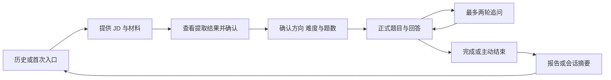

# 01 · 产品与范围

> v2.0 · 2026-11-17 · 目标设计，尚未整体实现。决策依据：D01–D06、D10、D16、D19、D24。
> 总入口：[README](README.md)。具体业务规则见 [02](02-面试业务规则.md)。

## 1. 项目背景与目标

作者是求职 Agent 开发岗位的 26 届毕业生。项目是当前长期主力开发任务，每天约投入 4 小时，包含阅读与理解代码；基础概念学习和其他小型技术练习另行安排。没有必须在 24 天内交付的要求。

项目同时有两个目标：

1. 产品目标：让初级求职者练习回答与被追问，得到能追溯到自己回答的改进建议。
2. 学习与求职目标：亲自理解 Agent 工作流、材料处理、检索、结构化输出、恢复、评测和取舍，积累可复核的开发经验。

这是有明确边界的模型工作流项目。无需为了“Agent”名称引入自主多智能体、任意工具执行或微服务。模型承担内容判断，程序承担动作边界和持久化一致性。

## 2. 目标用户、场景与痛点

| 用户或场景 | 具体问题 | 产品应提供什么 |
|---|---|---|
| 0–3 年经验的 AI 应用 / Agent 求职者 | 通用题库与自己的项目脱节 | 结合确认后的项目经历和 JD 提问 |
| 能背概念但没有练过追问的人 | 无法解释选型依据、验证过程或边界 | 根据回答进行澄清、深挖和矛盾核对 |
| 学生、自学者 | 只有课程或小项目，没有漂亮的业务数字 | 接受真实的小项目，评价证据而不强迫编数字 |
| 尚无项目的学习者 | 无法完成项目面试的材料要求 | 明确标注的知识专项练习，不声称评过项目能力 |
| 反复练习的人 | 不知道下一次具体改什么 | 引用回答、给少量可执行动作；历史可回看 |

首版支持一个岗位画像 `ai_app_engineer.tech`，经验范围限应届/初级。用户可以提供目标 JD；缺少 JD 时可显式选用示例岗位描述，报告标记输入来源，不伪装成真实招聘需求。

首版开放三个方向：`agent`、`rag`、`backend`（显示为 Python 后端与工程基础）。Prompt、框架集成、评测与交付作为题目标签及考察点。选择非支持岗位时提示覆盖边界，让用户改用当前画像或退出，不自动声称支持所有技术岗。

## 3. 成功意味着什么

- 用户能辨认问题与自己材料的关系，系统不会捏造“你做过某项目”。
- 追问能指出本次回答需要澄清或深入之处，而不是固定换一句话。
- 报告能回答“哪句话有什么问题、为什么、下次怎样验证改进”。
- 已提交内容在刷新和重启后仍可恢复，异常结局可以解释。
- 作者能用代码、测试、trace 元数据和实验记录解释上述能力。

不承诺预测录用概率、判断简历真实性、验证全部业务数字或等价替代真人招聘。首次验收是小样本产品与工程验证，不代表人群级统计有效性。

## 4. 首版范围

| 类别 | 首版包含 | 后置或排除 |
|---|---|---|
| 入口 | 示例材料、结构化填写、粘贴文本、文本型 PDF、DOCX | 扫描件和图片 OCR 后置 |
| 面试 | 知识题、真实项目题；默认 5 题、最多两轮追问 | 假设场景设计题、多面试官后置 |
| 反馈 | 结束后集中反馈；知识与项目分开，逐题证据与建议 | 整场混合总分、录用/投递等级不采用 |
| 使用 | 本地单人浏览器文字界面、历史、继续、中止、删除、Markdown 导出 | 在线服务、语音、教学模式、跨场趋势后置 |
| 内容 | 约 30 道审核知识题；先约 10 道贯通 | 不把 120 题、八维或多岗位作为本期门槛 |
| 工程 | LangGraph、数据库、检索、基本观测、恢复、回归与实验 | 自建完整观测平台、复杂队列、分布式部署不在首版 |

“后置”有独立路线与触发条件，见 [06](06-后续演进路线.md)，不是暗中取消，也不是首版完成前必须补齐。

## 5. 用户旅程

规划页展示方向、知识/项目题数量、难度和材料来源，不提前透露具体题面或参考答案。若修改规划配置，开始前重新生成计划；开始后计划冻结，个别出题降级要记原因和实际覆盖。

用户提交回答后立即知道是否已接收。等待显示“准备问题 / 分析回答 / 生成报告”等状态，不显示未经校验的 token。界面说明“已提交内容会保存；未提交草稿暂不保证恢复”。没有整场强制结束倒计时。

## 6. 页面与交互

保留 Jinja2 + 原生 JS 的多页结构，可使用本地静态第三方库，不引前端构建流程。工程原因是作者熟悉模板、页面较少且前端不是主线，不将框架优劣说成普遍结论。

| 页面 | 主要行为 | 空态或失败提示 |
|---|---|---|
| 历史 `/` | 进行中置顶；继续、查看报告、再练一次、删除 | 无记录时提供“使用示例开始”与“提供自己的材料” |
| 材料 `/new` | 选择入口，说明云端处理，提取与编辑确认 | 解析失败保留可用信息，引导粘贴文本；预览过期需重新提供 |
| 规划 `/planning?s=` | 选择已支持方向、题数与难度；只展示考察计划 | 内容不足时说明覆盖限制，不悄悄换成未验证能力 |
| 面试 `/interview?s=` | 展示正式问题、提交、跳过、结束；等待与恢复 | 过期标签页提示刷新；系统故障不显示为答错 |
| 报告 `/report?s=` | 分类反馈、证据、已答与有效评分题数、导出 | 待生成/待补评/模板摘要/无有效评分各有明确说明 |

页面路由由服务端检查当前阶段。所有业务修改还需 API 校验，页面守卫不能代替接口约束。表单导航使用 POST → 303 → GET；JS 异步提交使用接口幂等契约。进度以服务端为准，前端不自行推进题目。

“再练一次”复制已确认材料和配置、创建新会话并进入规划，不复制回答或分数；不是覆盖旧答案，不承诺一定重考原题。导出是用户主动下载，不再套一次模型工具审批；导出文件的外部副本由用户管理。

## 7. 需求与验收追踪

| ID | 首版需求 | 业务/实现依据 | 验证入口 |
|---|---|---|---|
| R01 | 多入口材料确认与云端处理告知 | 02 §1、04 §6 | 材料样本与过期/确认测试 |
| R02 | 知识与真实项目题、无项目降级 | 02 §2 | 题型与材料适配用例 |
| R03 | 个性化且有依据的动态追问 | 02 §3 | 追问人工核对与轮次测试 |
| R04 | 分类评分与证据 | 02 §4 | 校准、引用、N/A 测试 |
| R05 | 报告可行动且无虚假分数 | 02 §5 | 完整/部分/无分报告测试 |
| R06 | 保存、幂等、重启恢复 | 03 §3–4 | 故障注入与唯一约束测试 |
| R07 | 跳过、中止与预算收尾 | 02 §6、03 §5 | 结束路径测试 |
| R08 | 数据删除、迁移与最小日志 | 04 §6–7 | 删除重试与迁移/隐私测试 |
| R09 | 基本可观测与可复核评测 | 03 §7、05 | trace 元数据、固定基线与实验产物 |
| R10 | 能解释项目过程 | 05 §6、记录目录 | 讲解提纲与真实证据索引 |

## 8. 本地与后续上线的边界

首版绑定本机地址，页面也在本机浏览器使用。模型可调用配置的云服务，因此首次材料处理前必须说明数据去向。不要打开端口或仅关闭观测页就宣称可公开部署。

保留统一配置、模型网关、repository、访问者上下文入口。后续上线需要另补身份、资源归属、访问检查、额度和运维；首版不制造已经完成这些能力的假象。
