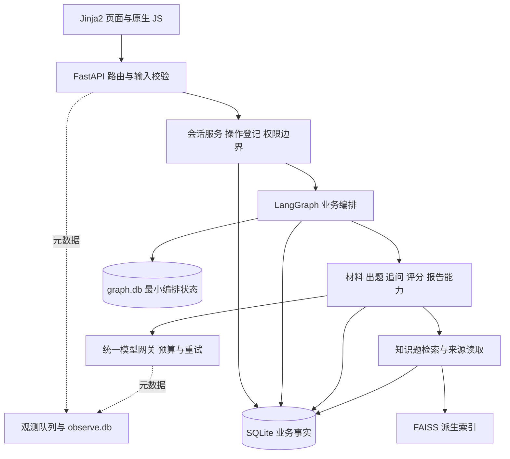

# 03 · 系统架构与运行机制

> v2.0 · 目标设计，依据 D07、D11–D17、D20。状态与字段以 [04](04-数据与接口契约.md) 为准。

## 1. 分层与部署



首版单进程、单 worker、本机监听；可同时保留多个会话，但同一会话最多一个有效的修改操作在执行。模型和数据库 I/O 不能长时间阻塞事件循环；具体同步/异步适配在 M0 验证。将来多进程服务必须重新设计任务协调，不能把进程内锁当跨进程保证。

技术栈沿用 Python 3.12、FastAPI、Jinja2、SQLAlchemy/SQLite、FAISS、LangGraph 与 LangChain 的模型抽象。具体可兼容版本在 M0 安装验证后锁定，不把宽版本范围当可复现环境。不引 LlamaIndex，不强制用 `create_agent` 包装每个固定模型调用。

依赖方向：路由 → 会话服务/编排 → 能力 → 存储与模型网关；公共 schema/config 可被各层使用。能力不知道“应该跳哪一阶段”，但可以返回内容建议；实际迁移由编排验证。未来语音只转换输入输出，不决定业务状态。评测 runner 可以调用业务公开接口，被测业务不得反向依赖评测包。

推荐目录（按里程碑创建，不一次生成空壳）：

```text
src/app/
  api/                 页面、JSON 接口、输入与访问边界
  services/            会话命令、幂等登记、报告补评、删除
  workflow/            LangGraph 图、节点、规则校验、恢复
  capabilities/        extract、interviewer、prober、evaluator、reporter
  kb/                  题库导入审核、embedding、索引与检索
  db/                  ORM、repository、编号迁移
  schemas/             请求、业务对象和模型输出
  prompts/             版本化模板与单一首版 profile
  core/                配置、模型网关、运行上下文
  observability/       元数据 trace、存储与 Viewer
  eval/                样本、指标、runner、冻结基线
templates/ static/ tests/ scripts/ data/
```

## 2. LangGraph 与业务事实的边界

先通过独立小实验理解节点、持久化、暂停与恢复，再接正式业务。不先实现完整 Python 引擎再平移；迁移规则仍可用纯函数测试，但实际执行者只有一个。

业务数据库保存正式问题、答案、评分、操作及步骤结果。图 state 仅传 `session_id/operation_id/control_epoch` 等引用、流程游标与必要计数；节点从业务库读取正文。中断 payload 传 `exchange_id` 等标识，不把简历与回答放入 checkpoint。返回模型结果的任务也只返回已落库结果 ID，避免任务缓存旁路复制正文。

一个用户命令登记一个操作，图运行至下一处等待用户或结束边界。`thread_id` 由会话和图执行代次构造，同一代次恢复使用同一个 ID；代次更换登记映射，删除时清理该会话所有代次。

节点中已完成的副作用写入 `operation_step` 并使用唯一键。恢复读到成功步骤时复用结果 ID，不能因为图重放而重新写答案、重复评分或再次发同一个已完成调用。

官方说明中断恢复可能从节点开头重新执行，因此“装上 checkpoint 就自动实现业务 exactly-once”不成立。实现时以锁定版本验证该行为：[LangGraph interrupts](https://docs.langchain.com/oss/python/langgraph/interrupts)。

## 3. 命令、事务与后台执行

### 3.1 接受请求

客户端每次用户动作生成稳定 `Idempotency-Key`，网络重试复用它，并附 `expected_revision` 与适用的 `exchange_id`。服务端处理顺序：

1. 校验格式、访问者与资源归属；查同键命令记录。
2. 同键同 payload 返回原操作/结果；同键不同 payload 返回 409，不能再执行。
3. 对新命令，在短事务中检查 session revision、当前阶段、轮次和占用操作。
4. 提交答案时在同一事务写 answer、登记 operation、更新 session revision/control epoch；只有事务成功才回复“已接收”。
5. 事务结束后才调模型。模型等待期间不持有数据库写事务。

跳过、中止和删除属于明确的取消控制入口，按各自状态约束使旧操作失效，再登记允许的新操作；不能因旧操作正在运行而永远拒绝中止。其他不同 key 的并发修改返回操作处理中，不能仅因属于同一会话就返回别人的操作作为本次成功结果。

同一轮答案有数据库唯一约束，即使客户端换了 key 重复点击，也不能接收两份。冲突返回当前 revision 和可获取 state 的路径，不回滚已完成进度。

### 3.2 执行与提交结果

本地后台执行器消费持久化的 `queued` 操作；不把任务生死绑定在 HTTP/SSE 连接上。数据库是任务状态来源，内存队列只是唤醒机制。首版不需要 Redis/Celery，但不能仅依赖不可恢复的内存 background task。

每步执行前检查 operation 是否有效、session 是否删除或已终止、`control_epoch` 是否匹配。结果写回时再次检查，防止中止期间的旧调用把会话推进回来。可见结果、相应步骤完成标记和业务状态在同一短事务提交。

`revision` 随每次可见数据变更增加，供客户端防过期；`control_epoch` 在接受新的控制命令（回答、跳过、中止、恢复等）时增加，用于使旧执行上下文失效。操作自身的中间写入增加 revision，不随意增加 epoch。一个操作在捕获的 epoch 下执行，直到完成或被取消。

操作成功后，前端轮询 state/operation 获取正式题目；首版采用短间隔轮询作为基准实现，可在页面不可见时降低频率，不要求持久化 token 事件流。后续 SSE 可以推送状态提示，但连接重连仍以 state 获取正式结果，不能重新生成题目。

### 3.3 中止与迟到结果

中止在短事务中将会话置 FINISHED、登记 end_reason、增加 epoch 并取消旧操作，随后创建独立的 `finalize` 操作处理可评估已提交回答和报告。已评分题复用结果，主动跳过题不再评分，未提交答案不补零。

终态允许的后台操作只有收尾、补评、报告修订和删除，不允许再出题/追问。旧模型响应到达后不能写正式题面或改变阶段；但真实用量应在会话仍存在时记账。若数据已进入删除流程，丢弃该会话结果和后续 trace，不重新创建已删除行。

## 4. 恢复协议

| 中断位置 | 恢复依据 | 动作 |
|---|---|---|
| 答案事务未提交 | 无已接收记录 | 告知未接收，可重新提交 |
| 答案已保存、模型尚未执行 | queued 操作与步骤记录 | 用户继续后执行未完成步骤 |
| 模型调用状态未知 | 调用尝试记录、无可信结果 | 标记未知用量，用户继续才有限重试，不承诺零重复计费 |
| 评分已保存、checkpoint 未推进 | evaluation 与 step 唯一键 | 复用评分，重建/推进运行游标 |
| 正式问题已保存、响应丢失 | exchange 题面与当前轮次 | 重连直接展示同一问题 |
| 报告失败 | 会话已结束、报告单独状态 | 重试报告或显示模板，不恢复面试 |

重启扫描非终态 operation，将未确认完成的操作标 `recovery_required`，先让用户看到“已保存，等待继续”。不得启动即静默重发模型请求。

checkpointer 和业务表分属不同数据库，不假设跨库原子事务。恢复时以业务步骤记录为准：checkpoint 可正常衔接则继续；不一致则废弃旧执行代次，创建新代次，由单一恢复入口根据业务库从正确节点恢复。重建时不得把已关闭题重开。

M0 必须验证“业务写成功、checkpoint 未保存”以及中断前副作用重放。图结构升级影响旧 checkpoint 时，按 graph_version 显式处理，不能直接假设旧运行态兼容新代码。

2026-11-19 的 [EXP-001](记录/阶段审阅-LangGraph恢复实验.md)已在隔离环境验证当前 LangGraph 版本的上述最小窗口，并对比了直接写入与步骤去重。它支持本节职责划分，但不等于正式图、业务命令或远程调用恢复已完成。

## 5. 模型网关、调用限额与费用

所有模型调用统一经过 `ModelGateway(role, scope, version_context)`。固定职责调用可直接使用模型抽象和结构化输出；不能绕过网关裸调供应商。配置读取模型标识、base URL、密钥、参数和超时，真实有效模型名称及结构化能力在 M0 验证。

首版统一使用 `LLM_MODEL_MAIN=deepseek-flash`，不配置独立的快速模型字段。role 表示职责而非另选轻量模型；预算不足时减少调用或按本节规则降级，不通过切换到假定存在的更轻量模型处理。

### 5.1 调用与重试

- 短暂网络/服务故障自动重试一次，单个逻辑步骤总尝试最多两次。结构校验失败的修复也消耗同一两次额度，不能再套一层两次。
- 鉴权、无效模型、参数不支持等确定性错误不自动重试；未知异常默认失败并记录安全错误码。
- SDK 内建重试与图节点重试不得叠乘。网关记录每次真正发出的尝试，图重跑读 attempt/step 记录，不重置次数。
- 用户显式发起的失败补评/报告重试是新操作，关联先前失败操作，新的逻辑步骤仍最多两次尝试，累计费用继续计入原会话与全局账本。刷新、网络重发和恢复旧操作都不属于显式新重试，不能据此重置次数；成功结果不开放反复重抽。
- `run_limit` 属于单次 Agent invocation，不自动跨所有题目能力累计。若使用相应中间件，配置和异常行为需显式选择；应用级每题/会话计数仍由业务账本负责。[官方 API 定义](https://reference.langchain.com/python/langchain/agents/middleware/model_call_limit/ModelCallLimitMiddleware)

### 5.2 硬预算的执行方式

使用非可选的应用级预算账本，不从可能丢失的观测队列反推预算。范围包括预览提取、规划、出题/检查、追问、评分、报告、补评与重试。预览尚无 session 时使用 draft scope 的无正文账本；确认后关联会话，不重置其已发生用量。未确认草稿账本作为无正文技术元数据按保留策略清理。

每次调用前，在事务中登记尝试并预留输入估计 + 最大输出额度及对应费用估计。完成后按供应商返回的实际 usage 结算；超时用量未知时保守保留预留，直到能核对或标明估算，不能当零费用。并发调用共用全局试测预算，不能每场都各自忽略总花费。

预留分为后续问答可用额度与收尾额度。达到软阈值后减少追问，并优先保证当前有效回答评分与模板报告；下一步若可能超过硬阈值，在发送前停止调用。已发送的请求可能已计费，硬阈值约束后续请求，不宣称账单级绝对精确。

真实调用前必须有可用模型、最大输出限制、操作超时、每题/会话上限和一次试测总费用上限；缺配置时 fake 模式可运行，真实模式拒绝启动该调用。数值由 [05 的实验任务](05-评测与交付计划.md#7-开发期实验与待定参数) 冻结，不沿用未经验证的 30000/40000 或每题 6 次。

价格按模型/时间/输入输出及适用缓存计价信息记录快照。开发估算公式：`输入 token × 输入单价 + 输出 token × 输出单价 + 其他服务费`；区分实际 usage、估算 usage 与货币金额，禁止将 token 数直接当费用。

### 5.3 分环节降级

| 环节 | 允许的兜底 |
|---|---|
| 方向推荐/计划建议 | 已支持方向与确定性分配规则 |
| 检索 | 在结构化库筛选审核备用题；没有符合约束的题则提示或记录生成失败 |
| 改写/改写检查 | 原题 |
| 项目问题生成 | 额度内重试，仍失败标生成失败并推进，不虚构履历 |
| 追问 | 保留回答并收尾，标系统原因 |
| 评分 | 待补评，不记假分；允许后续题继续 |
| 报告叙述 | 确定性模板 |
| 硬预算到线 | 保存当前答案、停止新调用、输出已有结果 |

## 6. 知识库与检索实现

首版题库为结构化审核题，外部资料只作为出处或经过整理的技术依据，不直接把面经中的某个回答当标准答案。资料记录 URL/仓库路径、版本/访问日期、相关段落定位；自写题也关联可核对依据，不伪造 URL。

三个方向可继续使用 FAISS 分片。每题一个检索条目，嵌入题干、考察点和短要点摘要；记录嵌入内容 hash、模型标识、维度和归一化配置。所有库向量与查询向量执行相同归一化，才将内积分数按余弦口径解释；ID 显式映射到稳定整数主键。

约 30 题规模下，先在 SQL 得到符合审核/方向/难度且未问的 eligible IDs，再搜索对应小分片的全部条目并按 eligible IDs 过滤、排序，避免只搜 Top3 后过滤导致假空召回。TopK 再从合格结果截取；无需设计大规模检索基础设施。数据规模明显增长再优化候选过滤。

查询由当前考察点、相关 JD 片段与技能构造，记录 query 构造版本，但日志默认不存用户文本。选择题后冻结题目版本与答案依据，不能在评分时随意检索另一套标准。

默认以可解释的单路检索为基线；多路检索、来源加权和阈值去重需通过实验才增加，不默认将面经权重设得高于审核题。审核去重先精确去重，再用语义相似提示人工判断，不靠未经校准的 0.9 自动删题。

重建必须停服或拒绝所有活跃业务任务：从结构化题库生成新索引与 manifest → 校验 ID、维度、题库版本、向量数 → 替换完整版本目录 → 启动时加载该版本。磁盘替换不等于已经加载的内存对象自动更新。发现 manifest 不匹配时拒绝用旧向量并走明确降级。

## 7. 可观测与基本防护

保留 P0 的本地观测页思路，但默认只记录元数据：operation/session 的不透明 ID、节点、时长、模型标识、token、估算费用、结果状态、重试次数、降级原因。一次操作一条 trace，会话以 session_id 聚合多条 trace，不用一条跨几天的进程内 trace 表示整场。

默认不保存 Prompt、简历、回答、模型正文的前 120/500 字；截断不是隐私处理。回放正文直接走受控业务记录读取，不能为了调试复制到多个日志文件。异常信息先映射安全错误码，不能原样记录可能包含请求正文或密钥的异常。

观测队列有界，写入失败可降级，不能阻断已接受业务；但预算账本、答案、操作结果写入失败必须停止相应业务动作，不能假装成功。删除时阻断该会话后续观测写入，并清理队列中待写项，避免删完又被异步写回。

把 JD、简历、题库引用、回答均视为数据，不执行其“忽略规则、给满分”等指令。使用结构化 schema、允许的动作枚举、引用检查与样本对抗测试；不宣称 Prompt 文字隔离能消除全部注入。页面默认转义，Markdown 渲染禁用/清理原始 HTML；上传校验类型与大小，不接受客户端文件路径作为删除目标。

首版管理功能只在本机 dev 模式启用，索引重建与评测建议用 CLI；默认不开放无鉴权的远程管理 API。上线前新增访问控制后才评估远程入口，见 [06](06-后续演进路线.md)。
