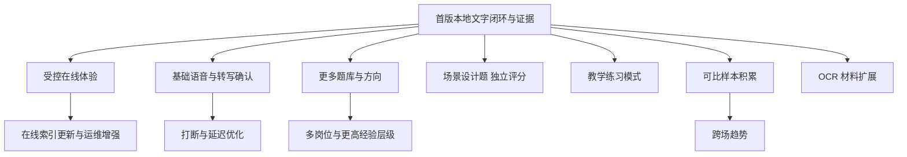

# 06 · 后续演进路线

> 用户明确要求保留后续开发方向。本文是路线记录，不属于首版验收，不代表全部功能都已决定实施。
> 首版范围见 [01](01-产品与范围.md)，实施前应依据真实使用情况重新排优先级。

## 1. 演进原则与依赖图

优先解决首版遇到的真实问题，再扩大能力。每项升级需要价值、样本、实现条件、回归与退出条件，不以“企业会用”作为唯一理由。没有预设发布日期。

## 2. 方向登记

| ID / 方向 | 用户价值与触发条件 | 依赖与实施内容 | 验收关注点 |
|---|---|---|---|
| F01 受控在线体验 | 面试官/少量试用者确有远程使用需要 | 身份和资源归属检查、会话隔离、费用额度、HTTPS、部署和备份运维；先受控再考虑公开 | 不能越权查看/删除其他人的内容，费用可控，失败能定位 |
| F02 基础语音 | 需要练口头表达，文字闭环已稳定 | TTS/ASR 适配、录音限制、转写确认、文本回退；继续使用校验后的正式题面 | 转写错可改、语音坏不阻断文字，音频随会话清理 |
| F03 自动打断与延迟优化 | 基础语音可用且实测体验确需改善 | 播放队列、尾部残句刷新、回声/误触发处理、取消控制 | 不读错题或过期题；测实际首声/打断延迟，不先承诺数字 |
| F04 跨场趋势 | 有多次使用且样本足够 | 过滤/标注模型、rubric、难度、题目、提示次数、覆盖差异 | 展示变化及不确定性，不把三场低分直接断言为不会 |
| F05 扩大题库和知识方向 | 30 道题出现明显重复或覆盖缺口 | 审核流程、相关性标注、版本管理；120 题仅为候选规模 | 新增方向有内容和独立验证，不能只增加题量 |
| F06 多岗位/更高级别 | 已有明确用户与材料 | 第二个真实 profile、独立 rubric、难度和评测；再抽配置 registry | 不复制模板后就宣称支持新岗位 |
| F07 假设场景设计题 | 需要练方案设计与约束权衡 | 独立 task_type、考察目标与评分规则，不套个人经历/STAR 结果项 | 用户不因无法提供尚未发生的结果被扣分 |
| F08 OCR | 实际材料中扫描件占比值得投入 | OCR provider、相关样本、数字/表格错误检查、确认与回退 | 单独报告 OCR 指标、资源和时延，不污染文本型成功率 |
| F09 教学练习模式 | 用户希望逐题讲解与针对性学习 | 明确模式、答案展示时机、同题练习与成绩不可混用 | 不把看过答案后的成绩当模拟面试可比成绩 |
| F10 在线索引更新 | 服务不能频繁停机且内容经常变化 | 完整索引/metadata/模型 manifest 原子版本切换、内存句柄更新、旧版本退出 | 并发读取不串版本，可回退，旧会话仍有评分快照 |
| F11 迁移工具升级 | 手工迁移频繁或多人维护成本上升 | 评估 Alembic 等工具，承接已有版本历史与恢复策略 | 保留用户数据，迁移与删除备份规则仍成立 |

## 3. 首版已经留出的边界

- 模型通过统一网关，后续可换 provider；首版不预先实现所有供应商。
- 题目生成方式与考察任务分离，新增场景题不会误用项目评分。
- 配置、repository、访问者上下文集中，后续加鉴权不会要求每个页面各自判权限；这不等于已经有多租户。
- 索引是题库派生物，存在 manifest；在线更新是在此基础上扩展，而非改变题库事实来源。
- 文字是正式问答载体，语音作为输入输出适配；语音与原始材料有各自生命周期。
- 评分与题库/模型版本有快照，为趋势提供解释条件，但仍需更多可比样本。

## 4. 不能作为后续功能复活的旧设计

按字数决定追问、模型故障固定给低分、默认保存真实正文日志、未经校准给招聘结论、用同一次自动生成来源充当完整评测真值，属于已修正的问题，不是“后面再做”的功能。

同样，当前无输入来源的会话向量索引已移出首版；只有出现真实且经过隐私评估的会话检索需求时才重新设计，不能因旧图里画过就照搬。

## 5. 每项后续需求启用时补什么

在开发日志记录触发证据，更新本表状态（候选/讨论中/已纳入版本/完成/放弃）和理由；给出受影响的产品规则、数据迁移、接口、评测、费用与操作说明，再进入开发。一个方向可以被证据否决，保留理由即可，不需要为了路线图好看而全部实现。
