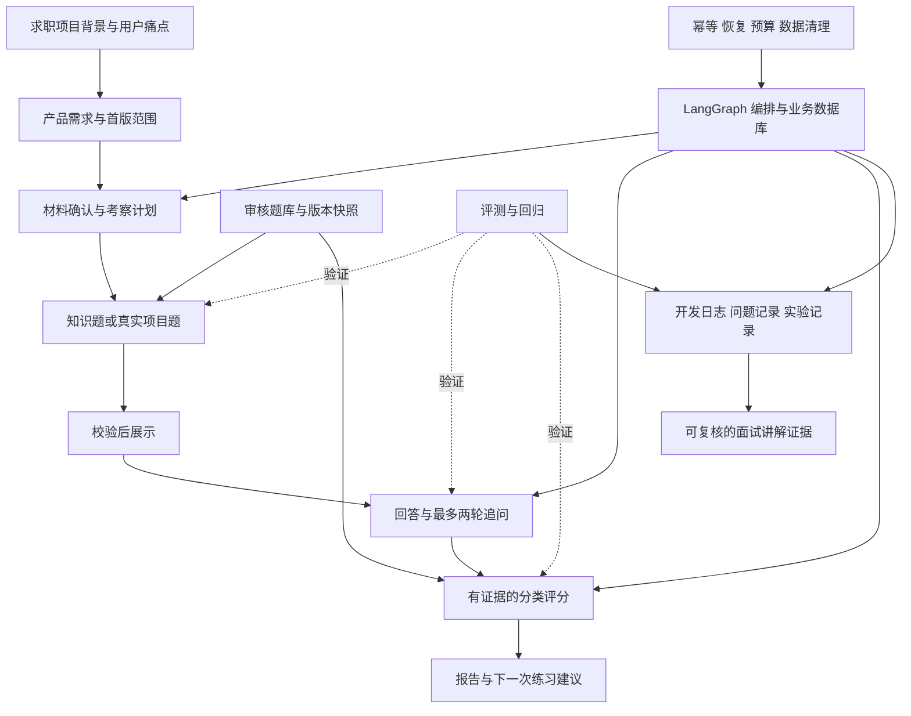

# AI 模拟面试项目 · 设计总入口

| 项目 | 内容 |
|---|---|
| 设计基线 | v2.0 · 2026-11-17，五批讨论后的首版范围 |
| 定位 | 面向 AI 应用 / Agent 初级岗位求职者的个性化模拟面试 |
| 作者背景 | 26 届毕业生，以求职展示、理解工程设计与积累真实开发经验为目的 |
| 当前实现 | P0 配置、元数据日志、trace 和观测页于 2026-11-19 完成本机合成核验；面试业务尚未实现，见记录目录的 P0 阶段审阅单 |
| 首版形态 | 本地单人、浏览器文字界面、云端模型可配置；本地运行不等于离线模型 |
| 投入 | 每天约 4 小时，包含理解代码；没有硬截止日期，按里程碑验收 |

本目录是当前设计入口。旧文档保留为历史材料，新旧冲突时以本目录正文为准。v2.0 是**设计版本**，不表示已经发布可用的产品 v2.0。

## 1. 怎样阅读

| 文档 | 回答的问题 | 权威内容 |
|---|---|---|
| [01-产品与范围](01-产品与范围.md) | 为什么做、为谁做、做到哪里 | 背景、用户、痛点、需求、页面、首版范围 |
| [02-面试业务规则](02-面试业务规则.md) | 面试官应该怎样表现 | 题型、规划、追问、评分、报告、结束语义 |
| [03-系统架构与运行机制](03-系统架构与运行机制.md) | 怎样可靠执行这些规则 | 模块职责、LangGraph、幂等、恢复、预算、检索、可观测 |
| [04-数据与接口契约](04-数据与接口契约.md) | 各模块怎样交换与保存数据 | 状态枚举、数据关系、请求响应、迁移、删除与保留 |
| [05-评测与交付计划](05-评测与交付计划.md) | 怎样证明做到了 | 样本、测试、门禁、里程碑、实验待办、交付证据 |
| [06-后续演进路线](06-后续演进路线.md) | 首版之后可以做什么 | 后置能力的价值、依赖、触发条件与验收方向 |
| [07-设计决策与待办](07-设计决策与待办.md) | 为什么这样选择 | D01–D25 决策记录、评审问题去向；不复制成第二份业务规范 |
| [记录/交接文档](记录/交接文档.md) | 现在实际上做到哪里 | 代码现状、差异、下一步、验证状态 |
| [记录/开发日志](记录/开发日志.md) | 每次工作做了什么、学到了什么 | 活动、产物、验证、理解检查与下一步 |
| [记录/问题记录](记录/问题记录.md) | 遇到什么真实问题、怎样定位 | 现象、证据、假设、排查、修复与验证 |
| [记录/实验记录](记录/实验记录.md) | 哪个方案更合适、证据是什么 | 变量、样本版本、原始结果、费用和决定 |
| [记录/设计整合检查](记录/设计整合检查.md) | 本轮文档核查了什么 | 链接、决策覆盖、历史文件保护与验证边界 |

第一次阅读按 01 → 02 → 03 → 04 → 05。接手开发先看“记录/交接文档”，再定位对应正文。面试准备从开发日志、问题记录、实验记录找证据，再用 01–03 解释设计。

## 2. 项目总体图谱

## 3. 首版必须兑现的承诺

- 基于用户确认后的材料问问题，不能虚构个人经历；无项目时明确切换为知识专项。
- 追问看实际回答，代码控制合法动作、最多两轮与预算；不按 80 字阈值机械判断。
- 题面先校验、保存，再展示；评分引用实际回答，知识与项目表现分开，不给招聘结论。
- 已提交答案可恢复；重复请求不会重复推进；故障不折算成用户低分。
- 首版约 30 道审核知识题、三个开放方向；先约 10 道贯通流程。
- 保留开发过程的真实证据，不能把未来功能、设计推演或假数据当成已完成成果。

## 4. 状态与文档维护约定

正文是**待实现的目标设计**，除非显式写“已实现并附验证记录”。每项成果区分：已有代码 / 已验证 / 待实现 / 待实验 / 后续方向。规则由用户选择定下，必要的字段、默认算法和接口是为使规则可执行所作的工程细化；实测显示有问题时按变更流程修订，不宣称所有技术细节均由用户逐项指定。

同一规则只在“权威内容”对应正文定义。修改时同步受影响契约、测试和决策理由。小改记录日期、原因、影响文件；范围或业务口径变化先讨论。程序缺陷修复不要求重新批准已经确认的规则。

每天开发结束补日志；真实故障及时记问题；模型/检索策略对比记录实验；里程碑结束更新交接。日志记录规范见[开发日志](记录/开发日志.md)。

## 5. 历史资料与当前差异

- [v1.5.6 原始设计快照](archive/设计文档-v1.5.6.md)：历史依据，不作为当前开发验收标准。
- [旧交接文档](../交接文档.md)、[旧问题记录](../问题记录.md)：原样保留，旧方案以当时背景理解。旧问题 010 的旧接口建议不是当前计划。
- 仓库中的 `demo/` 是视觉原型，内含旧总分、旧流程和模拟数据；可以复用样式，接业务时必须按当前规则调整。
- 旧观测预览差异已在 P0 核验中修正，见[新问题记录](记录/问题记录.md)。仅验证了当前观测路径，未来图状态、模型 callback 与业务数据清理仍需单独实施；历史库正文没有自动删除。

## 6. 设计冻结边界

25 项方向已商定，当前设计可作为进入 M0 的基线。还需实验确定的事项包括模型能力兼容、费用上限数值、调用超时、输入上限、质量门槛和真实时延，统一见[实验待办](05-评测与交付计划.md#7-开发期实验与待定参数)。这些不是无限补设计的理由；先以小实验验证，再进入对应里程碑。

设计基线 0ec912e、P0 工程 a420cfa、[LangGraph 实验](记录/阶段审阅-LangGraph恢复实验.md) 5612dcf 已推送。当前[模型试测准备](记录/阶段审阅-模型试测准备.md)已获同意，按该批范围提交同步；下一阶段 deepseek-flash / 0.02 USD 单次上限已授权，尚无真实调用。密钥与请求执行保护仍待补齐，正式面试图仍待推进，不将准备材料称为整个 M0 完成。
