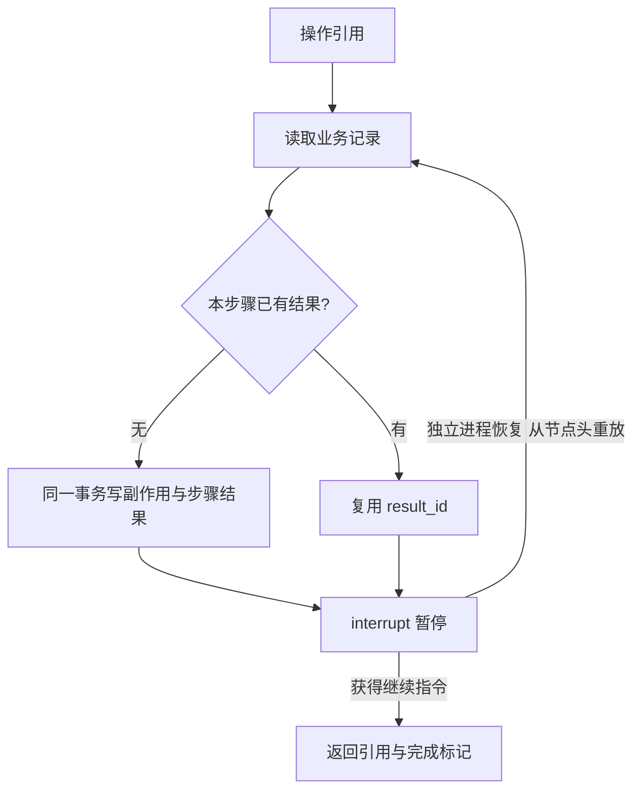

# 阶段审阅 · LangGraph 最小恢复实验

> 2026-11-19：用户听取通俗说明后明确回复“审阅通过”，授权本批提交与推送；执行结果以 Git 历史和远程分支为准。
> 范围为 M0 / X02 的独立技术验证，不接入 FastAPI 或正式面试业务。

## 1. 这次实际做了什么

在 `.venv-langgraph` 独立环境运行真实 LangGraph 与 SQLite saver，业务写入另存 `business.db`，编排状态存 `graph-g1.db`。每次开始、巡检、恢复都由不同 Python 子进程完成，不以同进程内存冒充重启恢复。

图 state 只含 `operation_id / step_key / result_id / continued`。合成正文留在业务表，节点通过引用读取，不在 interrupt/resume 中携带正文。



这是为了观察重放而特意设置的“写入后暂停”实验图，不是正式产品的提问、评分或工具审批流程。

## 2. 四个场景与结果

| 场景 | 操作与预期 | 实测 |
|---|---|---|
| 直接写入基线 | 暂停前插入一条，换进程恢复；观察是否重复 | 节点进入 2 次，业务记录 2 条，复现重复副作用 |
| 步骤去重候选 | 相同流程，按 operation_id + step_key 唯一记录结果 | 节点进入 2 次，业务记录仍为 1 条 |
| 业务已提交、图未完成时退出 | commit 后、节点 return 前执行 os._exit(73)，再新进程恢复 | 检查时业务已有 1 条、图仍待执行；恢复后仍为 1 条，节点进入累计 2 次 |
| 新 checkpoint 代次 | 承接上一场景，用全新 graph-g2.db / thread_id 从业务事实重新运行 | 节点进入累计 3 次，复用原结果，业务仍为 1 条 |

前两个场景还各做一次错误 thread_id 恢复，入口拒绝且不增加业务记录。拒绝由实验代码的 `get_state().next` 检查完成，不是框架提供了完整业务权限系统。

“新代次”由实验命令明确指定，不是已实现自动损坏检测、自动恢复生产会话或 checkpoint 删除。查看状态只读图进度，不会自动执行节点；只有明确恢复命令才执行。

四个场景均符合预期。基线出现两条是本次预期复现，不是将其当作生产可接受行为。

## 3. 可复现证据

- 脚本：[langgraph_recovery.py](../../../scripts/experiments/langgraph_recovery.py)。
- 原始结果：[EXP-001-result.json](实验产物/EXP-001-result.json)，保留首次完整执行的数字、进程 ID、版本和检查标记。
- 版本：Python 3.12.14、LangGraph 1.2.22、checkpoint 4.3.2、SQLite saver 3.1.3、langchain-core 1.8.3。
- 依赖：[专用快照](../../../requirements-langgraph-experiment.lock.txt)，41 项，`pip check` 通过；未做 hash 锁定或第二个干净环境的重装对比。
- 原始运行目录：`data/experiments/EXP-001-first/`，含业务与图数据库，不提交；JSON 是可公开的合成数据。before.pid 表示当次巡检/开始子进程，不应把崩溃场景 before.pid 解读为已退出的故障进程。

在项目根目录的 PowerShell 执行：

```powershell
# 首次准备独立实验环境，已有时跳过创建和安装。
.\.venv\Scripts\python.exe -m venv .venv-langgraph
.\.venv-langgraph\Scripts\python.exe -m pip install -r requirements-langgraph-experiment.lock.txt

# 默认每次新建随机运行目录；不要覆盖首次证据目录。
.\.venv-langgraph\Scripts\python.exe scripts/experiments/langgraph_recovery.py
```

脚本会自动运行全部场景并输出 JSON。已存在的非空或空目标目录均拒绝复用；不删除旧结果。崩溃是对子进程进行的预期故障注入，主实验进程继续验证恢复。

本轮框架依赖从机器现有 pip 镜像下载，P0 环境未安装新包。框架带入 LangSmith 等传递依赖，实验显式关闭 tracing 并拦截子进程 socket.connect；没有模型类、真实密钥或用户材料参与。这个拦截不是 OS 级网络防火墙。

## 4. 对项目设计的意义与限制

checkpoint 可恢复图的执行位置，但节点重放仍可能再次运行 Python 代码。本地副作用和步骤成功结果放在同一个业务事务中，恢复时优先查询该记录，可避免重复插入。[官方 interrupt 说明](https://docs.langchain.com/oss/python/langgraph/interrupts)

正式实现继续采用“业务事实以业务库为准，图状态保存引用”的边界。本实验仅验证了当前图内合成标记不进入 checkpoint，不证明未来 callback、完整问答或调试路径已经安全。内存 saver 不适合本次跨进程验证，因此使用持久化 SQLite saver。[官方持久化说明](https://docs.langchain.com/oss/python/langgraph/persistence)

这没有实现远程 API 的 exactly-once：远端已收费而本地未记账的窗口仍可能存在。没有并发写入、进程多 worker、取消与迟到结果、预算、业务 API、真实模型、旧图版本兼容测试。下一阶段仍需单独推进。

## 5. 建议审阅与理解检查

1. 看结果表：为什么 guarded 的 visits 是 2，effects 却是 1？
2. 看 `write_effect`：为什么 completed_steps 和 effects 必须同事务写入？
3. 看崩溃位置：业务已经 commit，为什么图仍显示有待执行节点？
4. 为什么这个实验仍然不能保证真实模型不会重复收费？

本实验由 AI 协助实现和执行，作者理解情况待阅读与讨论，不写成已独立掌握。审阅通过后才提交本批；下一阶段建议做模型最小能力请求与费用估算，真实调用前先确定具体上限。

审阅结果：2026-11-19 用户明确通过。本次只补审批和交接记录，不改变已测脚本或原始结果；本单随提交保存，不预写自身提交号。同步完成后停下。

## 6. 本批拟提交范围

12 个文件，未改变 P0 的 src、tests 或依赖快照：

```text
.gitignore
README.md
docs/项目设计/README.md
docs/项目设计/03-系统架构与运行机制.md
docs/项目设计/记录/交接文档.md
docs/项目设计/记录/实验记录.md
docs/项目设计/记录/开发日志.md
docs/项目设计/记录/问题记录.md
docs/项目设计/记录/实验产物/EXP-001-result.json
docs/项目设计/记录/阶段审阅-LangGraph恢复实验.md
requirements-langgraph-experiment.lock.txt
scripts/experiments/langgraph_recovery.py
```

拟用提交说明：`experiment: 验证 LangGraph 跨进程恢复与业务写入去重`。提交前按此范围核对，不纳入虚拟环境和运行数据库。

最终核查：12 个工作区文件与本清单一致；57 个本地链接、5 个标题锚点有效，代码围栏完整；脚本语法与 git diff --check 通过；公开 JSON 与原运行产物 hash 一致。有限凭据模式扫描没有匹配。P0 的 19 项依赖版本仍与原快照一致，未重复运行无改动的 P0 测试。实验环境和运行目录已确认被 Git 忽略；当前仍在 main，暂存区为空，未提交。
